# HMS — Complete Project Documentation

**Product:** ACX Platform — HMS (Hospitality Management System) for the IKANOS portal
**Repository:** `ACX-Platform`
**Branch documented:** `feature/cleanuped-Mysql-Data`
**Document date:** 2026-11-13
**Method:** Read-only static analysis of the repository. No source code, configuration, database row or Git ref was modified. Every statement below is traceable to a file in this repository; items that could not be established from the code are listed separately in [§16 Missing / Unverifiable Information](#16-missing--unverifiable-information).

---

## Table of Contents

1. [Executive Summary](#1-executive-summary)
2. [Business Context, Market & Product Positioning](#2-business-context-market--product-positioning)
3. [System Architecture](#3-system-architecture)
4. [Technology Stack](#4-technology-stack)
5. [Repository Structure](#5-repository-structure)
6. [Database Design](#6-database-design)
7. [Domain Model & Vocabulary](#7-domain-model--vocabulary)
8. [Backend API Specification](#8-backend-api-specification)
9. [OSS Microservice (Device / Telemetry / Alert / Energy)](#9-oss-microservice-device--telemetry--alert--energy)
10. [Frontend Application](#10-frontend-application)
11. [Security, Authentication & Authorization](#11-security-authentication--authorization)  
12. [End-to-End Data Flows & Workflows](#12-end-to-end-data-flows--workflows)
13. [Functional Requirements (as implemented)](#13-functional-requirements-as-implemented)
14. [Non-Functional Requirements & Characteristics](#14-non-functional-requirements--characteristics)
15. [Build, Run, Test & Deployment](#15-build-run-test--deployment)
16. [Missing / Unverifiable Information](#16-missing--unverifiable-information)
17. [Appendix A — Complete Table Inventory](#appendix-a--complete-table-inventory)
18. [Appendix B — Complete Enum Inventory](#appendix-b--complete-enum-inventory)
19. [Appendix C — Complete REST Endpoint Inventory](#appendix-c--complete-rest-endpoint-inventory)
20. [Appendix D — Source Evidence Index](#appendix-d--source-evidence-index)

---

## 1. Executive Summary

### 1.1 What the product is

HMS is a **web-based hospitality operations platform for smart (IoT-instrumented) hotels**. It combines classic hotel back-office functions — reservations, check-in/check-out, room occupancy, housekeeping, service requests, staff and role administration, reporting — with **live device telemetry** from in-room smart hardware (locks, air-quality sensors, energy meters, hubs).

The tagline rendered on the dashboard header is *"Smart buildings, Smart Operations."* ([Dashboard.tsx:72](frontend/src/features/dashboard/pages/Dashboard.tsx#L72)), and the About-page vendor identity is **Inspironics Corporation, USA** ([platform.ts:11](frontend/src/core/config/platform.ts#L11)).

### 1.2 Current system shape

The system is a **three-tier, two-database, multi-process platform**:

| Tier | Component | Technology | Port | Data store |
|---|---|---|---|---|
| Client | HMS Web | React 18 + TypeScript + Vite | 8080 | — |
| Application | HMS Backend (BSS) | FastAPI + SQLAlchemy 2 | 8000 | MySQL `inspironics_app` |
| Application | OSS Device service | FastAPI (read-only adapters) | 8001 | PostgreSQL `insp_iot` |
| Application | OSS Telemetry service | FastAPI | 8002 | PostgreSQL `insp_iot` |
| Application | OSS Alert service | FastAPI | 8003 | PostgreSQL `insp_iot` |
| Application | OSS Energy service | FastAPI | 8004 | PostgreSQL `insp_iot` |

Source: [ecosystem.config.js](ecosystem.config.js), [backend/app/main.py](backend/app/main.py), [oss-service/app/main.py](oss-service/app/main.py).

### 1.3 Headline numbers (verified)

| Metric | Value | Evidence |
|---|---|---|
| Database tables (BSS, model-declared) | **93** | [models/__init__.py:1](backend/app/models/__init__.py#L1) |
| Database tables (BSS, live inventory) | **95** (957 columns, 250 FKs, 1,798 rows) | [BSS_INVENTORY_REPORT.md](backend/docs/BSS_INVENTORY_REPORT.md) |
| Native ENUM types | **34** | [models/enums.py:161](backend/app/models/enums.py#L161) |
| REST endpoints (HMS v1) | **~170** across 22 endpoint modules | [Appendix C](#appendix-c--complete-rest-endpoint-inventory) |
| RBAC modules | **18 seeded** / **17 used by the frontend** | [reference.py:123](backend/seeds/data/reference.py#L123), [modules.ts:29](frontend/src/core/rbac/modules.ts#L29) |
| Backend test functions | **823** | `backend/tests/` |
| OSS service test functions | **35** | `oss-service/tests/` |
| Alembic migrations | **6**, branched into **2 heads** (`b3c4d5e6f7a8`, `a3f1c8e2d904`) | `backend/migrations/versions/` |
| Frontend routes | **28** (incl. redirects) | [App.tsx](frontend/src/App.tsx) |
| Reports | **9** | [services/reports.py](backend/app/services/reports.py) |
| API version | `0.3.0` | [version.py:8](backend/app/core/version.py#L8) |
| Frontend/platform version | `1.0.0` | [package.json:5](frontend/package.json#L5) |

### 1.4 Architectural thesis

The defining architectural decision is the **OSS/BSS split**:

- **BSS (Business Support System)** — the hotel business: facilities, rooms, stays, guests, staff, services, maintenance, billing, marketing. Owned by HMS, stored in **MySQL `inspironics_app`**, read **and written** by HMS.
- **OSS (Operations Support System)** — the device estate: devices, telemetry, device alerts, energy statistics. **Externally owned**, stored in **PostgreSQL `insp_iot`**, **read-only** to HMS and reached only through the OSS microservices' HTTP API.

The boundary is declared once, in [backend/app/core/oss_routes.py](backend/app/core/oss_routes.py), and is honoured by the router, the dispatch proxy, the tests and the documentation alike. A feature flag `OSS_ENABLED` switches each OSS-surfaced read between "served locally from BSS" and "forwarded to the OSS microservice", with the RBAC gate unchanged on both paths.

The bridge between the two worlds is a single HMS-owned table, **`room_device_map`**, which maps an OSS `device_id` to an HMS `amenity_id` (room) — because OSS has no concept of a room and HMS may not write to OSS ([device.py:447](backend/app/models/device.py#L447)).

---

## 2. Business Context, Market & Product Positioning

> **Evidence basis.** This section is derived from product artefacts inside the repository: the seeded reference vocabulary, the module registry, the navigation structure, the report catalogue, the platform-identity constants, and the analysis documents under `docs/`. Where a business fact is *not* evidenced it is listed in §16 rather than inferred.

### 2.1 Target market

| Dimension | Evidence-based finding | Source |
|---|---|---|
| **Industry** | Hospitality — hotels and hotel-like premises | `facility` ("A hotel / premise"), `guest_rooms` column, `stay`, `package`, `occupancy` |
| **Segment** | **Smart / IoT-enabled hotels** — properties with in-room connected hardware | `device_type` families, MQTT broker/topic tables, `room_device_map`, Caleido device estate |
| **Deployment model** | Single-tenant-per-organisation, multi-facility-capable, but **currently single-facility in practice** | `organisation` → `facility` hierarchy exists; `daily_dual_data_point` is single-facility by primary key ([reporting.py:71](backend/app/models/reporting.py#L71)); live inventory shows 1 organisation, 1 facility |
| **Property scale supported** | Building → wing → floor (max 3 levels) via `property_type.levels` 1–3 and `property_chain` | [facility.py:122-207](backend/app/models/facility.py#L122) |
| **Geography** | International-capable: 239 seeded countries, ISO-4217 currency master, phone country codes | `country` (239 rows), `currency` table |
| **Vendor** | Inspironics Corporation, USA | [platform.ts:11](frontend/src/core/config/platform.ts#L11) |
| **Licensing** | "Enterprise" (default label, overridable via `VITE_PLATFORM_LICENSE`) | [platform.ts:12](frontend/src/core/config/platform.ts#L12) |

### 2.2 Product positioning

HMS is positioned as the **staff-facing web console of a wider multi-client platform**. The code explicitly models a platform boundary across **three client applications** ([core/platform.py](backend/app/core/platform.py)):

```
                ┌──────────────────────────────────────────────┐
                │          IKANOS / Caleido Platform           │
                └──────────────────────────────────────────────┘
                       │              │                 │
           ┌───────────┴──┐    ┌──────┴───────┐   ┌─────┴──────────┐
           │   HMS Web    │    │ Mobile app   │   │  Guest mobile  │
           │ (this repo)  │    │ (staff/tech) │   │  app ("Porta") │
           └──────────────┘    └──────────────┘   └────────────────┘
            Admin, Manager       Staff, Technician        Guest
```

Only `role_type` ∈ {`admin`, `manager`} may authenticate against HMS Web; `staff` and `guest` role types are routed to the mobile applications and are refused an interactive web session ([platform.py:38-62](backend/app/core/platform.py#L38)).

A second client identity is visible in the data vocabulary: the `request_source` enum has exactly two values, **`ikanos`** and **`porta`** ([enums.py:57](backend/app/models/enums.py#L57)) — i.e. a service request or stay can originate from the staff portal or from the guest-facing app.

### 2.3 Hardware line — "Caleido"

The device estate is a named product family, seeded verbatim ([reference.py:12](backend/seeds/data/reference.py#L12)):

| Device type | Short code | Role (from telemetry parameters and model comments) |
|---|---|---|
| **Intellihub** | `HUB` | Room hub / gateway; energy, voltage, current, power, relay control |
| **Kleio** | `KLE` | **Smart door lock** — battery %, lock status, lock operations, temperature |
| **Mikos** | `MIK` | Energy / power meter — voltage, current, active + reactive + apparent energy, power factor, frequency |
| **AirQ** | `AIR` | Air-quality sensor — room temperature, air quality, humidity, pressure |

The dashboard widget that visualises device performance is named **"Caleido At Work"** ([CaleidoAtWork.tsx](frontend/src/features/dashboard/components/CaleidoAtWork.tsx)), and the RBAC module gating device data is `caleido_network`.

### 2.4 Product offering — functional modules

The 18 seeded `role_module` rows are the product's own feature catalogue ([reference.py:123](backend/seeds/data/reference.py#L123)):

| # | Module key | Product feature | Read | Write | In current UI |
|---|---|---|---|---|---|
| 1 | `dashboard` | Operations dashboard (KPIs, energy, occupancy, alerts, activity) | ✔ | ✘ | ✔ `/HMS` |
| 2 | `occupancy` | Live room occupancy board + room details | ✔ | ✔ | ✔ `/occupancy` |
| 3 | `bookings` | Reservations and check-in/check-out | ✔ | ✔ | ✔ `/reservations`, `/check-in` |
| 4 | `service_tracking` | Guest/internal service ticket tracking | ✔ | ✔ | ✔ `/services/tracking` |
| 5 | `service_planning` | Scheduled / planned / disinfection maintenance | ✔ | ✔ | ✔ `/services/planning` |
| 6 | `facility_management` | Facility, buildings, floors, rooms, room types, packages, features | ✔ | ✔ | ✔ `/config/facility` |
| 7 | `user_roles` | Roles and the role × module permission matrix | ✔ | ✔ | ✔ `/config/user-roles` |
| 8 | `service_setup` | Service catalogue (categories, items, pricing) | ✔ | ✔ | ✔ `/config/services-setup` |
| 9 | `employees` | Staff directory, departments, job functions | ✔ | ✔ | ✔ `/config/employees` |
| 10 | `job_order` | Field work orders (installation / replacement / troubleshoot) | ✔ | ✔ | ✔ `/config/job-order` |
| 11 | `offers` | Promotional offers / promo codes | ✔ | ✔ | ✔ `/offers` |
| 12 | `events` | Facility events | ✔ | ✔ | ✔ `/events` |
| 13 | `caleido_network` | Device estate, telemetry, limit-config alerts, room-device mapping | ✔ | ✔ | ✔ `/config/limit-alert`, `/config/room-devices` |
| 14 | `firmware_management` | Firmware distribution | ✔ | ✔ | **✘ removed from UI** ([modules.ts:22](frontend/src/core/rbac/modules.ts#L22)) |
| 15 | `reports` | 9 operational reports + Excel export | ✔ | ✘ | ✔ `/reports/*` |
| 16 | `tickets` | Ticket management view | ✔ | ✔ | ✔ `/tickets` |
| 17 | `holidays` | Holiday / occasion calendar | ✔ | ✔ | ✔ `/holidays` |
| 18 | `default_key` | Default digital-key settings | ✔ | ✔ | ✔ `/key-settings` |

### 2.5 Service lines offered to guests

The 7 seeded `service_type` rows are described in the model as *"the 7 Services Tracking tabs"* ([service.py:30](backend/app/models/service.py#L30)):

1. Room Service
2. Travel Desk
3. Business Center
4. Food Order
5. Facility Maintenance Service
6. Health & Fitness
7. Sanitation Maintenance Service

### 2.6 Competitive/differentiating capabilities evidenced in code

| Capability | Evidence |
|---|---|
| **Digital key issuance & expiry** | `access_key` (app key + keypad key), `user_device_acl` with `start_time`/`end_time`, `key_type` ∈ {Primary, Shared, Staff, Default}, `device_command` types `Keys`, `DefaultKey`, `ShareKey` activity |
| **Room-condition-driven check-in gating** | Check-in is **refused** when a room carries a blocking condition ([stays_write.py:357](backend/app/services/stays_write.py#L357)) |
| **Per-room energy accounting** | `energy_stat` keyed by (device, facility, amenity, hour) |
| **Threshold-breach alerting** | `value_alert_limit_config` + `value_alert` with low/high limits in both % and absolute form |
| **Alert → Incident lifecycle** | Raw `device_alert` stream deduplicated into assignable `device_incident` with `incident_history` audit trail |
| **Bulk reservation import** | CSV upload with per-row validation and an `import_job` audit record ([stays_write.py:940](backend/app/services/stays_write.py#L940)) |
| **Multi-channel notification dispatch** | `notification_template` × {email, sms, push notification, silent notification}, 16 seeded templates |
| **Report export** | `.xlsx` export sharing the exact column definition with the on-screen table |

### 2.7 Business model signals (and their limits)

The schema carries **exactly one price column** — `service_category_item.price_per_unit` — plus `package.price` and the invoice monetary triple (`net_amount`, `total_tax`, `total_amount`). The model comments are explicit that **room tariff has no source** in the originating schema and that invoice generation is therefore not implemented:

> *"Invoice generation. `invoice` stores net_amount / total_tax / total_amount but the schema encodes no tariff, no room rate (`package` has no price) and no tax rate, so the amounts cannot be derived. Reported as a business-rule gap."* — [stays_write.py:28-30](backend/app/services/stays_write.py#L28)

(Note: `package.price` *was* subsequently added by migration `b3c4d5e6f7a8`; the comment predates it. Rate-plan pricing is therefore now representable, but no rate/tax calculation engine exists.)

Per the integration analysis, the product has **no** rates engine, availability calendar, folio, payments, loyalty, channel-manager or sustainability modules ([HMS_EXECUTIVE_SUMMARY.md](docs/hms-integration-analysis/HMS_EXECUTIVE_SUMMARY.md)).

---

## 3. System Architecture

### 3.1 Deployment topology

```mermaid
flowchart LR
    subgraph Browser
      FE["HMS Web<br/>React 18 + Vite<br/>:8080"]
    end

    subgraph AppTier["Application tier (PM2-managed)"]
      BE["hms-backend<br/>FastAPI :8000<br/>auth + RBAC + BSS"]
      D["hms-oss-device :8001"]
      T["hms-oss-telemetry :8002"]
      A["hms-oss-alert :8003"]
      E["hms-oss-energy :8004"]
    end

    subgraph Data["Data tier"]
      MY[("MySQL 8<br/>inspironics_app<br/>BSS — read/write")]
      PG[("PostgreSQL<br/>insp_iot<br/>OSS — READ ONLY")]
    end

    KV["KeePass vault<br/>backend/etc/hmsBackend.kdbx"]

    FE -- "HTTPS /api/v1 (Bearer JWT)" --> BE
    BE -- "TLS, READ COMMITTED" --> MY
    BE -. "X-OSS-Service-Token" .-> D
    BE -. .-> T
    BE -. .-> A
    BE -. .-> E
    D --> PG
    T --> PG
    A --> PG
    E --> PG
    KV -. "credentials at startup" .-> BE
```

Evidence: [ecosystem.config.js](ecosystem.config.js), [config.py](backend/app/core/config.py), [vault.py](backend/app/core/vault.py), [oss_client.py](backend/app/services/oss_client.py).

### 3.2 Request dispatch logic

Every request enters through the HMS backend. The backend authenticates and authorises **before** deciding whether to serve locally or forward:

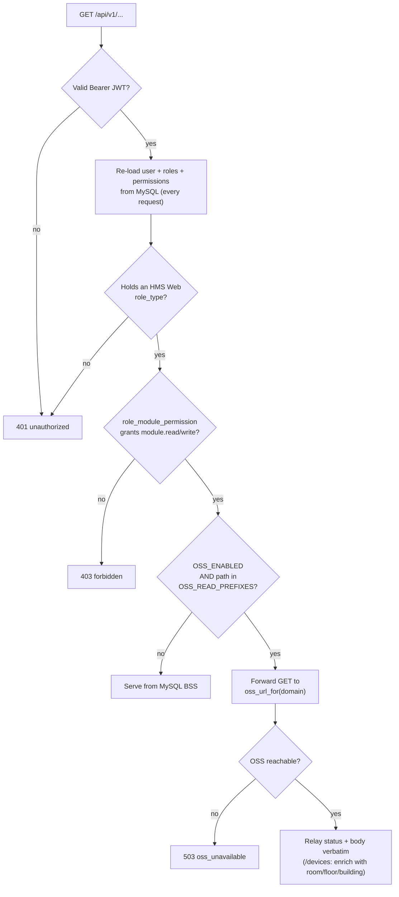

Evidence: [deps.py:38](backend/app/api/deps.py#L38), [oss_proxy.py](backend/app/api/v1/endpoints/oss_proxy.py), [oss_client.py:40](backend/app/services/oss_client.py#L40).

### 3.3 Backend layering

```
app/
 ├─ main.py          app factory: CORS, error handlers, router mount
 ├─ api/
 │   ├─ deps.py      DbSession, get_current_user, require_permission(module, perm)
 │   ├─ errors.py    one error envelope for everything
 │   ├─ write_errors.py  domain errors -> HTTP status
 │   └─ v1/
 │       ├─ router.py        single aggregation point; OSS_ENABLED branches here
 │       └─ endpoints/*.py   22 modules, HTTP concerns only
 ├─ services/*.py    all query + business logic (31 modules)
 ├─ schemas/*.py     Pydantic request/response contracts (20 modules)
 ├─ models/*.py      SQLAlchemy ORM, 93 tables in 14 groups
 ├─ db/              Base, PK tiers, mixins, engine, session, dialect types
 └─ core/            config, vault, security, platform boundary, oss_routes, version
```

Architectural invariants visible in the code:

- **Endpoints contain no SQL.** Each endpoint delegates to `app.services.*`.
- **Services raise domain errors** (`NotFound`, `Conflict`, `Invalid`) rather than `HTTPException`; a single handler maps them to 404/409/422 ([write_errors.py:15](backend/app/api/write_errors.py#L15)).
- **One error envelope** — `{"error": {"code", "message", "detail"}}` ([errors.py:42](backend/app/api/errors.py#L42)).
- **Reports add no queries.** Every report delegates to the read service already backing the corresponding screen, so a report can never disagree with its module ([reports.py:7-12](backend/app/api/v1/endpoints/reports.py#L7)).

### 3.4 OSS microservice architecture

Each OSS process is the **same codebase** with a different `OSS_DOMAINS` value; `build_api_router(settings.oss_domains)` mounts only that process's routers ([oss-service/app/main.py:50](oss-service/app/main.py#L50)).

```
oss-service/app/
 ├─ main.py        token guard on data routes; /health ungated
 ├─ api/           health + device/telemetry/alert/energy routers
 ├─ schemas/       byte-identical copies of the HMS contract
 ├─ adapters/      OSS row  ->  HMS contract translation
 ├─ db/tables.py   explicit read-only SQLAlchemy Core table definitions
 └─ models/reflect.py
```

**Failure modes are explicit, never fabricated:**

| Condition | Response |
|---|---|
| `OSS_DATABASE_URL` unset | `503 oss_not_configured` |
| OSS schema has no source for the resource | `503 oss_adapter_not_mapped` (`AdapterNotMapped`) |
| OSS process unreachable from HMS | `503 oss_unavailable` |

---

## 4. Technology Stack

### 4.1 Backend (`backend/requirements.txt`)

| Package | Version | Role |
|---|---|---|
| fastapi | 0.135.3 | HTTP framework, OpenAPI |
| uvicorn[standard] | 0.34.0 | ASGI server |
| sqlalchemy | 2.0.52 | ORM (2.0 typed `Mapped[...]` style) |
| alembic | 1.19.1 | Schema migrations |
| PyMySQL | 1.2.3 | MySQL 8 driver |
| cryptography | 50.0.2 | Required for `caching_sha2_password` |
| pydantic | 2.12.5 | Schemas / validation |
| pydantic-settings | 2.7.1 | Env-backed configuration |
| python-jose[cryptography] | 3.5.0 | JWT encode/decode |
| bcrypt | 5.0.0 | Password hashing |
| httpx | 0.28.1 | OSS service client + test client |
| openpyxl | 3.1.5 | `.xlsx` report export |
| python-multipart | ≥0.0.32 | CSV upload |
| pytest | 9.1.1 | Tests |

**Deliberately absent:** no PostgreSQL driver is declared for the backend. The retired `hms_db` cannot be reached, and OSS is only reachable through its service ([requirements.txt:3-12](backend/requirements.txt#L3)).

### 4.2 OSS service (`oss-service/requirements.txt`)

FastAPI + SQLAlchemy + **psycopg2** (the only component permitted a PostgreSQL driver).

### 4.3 Frontend (`frontend/package.json`)

| Area | Library | Version |
|---|---|---|
| Framework | react / react-dom | 18.3.1 |
| Build | vite | 5.4.19 |
| Compiler plugin | @vitejs/plugin-react-swc | 3.11.0 |
| Language | typescript | 5.8.3 |
| Routing | react-router-dom | 6.30.1 |
| Server state | @tanstack/react-query | 5.83.0 |
| UI primitives | Radix UI (24 packages) | — |
| Component system | shadcn-ui pattern (`components/ui/`, 48 components) | — |
| Styling | tailwindcss | 3.4.17 |
| Charts | recharts | 2.15.4 |
| Forms | react-hook-form + @hookform/resolvers + zod | 7.61.1 / 3.10.0 / 3.25.76 |
| Icons | lucide-react | 0.462.0 |
| Dates | date-fns | 3.6.0 |
| Toasts | sonner | 1.7.4 |
| Linting | eslint 9 + typescript-eslint 8 | — |

### 4.4 Process management

**PM2** (`ecosystem.config.js`) runs 6 processes: 4 OSS domain services, the HMS backend, and the Vite dev server. Each Python service runs from **its own virtualenv** (`backend/.venv`, `oss-service/.venv`), resolved cross-platform.

---

## 5. Repository Structure

```
ACX-Platform/
├── backend/                      FastAPI HMS backend (BSS)
│   ├── app/
│   │   ├── api/v1/endpoints/     22 endpoint modules
│   │   ├── core/                 config, vault, security, platform, oss_routes
│   │   ├── db/                   Base, PK tiers, session, dialect types
│   │   ├── models/               14 model groups, 93 tables
│   │   ├── schemas/              20 Pydantic contract modules
│   │   └── services/             31 service modules (all business logic)
│   ├── migrations/versions/      6 Alembic revisions
│   ├── seeds/                    seed runner + 11 step modules + reference data
│   ├── scripts/                  12 audit / verification scripts
│   ├── tests/                    27 test modules, 823 test functions
│   ├── docs/                     phase reports + schema blueprint + BSS inventory
│   └── etc/                      KeePass vault + builder (secrets, gitignored)
├── oss-service/                  Read-only OSS microservice
│   ├── app/{api,adapters,db,models,schemas,core}
│   ├── tools/discover_schema.py  read-only OSS schema discovery
│   └── tests/                    6 test modules, 35 test functions
├── frontend/                     Vite + React + TS client
│   ├── src/
│   │   ├── components/{layout,ui}
│   │   ├── core/{components,config,contexts,rbac,styles}
│   │   ├── features/             11 feature folders (vertical slices)
│   │   ├── hooks/
│   │   └── lib/api/              client, endpoints, hooks, mutations, types
│   └── public/                   IKANOS branding assets
├── docs/                         cross-cutting analysis + IEEE PDF manuals
├── secure-local/                 local secret-running helpers
└── ecosystem.config.js           PM2 process list
```

### 5.1 Frontend feature slices

| Slice | Pages | Backing modules |
|---|---|---|
| `auth` | Login | — |
| `dashboard` | Dashboard | `dashboard`, `facility_management`, `caleido_network`, `reports` |
| `occupancy` | Occupancy, RoomView | `occupancy` |
| `bookings` | Reservations, CheckIn, Bookings | `bookings` |
| `services` | ServiceTracking, ServicePlanning | `service_tracking`, `service_planning` |
| `config` | FacilityManagement, UserRoles, ServicesSetup, Employees, JobOrder, LimitConfigAlert, RoomDevices | 6 modules |
| `marketing` | Offers, Holidays, Events | `offers`, `holidays`, `events` |
| `reports` | Reports | `reports` |
| `tickets` | Tickets | `tickets` |
| `devices` | KeySettings, EnergyView, PowerView | `default_key`, `caleido_network` |
| `common` | About, NotFound, Placeholder | — |

---

## 6. Database Design

### 6.1 Engine policy

The BSS database engine is **not configurable**. There is no `DATABASE_URL` override and no engine switch:

> *"A second supported engine is a second runtime path that has to be kept working, and a free-form URL is a way for a stale environment to silently point the application at the retired PostgreSQL `hms_db`."* — [config.py:62-70](backend/app/core/config.py#L62)

Connection parameters come from the **KeePass vault**, not `.env` ([§11.5](#115-credential-handling)).

Engine settings ([db/session.py](backend/app/db/session.py)):

| Setting | Value | Reason given in code |
|---|---|---|
| `init_command` | `SET time_zone = '+00:00'` | timestamps stored in UTC; server defaults must agree |
| `isolation_level` | `READ COMMITTED` | MySQL's default REPEATABLE READ would pin a session to its first snapshot |
| `pool_pre_ping` | `True` | survive dropped pooled connections |
| TLS | folded in from `settings.mysql_ssl_args` | the server runs `require_secure_transport=ON` |

### 6.2 Primary-key tiering

Three tiers, declared once in [db/base.py](backend/app/db/base.py):

| Tier | Mixin | Type | Used for |
|---|---|---|---|
| **T1** | `SmallIntLookupPk` / `IntLookupPk` | SMALLINT / INTEGER, **not** auto-increment | Lookup tables whose original IKANOS ids are seeded verbatim |
| **T2** | `UUIDPk` | UUID (uuid4) | Business / transactional entities |
| **T3** | `BigIntPk` | BIGINT `GENERATED ALWAYS AS IDENTITY` | High-volume append-only logs (telemetry, alerts, notifications, audit) |

Two universal mixins:

- `LegacyIdMixin` — `legacy_id BIGINT NULL UNIQUE`, the original IKANOS integer key, so a live install can be migrated without key collision.
- `TimestampMixin` — `created_on` / `updated_on`, both `NOT NULL DEFAULT now()`, `updated_on` with `onupdate`.

`HMSBase` = `Base` + `LegacyIdMixin` + `TimestampMixin`.

### 6.3 Constraint naming

A deterministic naming convention is pinned on the metadata so Alembic autogenerate produces stable names ([base.py:25](backend/app/db/base.py#L25)):

```
ix_%(table_name)s_%(column_0_N_name)s
uq_%(table_name)s_%(column_0_N_name)s
ck_%(table_name)s_%(constraint_name)s
fk_%(table_name)s_%(column_0_N_name)s_%(referred_table_name)s
pk_%(table_name)s
```

`schema=None` is pinned deliberately: MySQL has no schema layer beyond the database, and qualifying would create permanent phantom drift in `alembic check`.

### 6.4 Cross-dialect type strategy

`app/db/types.py` provides `GUID`, `JSONB`, `DOUBLE`, `UTCDateTime`, `NOW` — portable types that render natively on MySQL and PostgreSQL. ENUMs follow the same pattern: an inline MySQL `ENUM` column type, with a PostgreSQL variant whose lifecycle is owned explicitly by the migration ([enums.py:30](backend/app/models/enums.py#L30)).

GIN indexes on JSON columns are declared with `.ddl_if(dialect="postgresql")` since MySQL cannot index JSON directly.

### 6.5 Table groups

| Group | Module | Tables | Domain |
|---|---|---|---|
| A | `facility.py` | 9 | Organisation, facility, property hierarchy, attachments, country, currency |
| B | `amenity.py` | 10 | Rooms, room status/conditions, packages, features |
| C | `stay.py` | 7 | Stays, occupants, allocations, documents, invoices, imports |
| D | `people.py` | 9 | Users, tokens, devices, roles, modules, permissions, departments, functions |
| E | `service.py` | 8 | Service taxonomy, catalogue, requests, line items, room service |
| F | `maintenance.py` | 4 | Maintenance requests, recurrence, amenities, assignees |
| G | `device.py` | 15 | Devices, firmware, telemetry, commands, MQTT, battery, room-device map |
| H | `job_order.py` | 3 | Job orders + device/amenity links |
| I | `access.py` | 4 | Key types, access keys, device ACLs, lock activity log |
| J | `alert.py` | 8 | Alert types, alerts, incidents, incident history, value alerts + limits |
| K | `activity.py` | 9 | Activity feed, notifiers, notification templates/dispatch/results |
| L | `scheduler.py` | 2 | Scheduler jobs and executions |
| M | `marketing.py` | 5 | Promo codes, facility events, occasions |
| N | `reporting.py` | 2 | Hourly energy rollups, daily dual data points |

Full table list in [Appendix A](#appendix-a--complete-table-inventory).

### 6.6 Core entity-relationship map

```mermaid
erDiagram
    organisation ||--o{ facility : owns
    facility ||--o{ property : has
    property_type ||--o{ property : classifies
    property ||--o{ property_chain : "level 1/2/3"
    property_chain ||--o{ amenity : locates
    amenity_type ||--o{ amenity : classifies
    package ||--o{ amenity : "rate plan"
    amenity_status ||--o{ amenity : status
    amenity ||--o{ amenity_condition_status : has
    amenity_condition ||--o{ amenity_condition_status : of
    amenity ||--o{ room_device_map : "hosts OSS device"

    app_user ||--o{ user_role : holds
    role ||--o{ user_role : granted
    facility ||--o{ user_role : "scoped to"
    role ||--o{ role_module_permission : grants
    role_module ||--o{ role_module_permission : on
    department ||--o{ app_user : employs
    job_function ||--o{ app_user : classifies

    stay ||--o{ room_allocation : allocates
    amenity ||--o{ room_allocation : "allocated as"
    stay ||--o{ stay_user : "occupied by"
    app_user ||--o{ stay_user : occupant
    stay ||--o{ stay_package : purchases
    stay ||--o{ invoice : billed
    stay ||--o{ user_document : "ID proof"

    service_type ||--o{ service_category : groups
    service_category ||--o{ service_category_item : contains
    service_request ||--o{ service_request_item : "line items"
    amenity ||--o{ service_request : "raised for"
    service_status ||--o{ service_request : status

    maintenance_request ||--o{ maintenance_request_amenity : covers
    maintenance_request ||--o{ maintenance_request_assignee : "assigned to"
    maintenance_request ||--|| maintenance_request_recurrence : "recurs by"

    device_type ||--o{ device : classifies
    device ||--o{ device_stat : emits
    device_param ||--o{ device_stat : "parameter of"
    device ||--o{ device_alert : raises
    device_alert ||--o{ device_incident : "escalates to"
    device_incident ||--o{ incident_history : "audited by"
    value_alert_limit_config ||--o{ value_alert : breached

    device ||--o{ access_key : "lock for"
    stay ||--o{ access_key : "key issued"
    user_device_acl ||--o{ access_key : authorises
    device ||--o{ lock_activity_log : logs
```

### 6.7 Decisions recorded in the schema

The model files are unusually explicit about what was **not** invented. Representative examples:

| Area | Decision | Evidence |
|---|---|---|
| Rooms | There is **no `room` table**. A room is an `amenity` whose `amenity_type.amenity_category = 'room'` | [amenity.py:88](backend/app/models/amenity.py#L88) |
| Buildings / floors | There are **no `building` / `floor` tables**. They are *projections* over `property` + `property_chain` (`level_one_id` = building, `level_two_id` = floor) | [occupancy.py:55](backend/app/services/occupancy.py#L55), [Dashboard.tsx:16](frontend/src/features/dashboard/pages/Dashboard.tsx#L16) |
| Bookings | There is **no `booking` table**. Booking, check-in, check-out and cancellation are all states of one `stay` row | [stay.py:5](backend/app/models/stay.py#L5) |
| Employees | There is **no `employee` table**. Staff are `app_user` rows with `is_staff = 1` | [people.py:5](backend/app/models/people.py#L5) |
| Guests | There is **no `guest` table**. Guests are `app_user` rows with `is_staff = 0` | [stays_write.py:22](backend/app/services/stays_write.py#L22) |
| Telemetry | Generic EAV: `device_param` (schema) + `device_stat` (values). The invented `energy_data`, `sensor_reading`, `device_uptime` tables were removed | [device.py:5](backend/app/models/device.py#L5) |
| Stay facility scope | `stay` has **no `facility_id`**; scope is reached via `room_allocation → amenity → facility` | [stay.py:25](backend/app/models/stay.py#L25) |
| Invoice status | `invoice` has **no `status` column**; payment state has no source | [stay.py:195](backend/app/models/stay.py#L195) |
| Service priority | `service_request` has **no `priority` column** | [service.py:148](backend/app/models/service.py#L148) |
| Alert severity | Only `warning` and `critical` exist — there is no `Info` | [enums.py:126](backend/app/models/enums.py#L126) |
| Daily KPIs | `daily_dual_data_point` is **single-facility by primary key** — preserved verbatim rather than silently widened | [reporting.py:71](backend/app/models/reporting.py#L71) |
| MQTT password | `mqtt_broker.broker_password` is clear text in the source schema; encryption at rest is flagged as an application concern | [device.py:315](backend/app/models/device.py#L315) |

### 6.8 Migration history

| Revision | Down revision | Content |
|---|---|---|
| `0e2687233b59` | — | Phase 1.7: the 92-table foundation (2,400 lines) |
| `7c4e2b9a1d53` | `0e2687233b59` | Rename `service_status` id 3 → "In Progress" |
| `8f1e3c5a7b92` | `7c4e2b9a1d53` | Create `room_status_condition_applicability` + seed the policy matrix |
| `9a2b3c4d5e6f` | `8f1e3c5a7b92` | Add `role.notification_preferences` (JSON) |
| `a3f1c8e2d904` | `7c4e2b9a1d53`† | Create `room_device_map` (OSS device → HMS room) |
| `b3c4d5e6f7a8` | `9a2b3c4d5e6f` | Priority 4: energy telemetry device FK, billing pricing, `currency` master |

† The chain **branches at `7c4e2b9a1d53`**, which has two children (`8f1e3c5a7b92` and `a3f1c8e2d904`), leaving two heads (`a3f1c8e2d904` and `b3c4d5e6f7a8`) and no merge revision in this repository — see [M-18](#163-data-and-schema).

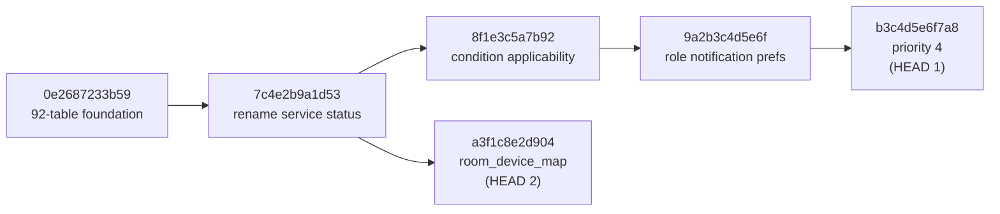

### 6.9 Seed data

`python -m seeds.run_seed` executes 11 ordered steps (`reference_data`, `facility`, `people`, `rooms`, `services`, `stays`, `devices`, `telemetry`, `alerts`, `operations`, `activity`). Reference data is transcribed verbatim from the original IKANOS dump; nothing is generated ([reference.py:1-9](backend/seeds/data/reference.py#L1)).

**Critically, the seed writes no usable credential.** Every `app_user.password_hash` it creates holds the literal `!seed-no-login`, which is not a valid bcrypt digest, so `verify_password` returns `False` for every seeded account by design ([security.py:7-13](backend/app/core/security.py#L7)).

---

## 7. Domain Model & Vocabulary

### 7.1 Room status vs room condition — the central distinction

HMS separates **status** (where a room is in the occupancy lifecycle) from **condition** (its housekeeping/operational state). A room can be `Available` *and* `Dirty`.

**Statuses** (`amenity_status`, T1 lookup — note id `0` is meaningful):

| id | Name |
|---|---|
| 0 | Available |
| 1 | Occupied |
| 2 | Unavailable |
| 3 | Allotted |

**Conditions** (`amenity_condition`): Dirty, Low battery, Under maintenance, Sanitation, Ready for occupant — extended in the live schema with *Guest Assistance Required* and *Device Offline* ([amenity.py:64-72](backend/app/models/amenity.py#L64)).

Each condition carries applicability flags: `applicable_to_occupied`, `applicable_to_vacant`, `is_active`.

### 7.2 The condition-applicability policy table

`room_status_condition_applicability` is a **configuration table**, not reference data. It maps *(room status, condition)* to four policy booleans ([amenity.py:168](backend/app/models/amenity.py#L168)):

| Column | Meaning |
|---|---|
| `is_applicable` | May this condition be set while the room is in this status? |
| `is_active` | Is this policy row live? |
| `blocks_checkin` | Does this condition prevent a check-in? |
| `blocks_readiness` | Does this condition prevent the room being considered ready? |

This table is what makes room-state behaviour **data-driven rather than hardcoded**: the service layer queries it rather than embedding condition ids ([stays_write.py:109-130](backend/app/services/stays_write.py#L109)).

### 7.3 Authoritative occupancy status

Because `amenity.status` and the stay graph are independent in the schema, the read layer computes an *authoritative* status with a precedence CASE ([occupancy.py:502](backend/app/services/occupancy.py#L502)):

| Precedence | Condition | Result |
|---|---|---|
| 1 | `amenity.status = 1` **OR** an in-house stay exists | `Occupied` |
| 2 | `amenity.status = 3` **OR** a pending allocation exists | `Allotted` |
| 3 | `amenity.status = 2` **OR** a blocking condition is active | `Unavailable` |
| 4 | `amenity.status = 0` | `Available` |
| else | — | `null` → surfaced as `Unknown` |

"In house" is defined precisely and identically everywhere: `actual_checkin_time IS NOT NULL AND actual_checkout_time IS NULL` ([occupancy.py:59](backend/app/services/occupancy.py#L59)).

### 7.4 Stay lifecycle

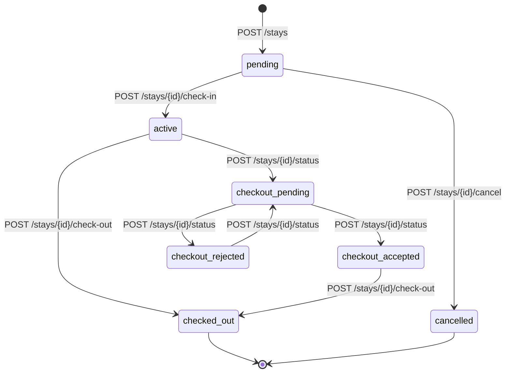

The three **terminal** transitions (`checked out`, `cancelled`, `active`) are **refused** by the generic status endpoint and must go through the dedicated action, so room state is always released or synchronised with them ([stays_write.py:460-469](backend/app/services/stays_write.py#L460)).

### 7.5 Stay status → room status mapping

Read out of the seeded data, not invented ([stays_write.py:3-15](backend/app/services/stays_write.py#L3)):

| Stay state | Room `amenity.status` |
|---|---|
| `pending`, allocated, not checked in | 3 `Allotted` |
| `active`, checked in | 1 `Occupied` |
| `checkout pending`, checked in | 1 `Occupied` |
| `checked out` | 0 `Available` (or 2 `Unavailable` if a blocking condition is active) |
| `cancelled` | no allocation at all |

Statuses that **still hold their rooms** (`LIVE_STAY_STATUSES`): pending, active, checkout pending, checkout accepted, checkout rejected.

### 7.6 Service request lifecycle

`service_status`: Pending (1) → Assigned (2) → In Progress (3) → Completed (4) / Canceled (5).

"In Progress" (originally "Partially completed") is explained by the line-item model: *a ticket is in progress while its items differ in status* ([service.py:236](backend/app/models/service.py#L236)).

A **separate** 4-value vocabulary exists for guest-app room-service calls (`room_service_request_status`: unassigned, assigned, cancelled, completed).

### 7.7 Alert → Incident model

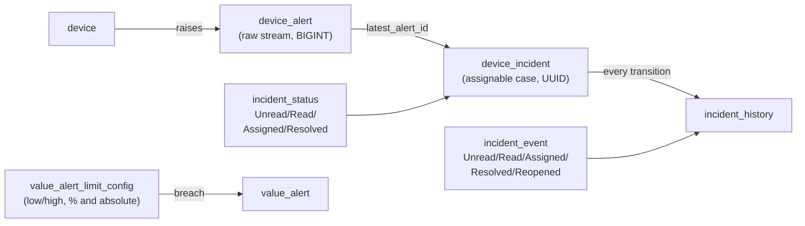

Notable: **`Reopened` exists only as an event, never as a status**; `resolved_on` and resolution notes live in `incident_history`, not on the incident ([alert.py:69-79](backend/app/models/alert.py#L69), [alert.py:178-183](backend/app/models/alert.py#L178)).

### 7.8 Telemetry (EAV) model

```
device_param (35 rows: id, device_type, param_name, data_type, unit)
        │
        └─< device_stat (device_id, timestamp, device_param_id, device_param_value TEXT)

device_current_stat  — latest snapshot per device, as one JSON blob
                       (avoids a top-N-per-group query over device_stat)
device_health_stat   — heartbeat log (health_status, device_temperature)
sensor_operation_stat— daily operation_percentage per device ("Smart Rooms Online")
energy_stat          — hourly energy per device per room; `hour` = hours since 2000
other_device         — third-party (non-Caleido) meter readings; no FKs in source
```

Values are stored as text; `device_param.data_type` says how to read them. `device_param.unit` is the Y-axis unit for charts.

---

## 8. Backend API Specification

### 8.1 Conventions

| Concern | Convention |
|---|---|
| Base path | `/api/v1` (`settings.API_V1_PREFIX`) |
| Auth | `Authorization: Bearer <JWT>` on every route except `/health*` and `/auth/login` |
| List responses | `Page[T]` = `{items, page, page_size, total}` |
| Pagination | `page` (≥1), `page_size` (≤ `MAX_PAGE_SIZE`) |
| Errors | `{"error": {"code", "message", "detail"}}` — one envelope everywhere |
| Docs | `/docs` (Swagger), `/redoc`, `/openapi.json` |

### 8.2 Status-code contract

| Code | Machine code | Raised when |
|---|---|---|
| 400 | `bad_request` | generic write error |
| 401 | `unauthorized` | missing/invalid/expired token, or user no longer holds an HMS Web role |
| 403 | `forbidden` | authenticated but the role lacks the module grant |
| 404 | `not_found` | `NotFound` domain error |
| 409 | `conflict` | `Conflict` domain error (double-booking, already checked in, …) |
| 422 | `validation_error` | request validation, or `Invalid` domain error |
| 500 | `internal_error` | unexpected — logged server-side, never leaked |
| 503 | `service_unavailable` / `oss_unavailable` / `oss_not_configured` / `oss_adapter_not_mapped` | database or OSS unreachable |

A MySQL `DataError` is deliberately mapped to **400, not 503** — "a client shown 503 retries a request that can never work" ([errors.py:77-83](backend/app/api/errors.py#L77)).

### 8.3 Health surface

| Route | Auth | Purpose |
|---|---|---|
| `GET /health` | none | Liveness. Deliberately does **not** touch the database, so it stays meaningful when MySQL is the thing that is down |
| `GET /api/v1/health/version` | none | API version |
| `GET /api/v1/health/db` | none | Readiness — can this process actually serve? |
| `GET /api/v1/health/oss` | none | Per-domain OSS reachability probe |

### 8.4 Endpoint families and their RBAC gates

| Family | Prefixes | Module gate |
|---|---|---|
| Auth | `/auth` | — |
| Facility hierarchy | `/facilities`, `/properties`, `/buildings`, `/floors`, `/rooms`, `/amenity-types`, `/packages`, `/features` | `facility_management` |
| Reference | `/countries`, `/currencies` | `facility_management` |
| Access control | `/users`, `/roles`, `/modules`, `/permissions` | `employees`, `user_roles` |
| Org structure | `/departments`, `/job-functions` | `employees` |
| Service catalogue | `/service-types`, `/service-statuses`, `/service-categories`, `/service-items` | `service_setup` |
| Service tickets | `/service-requests` | `service_tracking` |
| Maintenance | `/maintenance-requests` | `service_planning` |
| Job orders | `/job-orders` | `job_order` |
| Stays | `/stays`, `/room-allocations`, `/stay-occupants`, `/invoices` | `bookings` |
| Occupancy | `/occupancy`, `/amenity-statuses`, `/amenity-conditions` | `occupancy` |
| Devices & telemetry | `/device-types`, `/devices`, `/device-params`, `/device-stats`, `/device-current-stats`, `/other-device-readings`, `/room-devices`, `/limit-configs` | `caleido_network` |
| Alerts | `/alert-types`, `/alerts`, `/incidents`, `/value-alerts` | `caleido_network` |
| Notifications | `/notification-templates`, `/notifications`, `/activities` | `dashboard` |
| Energy / KPIs | `/energy-stats`, `/daily-data-points` | `reports` |
| Reports | `/reports` | `reports` |
| Marketing | `/offers`, `/events`, `/holidays` | `offers`, `events`, `holidays` |
| Keys | `/key-settings` | `default_key` |

### 8.5 Noteworthy endpoints

| Endpoint | Behaviour |
|---|---|
| `POST /stays/{id}/check-in` | Validates allocation exists, refuses if any room has a blocking condition, stamps arrival, sets stay `active`, sets rooms `Occupied`, clears conditions inapplicable to occupied rooms |
| `POST /stays/{id}/check-out` | Stamps departure, sets `checked out`, clears vacant-inapplicable conditions, releases rooms to `Available` (or `Unavailable` if blocked) and applies the default *Ready to Occupy* condition |
| `PATCH /room-allocations/{id}` | **Atomic room move** — old room released and new room takes the old room's state in one transaction |
| `POST /stays/bulk-upload` | CSV import; flexible header aliases, per-row validation, date-overlap clash detection, auto-creates guest `app_user` rows, writes an `import_job` audit record |
| `PUT /occupancy/{amenity_id}/conditions` | Enforces **exactly one active condition** per room, validated against the applicability policy table |
| `PUT /roles/{id}/permissions` | Full replacement of a role's module permission matrix |
| `GET /reports/{key}/export.xlsx` | Walks every matching page (ceiling `max_rows` ≤ 50,000) into one sheet with a provenance header |
| `GET /daily-data-points/summary` | Returns one pre-resolved row per metric via `ROW_NUMBER()` — moves ring selection and percentage out of the browser into SQL |
| `GET /occupancy/kpis` | KPI metadata, overridable per facility via `facility.cloud_details.occupancy_kpi_metadata` |

### 8.6 Report catalogue

| Key | Title | Source tables | Date filter column |
|---|---|---|---|
| `occupancy` | Occupancy Report | amenity, amenity_status, amenity_condition, stay | none (point-in-time) |
| `employee` | Employee Report | app_user, department, job_function, user_role | none (point-in-time) |
| `room-status` | Room Status Report | amenity, amenity_status, amenity_condition | none (point-in-time) |
| `booking` | Booking Report | stay, room_allocation, stay_occupant | expected check-in |
| `ticket` | Ticket Report | service_request, service_type, service_status, service_category | `created_on` |
| `housekeeping` | Housekeeping Report | maintenance_request (scheduled, planned) + links | start date |
| `sanitization` | Sanitization Report | maintenance_request (disinfection) + links | start date |
| `alert` | Alert Report | device_alert, alert_type, device, amenity | `created_on` |
| `energy` | Energy Report | energy_stat, device, amenity | `hour` (hours since 2000) |

Three reports accept **no** date range because they have no date column — *"inventing a date filter would make them lie"* ([reports.py:18-23](backend/app/api/v1/endpoints/reports.py#L18)).

---

## 9. OSS Microservice (Device / Telemetry / Alert / Energy)

### 9.1 Purpose

Serve the device/telemetry/alert/energy read surface from the **externally owned** OSS PostgreSQL (`insp_iot`), mapping its differently-shaped rows into the **exact API contract the HMS frontend already consumes** — so enabling OSS changes nothing the browser sees.

### 9.2 OSS schema (as mapped)

Declared read-only in [oss-service/app/db/tables.py](oss-service/app/db/tables.py):

| Table | Key columns |
|---|---|
| `insp_device` | device_id, device_uid, serial_number, device_name, device_type (free text), node_type, parent_device_id, is_gateway, appliance, manufacturer, model, firmware_version, site_id, status |
| `insp_device_health` | record_id, time, device_uid, health_status, temperature, recorded_at, device_id |
| `insp_device_state` / `insp_device_state_type` | device_state_id, device_state_type_id, state_effective_dtm_utc / device_state_name |
| `insp_device_performance` | record_id, time, device_uid, `param_data` JSONB, recorded_at, received_at |
| `insp_device_alert` | record_id, time, device_uid, alert_type, alert_severity, `alert_data` JSONB |
| `insp_site` | site_id, site_name, customer_id |

### 9.3 Adapter compatibility decisions

| HMS contract field | OSS reality | Decision |
|---|---|---|
| `device_type` (int id) | free text in OSS | Derive an ordinal registry over `DISTINCT device_type` |
| `device_short_code` | no source | Returned **null** — never fabricated |
| `health_status` label | no lookup table | Raw code surfaced as stored |
| `amenity_id` (room) | OSS has no rooms | Null from OSS; filled by HMS from `room_device_map` |
| `facility_id` | `site_id` (currently null on all rows) | Mapped, with the null-ness documented |
| `mfg_date`, firmware target, power/op flags, soft-delete `status` | no source | Null |
| Device filtering by amenity/facility | no OSS linkage | `AdapterNotMapped` → 503 |

### 9.4 Explicitly unmapped surfaces

| Resource | Reason |
|---|---|
| `/energy-stats` (list + summary) | No energy rollup table in OSS |
| `/other-device-readings` | No third-party meter table in OSS |
| `/device-stats/{id}` detail | No stable integer id in OSS |
| `/alerts/{id}` detail | No stable integer id in OSS |
| `/alerts/{id}/incidents` | No `device_incident` linkage in OSS |

### 9.5 Composed route — `/devices`

`/devices` is the one route HMS does not blindly relay. Because OSS has no rooms:

1. HMS answers the **location filters** (`amenity_id` / `floor_id` / `building_id` / `facility_id`) from its own `room_device_map`.
2. It asks OSS for exactly those `device_ids`.
3. It fills each returned device's room, floor and building from BSS before replying.
4. If nothing is installed at that location, it returns an empty page **without calling OSS at all**.

Unmapped devices keep the nulls OSS sent — HMS does not know their room ([oss_proxy.py:69](backend/app/api/v1/endpoints/oss_proxy.py#L69)).

### 9.6 OSS data flow

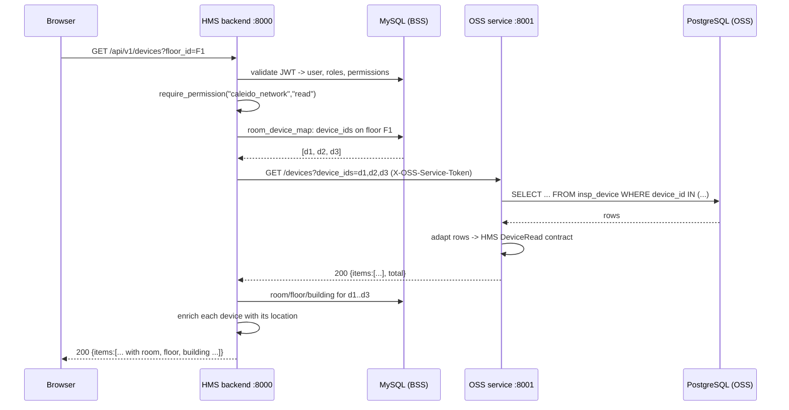

---

## 10. Frontend Application

### 10.1 Routing

| Path | Page | Module gate |
|---|---|---|
| `/login` | Login | — |
| `/` | → `/HMS` | — |
| `/HMS` | Dashboard | `dashboard` |
| `/hms`, `/dashboard` | → `/HMS` | — |
| `/occupancy` | Occupancy | `occupancy` |
| `/reservations` | Reservations | `bookings` |
| `/bookings` | → `/reservations` | — |
| `/check-in` | CheckIn | `bookings` |
| `/checkin` | → `/check-in` | — |
| `/services` | → `/services/tracking` | — |
| `/services/tracking` | ServiceTracking | `service_tracking` |
| `/services/planning` | ServicePlanning | `service_planning` |
| `/config` | → `/config/facility` | — |
| `/config/facility` | FacilityManagement | `facility_management` |
| `/config/user-roles` | UserRoles | `user_roles` |
| `/config/services-setup` | ServicesSetup | `service_setup` |
| `/config/employees` | Employees | `employees` |
| `/config/job-order` | JobOrder | `job_order` |
| `/config/limit-alert` | LimitConfigAlert | `caleido_network` |
| `/config/room-devices` | RoomDevices | `caleido_network` |
| `/offers` | Offers | `offers` |
| `/holidays` | Holidays | `holidays` |
| `/events` | Events | `events` |
| `/reports/*` | Reports | `reports` |
| `/tickets`, `/manage/tickets` | Tickets | `tickets` |
| `/power-view`, `/energy-view`, `/room-view` | → `/occupancy` (retired) | — |
| `/key-settings` | KeySettings | `default_key` |
| `/about` | About | none (all signed-in users) |
| `*` | NotFound | — |

Routing is **case-sensitive**: `/hms` is a separate path from `/HMS` and is explicitly redirected rather than left to fall through.

### 10.2 Navigation structure

```
HMS                              (link → /HMS, expandable)
 ├─ Occupancy                    → /occupancy
 └─ Services
     ├─ Services Tracking        → /services/tracking
     └─ Services Planning        → /services/planning
Stay                             (nav-only prefix, no route)
 ├─ Offers                       → /offers
 ├─ Reservation                  → /reservations
 └─ Check-in                     → /check-in
Config and Setup
 ├─ Facility Management · User Roles · Services Setup · Employees
 └─ Job Order · Limit Config Alert · Room Devices
Manage                           (nav-only prefix, no route)
 ├─ Holidays · Events · Tickets
Reports                          → /reports/occupancy
Default Key Settings             → /key-settings
About                            → /about
```

Nav items and whole groups are hidden when the signed-in user holds no read grant; a group with zero permitted children disappears entirely ([AppSidebar.tsx:386-397](frontend/src/components/layout/AppSidebar.tsx#L386)).

### 10.3 API client design

A **single** client ([lib/api/client.ts](frontend/src/lib/api/client.ts)) with:

- Base URL from `VITE_API_BASE_URL`, defaulting to the relative `/api/v1` (proxied by Vite in dev). **No production host is hardcoded anywhere in `src/`.**
- Token in `localStorage` under `hms.access_token`; attached as `Authorization: Bearer`.
- A single `ApiError` class exposing `isUnauthorized` / `isForbidden` / `isNotFound` / `isValidation` / `isConflict` / `isServerError` / `isNetworkError` and a `fieldErrors` accessor that unpacks FastAPI 422 `loc`/`msg` pairs for inline form display.
- A global `hms:unauthorized` window event on any 401 (except login), so `AuthContext` signs the user out from one place.
- Four transports: `request` (JSON), `download` (binary export, reads the filename from `Content-Disposition`), `requestForm` (multipart CSV upload), plus `saveBlob`.
- `describeApiError()` — one place that turns every failure mode into user-facing text.

Layering: `client.ts` (transport) → `endpoints.ts` (typed call per endpoint) → `hooks.ts` / `mutations.ts` (React Query) → feature pages.

### 10.4 Cross-cutting UI components

| Component | Role |
|---|---|
| `DataState` | Uniform loading / error / empty handling for every data-backed widget |
| `ModuleGuard` | Route-level RBAC guard |
| `ProtectedRoute` | Authentication guard |
| `NoEndpointNotice` | Explicit "no backing endpoint" notice instead of fake data |
| `TablePagination` | Shared pagination control |
| `PageHeader` | Shared page title / action bar with a 36 px control baseline |

### 10.5 Dashboard composition

| Widget | Data source |
|---|---|
| `DashboardKPIs` | Device alerts, active value alerts, incidents, Room in House, Stays in House, service requests, energy consumed, activities |
| `EnergyConsumptionChart` | `/energy-stats/summary` |
| `OccupancyStatisticsChart` | `/occupancy/summary` |
| `CaleidoAtWork` | `/daily-data-points/summary` (4 ratio rings) |
| `AlertsPanel` | `/alerts` |
| `RecentActivityPanel` | `/activities` |
| `StatusSection` | `/buildings`, `/floors`, `/rooms` drill-down (server-filtered, never client-truncated) |

Each widget owns its own query, so **one failing endpoint degrades its own box and nothing else** ([Dashboard.tsx:21-24](frontend/src/features/dashboard/pages/Dashboard.tsx#L21)).

One KPI label is notable for its honesty: **"Energy consumed (no unit)"** — the unit is not available, so it is not asserted ([DashboardKPIs.tsx:401](frontend/src/features/dashboard/components/DashboardKPIs.tsx#L401)).

---

## 11. Security, Authentication & Authorization

### 11.1 Authentication flow

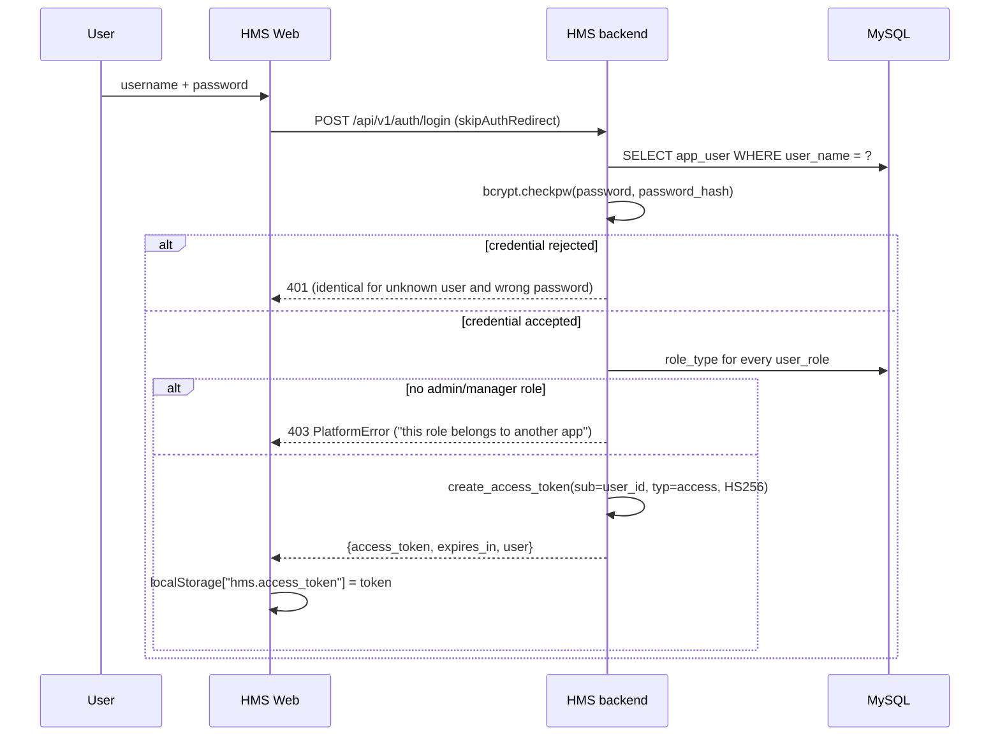

### 11.2 Token design

The JWT carries **identity only** — `sub`, `typ`, `iat`, `exp`. Explicitly:

> *"No role, no permission, no email, and certainly no credential goes into the token: authorization is re-read from the database on every request, so a token cannot carry stale or forged privileges."* — [security.py:81-85](backend/app/core/security.py#L81)

`typ: "access"` is validated on decode so a future refresh token can never be replayed as an access token. Default lifetime: 60 minutes.

### 11.3 Authorization model

Three-layer, all database-backed:

1. **Platform boundary** — only `role_type` ∈ {`admin`, `manager`} may hold an HMS Web session. Gating is on the constrained `role_type` ENUM, never on free-text role names, *"because an operator can rename 'Duty Manager' tomorrow"* ([platform.py:17-24](backend/app/core/platform.py#L17)).
2. **Module permission** — `require_permission(module_name, "read"|"write")` reads `role_module_permission.read_access` / `write_access` for the caller's roles. Nothing is hardcoded beyond the two column names.
3. **Revalidation on every request** — `load_hms_web_user` returns `None` if the user was deleted *or* no longer holds an HMS Web role: *"a token must not outlive the authority that justified it."*

Two documented mismatches between the operating handbook and the database are **reported, not resolved** ([platform.py:26-38](backend/app/core/platform.py#L26)):

- There is no `technician` value in `role_type`; the seeded "Technician" role is `staff`, so Technician is not separable at the type level.
- `system_user` exists in the enum but not in the handbook; it is treated as a non-interactive service account and excluded from web login.

### 11.4 Password handling

| Property | Implementation |
|---|---|
| Algorithm | bcrypt (`$2a$` / `$2b$` / `$2y$` prefixes accepted) |
| Verification | `verify_password` **never raises** — NULL hashes, the seed sentinel and malformed digests all return `False` |
| Seed state | Every seeded account holds `!seed-no-login`, which cannot be produced by any hashing scheme — **a freshly seeded database has zero accounts that can log in, by design** |
| Logging | *"nothing here ever logs a password, a hash or a token"* |
| Introspection | `credential_availability()` reports how many accounts could authenticate, rather than inventing credentials to make login succeed |

### 11.5 Credential handling

BSS MySQL credentials live in a **KeePass vault** (`backend/etc/hmsBackend.kdbx`, entry `MYSQL_BSS`), not in `.env`. `.env` holds only non-secret settings; nothing in it can reach the database.

Master-password resolution order ([vault.py:8-16](backend/app/core/vault.py#L8)):

1. `etc/shibboleth.zip` → `shibboleth.txt` (normal path)
2. `HMS_VAULT_MASTER_PASSWORD` environment variable (CI, containers)
3. Interactive prompt (developer workstation)

Enforced rules: the master password exists only as a local variable, is never stored on an object and never logged; the entry password is returned to the caller and never logged; a wrong master password yields a generic error.

The README is candid about the limits: *"shibboleth.zip is a plain ZIP, so anyone who can read `etc/` can read the master password. This is not protection against someone already on the box."* Its actual value is credential consolidation and single-point rotation ([etc/README.md](backend/etc/README.md)).

Credentials are cached once per process via `@lru_cache` because key derivation is deliberately slow.

`URL.create` escapes the password so `@`, `!`, `*`, `#` are safe, and SQLAlchemy masks it in `repr()` so it cannot leak through a traceback.

### 11.6 Transport security

| Link | Protection |
|---|---|
| Browser → HMS | CORS allow-list from `CORS_ORIGINS`; dev proxy avoids CORS entirely |
| HMS → MySQL | TLS required (`require_secure_transport=ON`). `MYSQL_SSL_VERIFY_CERT` defaults **true**; without a CA bundle the app *refuses to start* unless verification is explicitly disabled. The unverified branch still encrypts (PyMySQL would silently fall back to plaintext with `ssl={}`, so real keys are passed) |
| HMS → OSS | Optional shared `X-OSS-Service-Token`; **mandatory** outside `APP_ENV=development` — the OSS service refuses to start without it |
| OSS → PostgreSQL | Read-only connection; no DDL is ever emitted |

### 11.7 Fail-fast production guards

| Guard | Behaviour |
|---|---|
| `assert_production_ready()` | Refuses to sign tokens with the shipped dev JWT secret outside development |
| MySQL TLS | `RuntimeError` at startup if verification is on but no CA bundle is configured |
| OSS token | `RuntimeError` at startup if `APP_ENV != development` and `OSS_SERVICE_TOKEN` is unset |

### 11.8 Known security gaps (from the project's own audit)

Recorded in [HMS_EXECUTIVE_SUMMARY.md](docs/hms-integration-analysis/HMS_EXECUTIVE_SUMMARY.md) (dated 2026-10-10, before the MySQL migration):

- Data is **not** restricted to the user's own facility (no impact with one facility, blocking for multi-property).
- Guest contact details are stored unencrypted and returned by the users API.
- Two modules (`tickets`, `default_key`) were reported as not checked server-side. **Current code contradicts this for `default_key`** — `/key-settings` carries `DEFAULT_KEY_READ`/`DEFAULT_KEY_WRITE` gates ([facility_write.py:551](backend/app/api/v1/endpoints/facility_write.py#L551)). No `tickets`-gated router exists in the current endpoint set; the Tickets screen consumes `service_tracking`-gated endpoints. See §16.

---

## 12. End-to-End Data Flows & Workflows

### 12.1 Reservation → Check-in → Check-out

```mermaid
sequenceDiagram
    actor S as Staff (Manager)
    participant FE as HMS Web
    participant API as FastAPI
    participant SVC as stays_write
    participant DB as MySQL

    S->>FE: Create reservation
    FE->>API: POST /stays {booking_user_id, dates, room_ids, occupant_ids}
    API->>SVC: create_stay()
    SVC->>DB: verify booking user exists
    SVC->>SVC: validate checkout > checkin
    SVC->>DB: next_yearly_reference -> STY-YYYY-NNNN
    SVC->>DB: INSERT stay (status='pending')
    loop each room_id
        SVC->>DB: assert room free among LIVE_STAY_STATUSES
        SVC->>DB: INSERT room_allocation
        SVC->>DB: UPDATE amenity.status -> Allotted
    end
    loop each occupant
        SVC->>DB: INSERT stay_user
    end
    SVC->>DB: stay.no_of_rooms = count(allocations)
    API-->>FE: 201 StayRead

    S->>FE: Check in
    FE->>API: POST /stays/{id}/check-in
    SVC->>DB: assert not already checked in / not cancelled / not checked out
    SVC->>DB: assert at least one allocation
    loop each allocated room
        SVC->>DB: _has_blocking_condition(room)?
    end
    alt blocking condition present
        API-->>FE: 409 "Room must be Ready to Occupy"
    else
        SVC->>DB: stay.actual_checkin_time = now; status='active'
        SVC->>DB: amenity.status -> Occupied
        SVC->>DB: DELETE conditions not applicable_to_occupied
        API-->>FE: 200 StayRead
    end

    S->>FE: Check out
    FE->>API: POST /stays/{id}/check-out
    SVC->>DB: assert checked in and not already checked out
    SVC->>DB: actual_checkout_time = now; status='checked out'
    loop each allocated room
        SVC->>DB: DELETE conditions not applicable_to_vacant
        alt blocking condition remains
            SVC->>DB: amenity.status -> Unavailable
        else
            SVC->>DB: amenity.status -> Available
            SVC->>DB: ensure default condition 'Ready to Occupy'
        end
    end
    API-->>FE: 200 StayRead
```

**Guard rails enforced in this flow**

| Rule | Status | Message |
|---|---|---|
| Expected check-out must be after check-in | 422 | — |
| Room already held by another live stay | 409 | "That room is already allocated to stay {ref}" |
| Check-in without an allocation | 422 | "Allocate a room before checking this stay in" |
| Check-in with a blocking condition | 409 | "Room must be Ready to Occupy" |
| Check-in twice | 409 | "This stay is already checked in" |
| Cancel a checked-in stay | 409 | "check it out instead" |
| Extend to an earlier time | 422 | "must be later than the current one" |
| Release a room on an in-house stay | 409 | "check it out before releasing the room" |
| Mark a held room Available | 409 | "Stay {ref} still holds this room" |
| Mark a blocked room Available | 409 | "Resolve maintenance first" |

### 12.2 Room status ↔ condition synchronisation

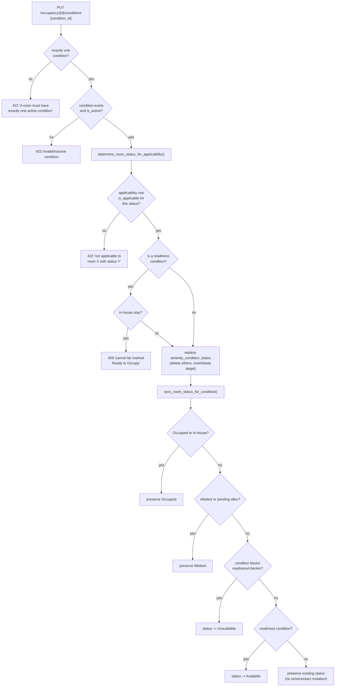

The "preserve existing status" branch is deliberate: an operational device condition such as *Low Battery* or *Device Offline* records a fact without taking the room out of service.

### 12.3 Bulk reservation upload

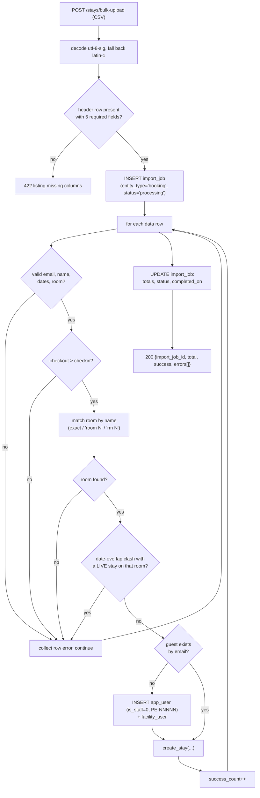

Accepted header aliases: `guest_email|email`, `guest_name|name|booker_name`, `checkin|checkin_date|expected_checkin_time`, `checkout|checkout_date|expected_checkout_time`, `room_number|room|room_name`, plus optional phone, guest count and comments. Twelve date formats are attempted, ISO-8601 first.

### 12.4 Report generation and export

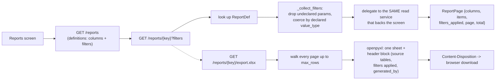

The column list travels **with** the data, and the spreadsheet writer consumes the same list — *"so the table and the download cannot drift apart."*

### 12.5 Dashboard data flow

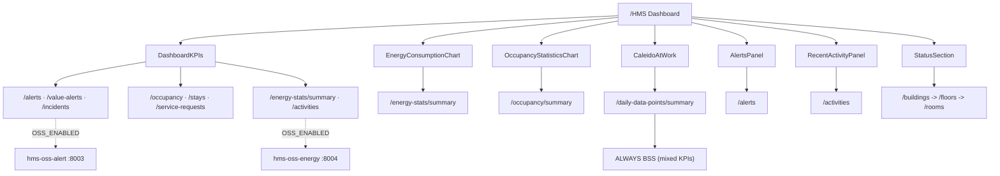

`/daily-data-points` is deliberately **always** BSS even with OSS enabled, because it holds mixed business + device KPIs ([oss_routes.py:9-11](backend/app/core/oss_routes.py#L9)).

### 12.6 "Caleido At Work" KPI derivation

`daily_dual_data_point` stores a numerator (`dp_1`) and denominator (`dp_2`) per `metric_type` per day. The five metric types are: `smart room`, `service request`, `checkout`, `booking`, `guest room`.

The business rule — *these are daily snapshots, so the ring shows the most recent snapshot inside the window, never an average or sum* — is expressed once, in SQL, as `ROW_NUMBER() OVER (PARTITION BY metric_type ORDER BY metric_date DESC)`. The percentage is computed from the two stored values and nothing else: no constant, no fallback, no default ([energy.py:419-437](backend/app/services/energy.py#L419)).

---

## 13. Functional Requirements (as implemented)

> Derived by reading what the code actually does. `FR-n` numbering is this document's; it does not exist in the repository.

### 13.1 Identity & access

| ID | Requirement | Evidence |
|---|---|---|
| FR-A1 | Users authenticate with username + password; failures are indistinguishable between unknown user and wrong password | `auth.py:88-101` |
| FR-A2 | Only `admin` / `manager` role types may use HMS Web; other role types receive a platform-boundary error | `platform.py:35` |
| FR-A3 | Access is granted per module per role, with separate read and write flags | `role_module_permission` |
| FR-A4 | Permissions are re-read from the database on every request | `deps.py:49-52` |
| FR-A5 | A user may hold different roles at different facilities (3-column composite PK) | `people.py:179-208` |
| FR-A6 | Role permission matrices are replaced wholesale via `PUT /roles/{id}/permissions` | `access_write.py:220` |
| FR-A7 | Users can be created, updated, deactivated, reactivated, and have passwords set | `access_write.py:87-175` |
| FR-A8 | Roles carry notification preferences (JSON array) | migration `9a2b3c4d5e6f` |

### 13.2 Facility & inventory

| ID | Requirement | Evidence |
|---|---|---|
| FR-B1 | An organisation owns one or more facilities | `facility.py:37-91` |
| FR-B2 | Property structure supports 1–3 levels (building → wing → floor) via `property_type.levels` and `property_chain` | `facility.py:122-207` |
| FR-B3 | Buildings and floors are served as projections with `floor_count` / `room_count` | `facilities.py:173-262` |
| FR-B4 | Rooms (`amenity`) belong to a type, a package and a property chain; rooms can nest via `parent_amenity_id` | `amenity.py:88-143` |
| FR-B5 | Room types are categorised `room` / `restaurant` / `others` | `amenity_category` enum |
| FR-B6 | Packages may contain sub-packages (many-to-many) and features | `sub_package`, `package_feature` |
| FR-B7 | A sub-package cannot self-link, be its own parent, or be a parent | `HMS_FACILITY_MANAGEMENT_DATA_FLOW_REPORT.md §3.2` |
| FR-B8 | Features may be flagged smart and tied to a device type | `amenity.py:270-292` |
| FR-B9 | Facility carries an authoritative ISO-4217 currency | `facility.currency_id` |

### 13.3 Stays

| ID | Requirement | Evidence |
|---|---|---|
| FR-C1 | A stay is created with expected arrival/departure, guest count, optional rooms and occupants | `stays_write.py:282` |
| FR-C2 | Stay references follow `STY-YYYY-NNNN` and are unique | `stays_write.py:295` |
| FR-C3 | A room cannot be double-booked across live stays | `stays_write.py:255-269` |
| FR-C4 | Check-in is blocked by an active blocking room condition | `stays_write.py:357-364` |
| FR-C5 | Check-out releases rooms and restores the default readiness condition | `stays_write.py:421-425` |
| FR-C6 | Re-allocation moves a stay between rooms atomically | `stays_write.py:588` |
| FR-C7 | Stays can be extended (departure only, forward only) | `stays_write.py:431` |
| FR-C8 | A checkout approval sub-flow exists (pending / accepted / rejected) | `stay_status` enum |
| FR-C9 | Guest ID documents have their own approval status | `user_document`, `POST /stays/{id}/documents/approval` |
| FR-C10 | Occupants are added/removed with `stay.no_of_guests` kept consistent | `stays_write.py:716-745` |
| FR-C11 | Bulk CSV reservation import with per-row error reporting and an audit record | `stays_write.py:940` |
| FR-C12 | Invoices store a point-in-time billing and facility snapshot | `stay.py:191` |

### 13.4 Occupancy

| ID | Requirement | Evidence |
|---|---|---|
| FR-D1 | Occupancy is a computed view joining amenity, status, conditions and the in-house stay | `occupancy.py:1-9` |
| FR-D2 | Authoritative status is derived by a documented precedence rule | `occupancy.py:502` |
| FR-D3 | Filters: facility, building, floor, amenity type, category, status, occupancy status, condition, is_occupied | `occupancy.py:700` |
| FR-D4 | Summary returns counts, percentages and same-day metrics (start-of-day, realized/expected in/out, current, end-of-day) | `occupancy.py:806` |
| FR-D5 | A daily occupancy series is computable over any date range | `occupancy.py:1010` |
| FR-D6 | A room has exactly one active condition | `stays_write.py:819` |
| FR-D7 | An eligible vacant, unallocated, unblocked room defaults to *Ready to Occupy* | `occupancy.py:263` |
| FR-D8 | Applicable conditions are queryable per room and per status | `GET /occupancy/{id}/applicable-conditions` |
| FR-D9 | KPI metadata is overridable per facility | `occupancy.py:1120` |

### 13.5 Services & maintenance

| ID | Requirement | Evidence |
|---|---|---|
| FR-E1 | Seven service types organise the catalogue and the tracking tabs | `reference.py:20` |
| FR-E2 | Catalogue: type → category → item, with per-item price and currency | `service.py:54-140` |
| FR-E3 | Service requests carry line items, each with its own status and assignee | `service_request_item` |
| FR-E4 | Requests record origin (`ikanos` / `porta`), department, assignee, amenity, stay, amounts, expected and completion dates | `service.py:143-230` |
| FR-E5 | Maintenance has three types: scheduled, planned, disinfection | `maintenance_request_type` enum |
| FR-E6 | Maintenance supports weekly recurrence with day mask and occurrence cap | `maintenance_request_recurrence` |
| FR-E7 | Maintenance covers many rooms and many assignees | `maintenance_request_amenity`, `..._assignee` |
| FR-E8 | `under_maintenance` takes a room out of service | `maintenance.py:100` |
| FR-E9 | Soft delete is distinct from workflow status | `maintenance.py:102` |

### 13.6 Devices, telemetry & alerts

| ID | Requirement | Evidence |
|---|---|---|
| FR-F1 | Four device families, hierarchical (sensors carry a `parent_device_id` hub) | `device.py:40-120` |
| FR-F2 | Firmware is versioned per device type with current vs expected on each device | `device.py:56-152` |
| FR-F3 | Telemetry uses a 35-parameter EAV registry with units | `reference.py:160` |
| FR-F4 | A latest-snapshot table avoids top-N-per-group over the full stat history | `device_current_stat` |
| FR-F5 | Health heartbeats and daily operational percentage are recorded | `device_health_stat`, `sensor_operation_stat` |
| FR-F6 | Outbound device commands are queued with a processing status | `device_command`, `command_processing_status` |
| FR-F7 | MQTT brokers and typed topics are modelled per facility/device | `mqtt_broker`, `mqtt_topic` |
| FR-F8 | Third-party (non-Caleido) meters are ingested separately | `other_device` |
| FR-F9 | Raw alerts escalate to assignable incidents with a full audit trail | `device_alert` → `device_incident` → `incident_history` |
| FR-F10 | Per-device-name, per-parameter limits drive threshold-breach alerts | `value_alert_limit_config`, `value_alert` |
| FR-F11 | OSS devices are placed in HMS rooms through `room_device_map` | `device.py:447` |
| FR-F12 | Hourly energy is rolled up per device per room; daily/weekly are aggregated at query time | `energy_stat` |

### 13.7 Access control & digital keys

| ID | Requirement | Evidence |
|---|---|---|
| FR-G1 | Keys exist in four types: Primary, Shared, Staff, Default | `reference.py:97` |
| FR-G2 | A key carries both an app key and a keypad key | `access.py:40-80` |
| FR-G3 | Access is time-boxed via `user_device_acl.start_time` / `end_time` — the mechanism behind automatic key expiry at checkout | `access.py:86-135` |
| FR-G4 | Staff keys can be issued against a maintenance request | `access_key.maintenance_request_id` |
| FR-G5 | Every lock/unlock event is logged with mode (app / keypad) | `lock_activity_log` |
| FR-G6 | A facility has a configurable default key user | `facility.default_key_user`, `/key-settings` |

### 13.8 Notifications & activity

| ID | Requirement | Evidence |
|---|---|---|
| FR-H1 | 22 activity types across 5 entity types feed the activity stream | `reference.py:200` |
| FR-H2 | Four delivery channels: email, sms, push notification, silent notification | `notification_channel` enum |
| FR-H3 | 16 seeded templates map an event to a channel and a Handlebars path | `reference.py:226` |
| FR-H4 | Dispatch is tracked per receiver with per-channel results | `notification`, `notification_receiver`, `notification_result` |
| FR-H5 | In-app notifier state is tracked 0 unread / 1 read / 2 clear | `activity_notifier_status` |
| FR-H6 | Activity visibility can be scoped by role | `activity_role_association` |

### 13.9 Reporting

| ID | Requirement | Evidence |
|---|---|---|
| FR-I1 | Nine reports, each self-describing (columns + accepted filters) | `reports.py` |
| FR-I2 | Reports add no queries — they reuse the module's own read service | `reports.py:7-12` |
| FR-I3 | Date ranges are inclusive of both days and mapped per report | `reports.py:177-185` |
| FR-I4 | Reports without a date column reject date filters rather than fake one | `reports.py:18-23` |
| FR-I5 | Excel export shares the column definition with the on-screen table | `report_export.to_xlsx` |
| FR-I6 | Export is bounded (`max_rows` ≤ 50,000) so one download cannot exhaust the server | `reports.py:332` |
| FR-I7 | The sheet header records source tables, filters applied and who generated it | `reports.py:371` |

### 13.10 Marketing

| ID | Requirement | Evidence |
|---|---|---|
| FR-J1 | Promo codes may be scoped to specific amenities | `promo_code`, `promo_code_amenity` |
| FR-J2 | Facility events are managed with a CRUD surface | `facility_event`, `/events` |
| FR-J3 | Occasions cover Festival, Birthday, Marriage anniversary and **Holiday** — holidays are a row, not a table | `reference.py:114` |

---

## 14. Non-Functional Requirements & Characteristics

### 14.1 Performance

| Technique | Where |
|---|---|
| N+1 elimination — one batched query for conditions and in-house stays across a whole page | `occupancy.py:551`, `occupancy.py:595` |
| Snapshot table instead of top-N-per-group | `device_current_stat` |
| Pre-aggregated daily KPIs | `daily_dual_data_point` |
| Ring selection pushed into SQL via `ROW_NUMBER()` | `energy.py:438` |
| Composite indexes on hot paths | `(device_id, timestamp)`, `(device_id, created_on)`, `(amenity_id, hour)`, `(facility_id, hour)`, `(lock_id, timestamp)`, `(device_name, timestamp)` |
| BRIN indexes on time-series (PostgreSQL only) | `device_stat.timestamp`, `device_health_stat.created_on` |
| GIN indexes on JSON (PostgreSQL only) | `amenity`, `app_user`, `device`, `service_category_item` metadata |
| `COUNT(CASE WHEN …)` instead of PostgreSQL-only `FILTER` | `occupancy.py:842` |
| Vault credential caching (`lru_cache`) | `config.py:11` |
| Connection pool pre-ping | `session.py` |
| Server-side drill-down (no client-side truncation) | `Dashboard.tsx:21-24` |
| Per-widget independent queries | React Query per component |
| Export ceiling | `max_rows` ≤ 50,000 |
| Page-size ceiling | `MAX_PAGE_SIZE` |

### 14.2 Reliability & resilience

- **Transaction boundaries** — every write service wraps its work in `transaction(db)`; multi-step operations (allocate, reallocate, bulk occupant changes) are atomic.
- **Graceful degradation** — an OSS outage returns 503 **for that domain only**; BSS routes are unaffected. On the dashboard, one failing widget degrades its own box.
- **Explicit unavailability** — `oss_not_configured`, `oss_adapter_not_mapped`, `oss_unavailable` are distinct, diagnosable codes. No fabricated data is ever returned.
- **Liveness vs readiness separation** — `/health` deliberately does not touch the database.
- **PM2 supervision** — `autorestart: true`, `max_restarts: 10` per process.
- **Soft deletes** — `status` smallint columns preserve history instead of destroying rows.
- **Safe vault recovery** — `build_vault.py --reset` moves an unopenable vault to a `.bak` and never deletes.

### 14.3 Security posture

Summarised in §11. Key properties: identity-only tokens, per-request authorization revalidation, constant-failure password verification, vault-held credentials, TLS-required database transport, fail-fast production guards, no production hostnames in source, no secrets in `.env`, uniform error envelope that never leaks exception types or tracebacks.

### 14.4 Maintainability

- **Strict layering** — endpoints have no SQL; services raise domain errors, not HTTP errors.
- **Single sources of truth** — the OSS/BSS boundary (`oss_routes.py`), the error envelope (`errors.py`), the API client (`client.ts`), the module registry (`modules.ts` mirroring `role_module`).
- **Documented provenance** — model docstrings carry `USE` / `ADAPT` / `MERGE` classifications against the originating IKANOS schema, with `[FACT]`, `[INFER]` and `REVIEW` markers.
- **No-invention discipline** — recorded explicitly in `NEEDS_REVIEW.md` and enforced in code comments ("Returned as null rather than fabricated", "no constant, no fallback, no default").
- **Deterministic constraint naming** so Alembic autogenerate is stable.
- **Name-based, not id-based, lookups** — `_room_status_id()` resolves a status *name* to its id on every use, so re-seeding `amenity_status` cannot silently write the wrong state ([stays_write.py:212-230](backend/app/services/stays_write.py#L212)).

### 14.5 Testability

| Suite | Count | Character |
|---|---|---|
| Backend | 823 functions, 27 modules | Integration tests against a live, freshly seeded database; assert the seeded baseline |
| OSS service | 35 functions, 6 modules | Scaffold tests; require no OSS database |

Notable backend suites: `test_occupancy_api.py` (80), `test_telemetry_api.py` (57), `test_device_api.py` (52), `test_access_api.py` (47), `test_service_api.py` (47), `test_alert_api.py` (46), `test_stay_write_api.py` (45), `test_schema_foundation.py` (41), plus dedicated OSS-dispatch, read-only, filter-contract and room-condition suites.

### 14.6 Observability

- Named loggers: `hms.api`, `hms.auth`, `hms.oss`, `hms.vault`.
- Unexpected exceptions logged in full server-side; nothing leaked to the client.
- SQL echo enabled only when `DEBUG and APP_ENV == "development"`.
- OSS latency measured by `probe()` and reported through `/health/oss`.
- `import_job` provides an audit record for every bulk upload.
- 12 verification/audit scripts under `backend/scripts/` (`verify_mysql_connection`, `verify_dashboard_kpis`, `verify_end_to_end_flow`, `audit_bss_mysql`, `audit_priority4*`, `reconcile_room_status`, `inventory_report`, …).

### 14.7 Portability & i18n

- **Dual-dialect** — every model renders on both MySQL and PostgreSQL via `with_variant` and `ddl_if`.
- **UTC everywhere** — `UTCDateTime` plus a session time-zone pin.
- **Currency-aware** — `currency` master with ISO code, symbol and `minor_units`; `currency_id` on facility, package, service item and invoice.
- **Country-aware** — 239 countries with ISO2/ISO3, numeric and phone codes.
- **UI language** — English only; no i18n framework is present.

### 14.8 Accessibility

`aria-label` attributes on dashboard KPI tiles carry both the figure and the label, because the visible text alone is insufficient ([DashboardKPIs.tsx:187-202](frontend/src/features/dashboard/components/DashboardKPIs.tsx#L187)); expandable nav controls carry descriptive `aria-label`s; interactive KPI tiles are announced as links.

### 14.9 Responsiveness

Tailwind responsive grids (`grid-cols-1 lg:grid-cols-3`), a collapsible sidebar (240 px ↔ 64 px) with tooltip labels when collapsed, a `use-mobile` hook, and `min-w-0` applied on every grid item to prevent wide charts forcing horizontal page scroll.

---

## 15. Build, Run, Test & Deployment

### 15.1 Backend

```sh
cd backend
python -m venv .venv && .venv/Scripts/activate      # source .venv/bin/activate on POSIX
pip install -r requirements.txt
cp .env.example .env                                # non-secret settings only
.venv/Scripts/python.exe etc/build_vault.py         # first-time vault setup
.venv/Scripts/python.exe -m scripts.verify_mysql_connection
alembic upgrade head
python -m seeds.run_seed                            # optional demo data
uvicorn app.main:app --reload                       # http://127.0.0.1:8000
python -m pytest                                    # needs a freshly seeded DB
```

### 15.2 OSS service

```sh
cd oss-service
python -m venv .venv && . .venv/Scripts/activate
pip install -r requirements.txt
cp .env.example .env                                # set OSS_DATABASE_URL
PYTHONPATH=. python -m uvicorn app.main:app --host 127.0.0.1 --port 8001
PYTHONPATH=. python -m pytest -q
```

Then enable dispatch in `backend/.env`:

```
OSS_ENABLED=true
OSS_SERVICE_URL=http://127.0.0.1:8001
# OSS_SERVICE_TOKEN=<same value on both sides>
```

### 15.3 Frontend

```sh
cd frontend
npm install
cp .env.example .env.local
npm run dev        # http://localhost:8080, /api/v1 proxied to VITE_API_PROXY_TARGET
npm run build      # production bundle
npm run lint
```

### 15.4 Whole stack under PM2

```sh
pm2 start ecosystem.config.js   # 4 OSS services + backend + frontend
pm2 list
pm2 logs hms-oss-telemetry
pm2 restart hms-backend
pm2 stop all / pm2 delete all
```

### 15.5 Configuration reference

**`backend/.env`** (non-secret only)

| Variable | Default | Purpose |
|---|---|---|
| `APP_NAME` | `HMS Backend` | — |
| `APP_ENV` | `development` | Gates dev-only behaviour |
| `DEBUG` | `true` | SQL echo in development |
| `API_V1_PREFIX` | `/api/v1` | — |
| `JWT_SECRET_KEY` | dev default | **Must** be changed outside development |
| `JWT_ALGORITHM` | `HS256` | — |
| `JWT_ACCESS_TOKEN_EXPIRE_MINUTES` | `60` | — |
| `CORS_ORIGINS` | 4 localhost origins | Comma-separated |
| `MYSQL_SSL_CA` | *(empty)* | PEM CA bundle path |
| `MYSQL_SSL_VERIFY_CERT` | `true` | — |
| `MYSQL_SSL_VERIFY_IDENTITY` | `true` | Server cert SAN covers the LAN IP `192.168.0.120` |
| `OSS_ENABLED` | `false` | Dispatch switch |
| `OSS_SERVICE_URL` | `http://127.0.0.1:8001` | Fallback base |
| `OSS_{DEVICE,TELEMETRY,ALERT,ENERGY}_SERVICE_URL` | unset | Per-domain overrides |
| `OSS_TIMEOUT_SECONDS` | `5.0` | — |
| `OSS_SERVICE_TOKEN` | unset | Shared inter-service token |

Host / port / user / password / database for MySQL are **not** read from `.env` — they come from the vault.

**`frontend/.env.local`**

| Variable | Default | Purpose |
|---|---|---|
| `VITE_API_BASE_URL` | `/api/v1` | Absolute base in deployed environments |
| `VITE_API_PROXY_TARGET` | `http://127.0.0.1:8000` | Dev proxy target |
| `VITE_PLATFORM_RELEASE_DATE` | build date | About page |
| `VITE_PLATFORM_LICENSE` | `Enterprise` | About page |

**`oss-service/.env`**

| Variable | Default | Purpose |
|---|---|---|
| `OSS_DATABASE_URL` *or* `OSS_DB_{HOST,PORT,NAME,USER,PASSWORD}` | unset | URL wins if both given |
| `OSS_DOMAINS` | `device,telemetry,alert,energy` | PM2 sets one per process |
| `HOST` / `PORT` | `127.0.0.1` / `8001` | Bind to a private interface |
| `OSS_SERVICE_TOKEN` | unset | Required outside development |

---

## 16. Missing / Unverifiable Information

> Everything below could **not** be established from this repository. Nothing has been invented to fill these gaps.

### 16.1 Business and commercial

| # | Gap | Why it matters |
|---|---|---|
| M-01 | **No pricing, licensing or commercial model** beyond the string "Enterprise" | Revenue model, tiers, per-room/per-property pricing unknown |
| M-02 | **No named customers, deployments or installed base**. Live data is demo seed: 1 organisation, 1 facility, 24 rooms, ~1,798 rows | Cannot assess production scale or references |
| M-03 | **No competitive analysis, market sizing or go-to-market material** | Positioning in §2 is inferred from capability, not from a stated strategy |
| M-04 | **No SLA, uptime target, RPO/RTO or support model** | NFRs in §14 are observed characteristics, not contracted targets |
| M-05 | **No formal product requirements document, user stories or acceptance criteria** | FRs in §13 are reverse-engineered from implementation |
| M-06 | **No roadmap** beyond the 7-phase sequence in the integration analysis (which predates the MySQL migration) | — |
| M-07 | **Room tariff / rate engine absent**. `package.price` exists; no rate plan calculation, no seasonal/dynamic pricing, no tax rate | Invoice totals cannot be derived — explicitly reported as a business-rule gap |
| M-08 | **No payments, folio, loyalty, channel-manager or availability-calendar modules** | Per the integration analysis, these are absent from the product |

### 16.2 Architecture and integration

| # | Gap | Why it matters |
|---|---|---|
| M-09 | **FleetExplorer / OSS ownership question (decision D-01) is not recorded as resolved** in the repository | The OSS microservice now exists and reads `insp_iot`, which answers the question *in code*, but no signed decision record is present |
| M-10 | **No OSS write path.** Device writes stay in HMS "until the write path is approved" | Device commissioning/decommissioning behaviour with OSS enabled is undefined |
| M-11 | **`insp_site.site_id` is null on all OSS rows**, so `facility_id` on OSS devices has no real value | Multi-facility device scoping cannot work today |
| M-12 | **No MQTT broker/ingestion service in this repository.** The schema models brokers and topics, but nothing here publishes or subscribes | Telemetry ingestion is performed by an external component |
| M-13 | **No scheduler runtime.** `scheduler_job` / `scheduler_job_execution` are modelled, but no executor exists in this repo | Recurring maintenance instance generation, checkout reminders and key expiry have no visible runner |
| M-14 | **No notification dispatcher.** Templates, receivers and results are modelled; nothing sends email/SMS/push here | — |
| M-15 | **No CI/CD pipeline, Dockerfile, Kubernetes manifest or infrastructure-as-code** | Deployment beyond PM2 on a single host is undefined |
| M-16 | **No reverse proxy / TLS termination configuration** for the browser→HMS link | Production HTTPS setup is unspecified |

### 16.3 Data and schema

| # | Gap | Why it matters |
|---|---|---|
| M-17 | **Table-count discrepancy**: models declare 93, the module docstring header says 93 while the summary line says "the approved 92-table schema", and the live inventory reports 95 (with `currency` flagged *"not in APPROVED_TABLES"*) | The approved baseline and the live schema have drifted; reconciliation is not recorded |
| M-18 | **Alembic branch with two heads.** `7c4e2b9a1d53` has two children (`8f1e3c5a7b92` and `a3f1c8e2d904`); the heads are `a3f1c8e2d904` and `b3c4d5e6f7a8`, and no merge revision exists in this repository | `alembic upgrade head` is ambiguous; the README's instruction to run it will not apply both branches. How the live database reached its current shape is not recorded here |
| M-19 | `other_device.ec` — **purpose undocumented** in the source schema | Preserved verbatim; meaning unknown |
| M-20 | `value_alert.device_status_id` — **no FK target identified** | Preserved verbatim; meaning unknown |
| M-21 | `activity_notifier.user_type` enum `'0'/'1'/'2'` — **label meanings undocumented** | — |
| M-22 | `department_key` and `function_key` enums are **single-valued** (`'admin'` only) | Likely truncated in the source dump |
| M-23 | `device_health_status` has only `Active` / `Inactive`; OSS stores a numeric code with **no lookup table** | OSS health is surfaced as a raw code |
| M-24 | 13 original Phase-1 enums were discarded — **zero matched the source system** | Documented in `enums.py`; historical only |
| M-25 | `NEEDS_REVIEW.md` records 8 missing entities (B1–B8) and under-specified entities (C1–C4) from the original documentation set | The source documentation is incomplete; the schema reproduces the *documented* model, explicitly not the original production DDL |
| M-26 | `room_service_request` may be a **Porta-only entity** (OPEN DECISION #7) — unresolved | — |
| M-27 | Live `amenity_condition` rows include *Guest Assistance Required* and *Device Offline*, which are **not in the seed file** | Provenance of the extra rows is not recorded |

### 16.4 Operations and security

| # | Gap | Why it matters |
|---|---|---|
| M-28 | **No MySQL CA bundle is supplied.** The connection is encrypted but unverified (`MYSQL_SSL_VERIFY_CERT=false` in the current deployment) | Server identity is unproven |
| M-29 | **No facility-level data scoping.** `facility_ids` is loaded onto the authenticated user, but no query filter enforces it | Blocking for multi-property deployments (noted in the project's own audit) |
| M-30 | **Guest PII is stored unencrypted** and returned by the users API | Flagged in the integration analysis; no remediation present |
| M-31 | **`mqtt_broker.broker_password` is clear text** — encryption flagged as an application concern, not implemented here | OPEN DECISION #14 |
| M-32 | **The `tickets` module is never enforced server-side.** The string `tickets` does not appear anywhere under `backend/app/`, so no endpoint declares `require_permission("tickets", …)`, even though `modules.ts` maps `/tickets` and `/manage/tickets` to it and `role_module` id 16 seeds it read/write | Frontend nav gating works, but a role denied `tickets` can still call the endpoints the screen uses (which are gated on `service_tracking`). Confirms the finding in the project's own 2026-10-10 audit |
| M-33 | **`firmware_management` module is seeded but has no routes and no UI** | Dead module in the registry |
| M-34 | **No rate limiting, brute-force lockout or account-lockout policy** | Login is unthrottled |
| M-35 | **No audit log of data access** (only `incident_history`, `lock_activity_log`, `activity`, `import_job` for their own domains) | — |
| M-36 | **No token refresh or revocation.** `user_token` is modelled but the JWT path does not use it; `typ` guards against future refresh tokens that do not exist yet | Sign-out is client-side only |
| M-37 | **Zero usable credentials after a fresh seed** — the only working account in the documented baseline (`ask@inspironics.net`) was created outside the seed | A fresh clone cannot log in without manual provisioning |
| M-38 | **No backup, restore or disaster-recovery procedure** is documented | — |

### 16.5 Documentation currency

| # | Gap |
|---|---|
| M-39 | `HMS_WORKING_ENVIRONMENT_BASELINE.md` (2026-09-18) documents a **PostgreSQL `hms_db`** backend and lists `psycopg2-binary` in requirements — **superseded** by the MySQL migration |
| M-40 | `docs/hms-integration-analysis/*` (2026-10-10) predates the OSS microservice and the MySQL BSS — its "one database, no MySQL, no FleetExplorer API" findings are **historical** |
| M-41 | `docs/HMS-Data-Gap-Analysis.md` (2026-08-15) is marked *in progress* for Parts B and C, and its "zero data integration" finding predates the API wiring |
| M-42 | `README.md` still describes the backend as "FastAPI service over PostgreSQL" and instructs `cp .env.example .env # set POSTGRES_*` — **stale** |
| M-43 | `backend/docs/*` phase reports reference PostgreSQL and the Phase-1 numbering; several code comments still say "read live from PostgreSQL" where the store is now MySQL |
| M-44 | Three IEEE-formatted PDF manuals exist (`User Manual`, `Quick Reference`, `Troubleshooting Guide`) and a `.docx` architecture summary; their contents were **not parsed** for this document |

---

## Appendix A — Complete Table Inventory

### Group A — Organisation, facility, property (9)
`organisation`, `facility`, `facility_user`, `property_type`, `property`, `property_chain`, `attachment`, `country`, `currency`

### Group B — Rooms, amenities, packages (10)
`amenity_type`, `amenity_status`, `amenity_condition`, `amenity`, `amenity_condition_status`, `room_status_condition_applicability`, `package`, `sub_package`, `feature`, `package_feature`

### Group C — Guests, stays, billing (7)
`stay`, `stay_user`, `stay_package`, `room_allocation`, `user_document`, `invoice`, `import_job`

### Group D — People, authentication, RBAC (9)
`app_user`, `user_token`, `user_device`, `role`, `user_role`, `role_module`, `role_module_permission`, `department`, `job_function`

### Group E — Services, tickets, catalogue (8)
`service_type`, `service_status`, `service_category`, `service_category_item`, `service_request`, `service_request_item`, `room_service_request`, `room_service_request_item`

### Group F — Maintenance / Services Planning (4)
`maintenance_request`, `maintenance_request_recurrence`, `maintenance_request_amenity`, `maintenance_request_assignee`

### Group G — Devices, telemetry, IoT (15)
`device_type`, `firmware`, `device`, `device_param`, `device_stat`, `device_current_stat`, `device_health_stat`, `command_type`, `device_command`, `mqtt_broker`, `mqtt_topic`, `other_device`, `battery_life_stat`, `sensor_operation_stat`, `room_device_map`

### Group H — Job orders (3)
`job_order`, `job_order_device`, `job_order_amenity`

### Group I — Access control, digital keys (4)
`key_type`, `access_key`, `user_device_acl`, `lock_activity_log`

### Group J — Alerts, incidents, value limits (8)
`alert_type`, `incident_status`, `incident_event`, `device_alert`, `device_incident`, `incident_history`, `value_alert_limit_config`, `value_alert`

### Group K — Activity feed, notification dispatch (9)
`entity_type`, `activity_type`, `activity`, `activity_notifier`, `activity_role_association`, `notification_template`, `notification`, `notification_receiver`, `notification_result`

### Group L — Scheduler (2)
`scheduler_job`, `scheduler_job_execution`

### Group M — Marketing, events, occasions (5)
`promo_code`, `promo_code_amenity`, `facility_event`, `occasion_type`, `occasion`

### Group N — Energy and reporting (2)
`energy_stat`, `daily_dual_data_point`

---

## Appendix B — Complete Enum Inventory

| # | Enum type | Values |
|---|---|---|
| 1 | `amenity_category` | room, restaurant, others |
| 2 | `stay_status` | pending, active, checkout accepted, checkout pending, checkout rejected, checked out, cancelled |
| 3 | `document_approval_status` | pending, approved |
| 4 | `user_document_approval_status` | approved, rejected, pending |
| 5 | `request_source` | ikanos, porta |
| 6 | `import_entity_type` | booking, job order |
| 7 | `import_status` | queued, success, error, processing |
| 8 | `gender` | male, female, other |
| 9 | `marital_status` | married, unmarried, divorced, other |
| 10 | `role_type` | admin, system_user, manager, guest, staff |
| 11 | `department_key` | admin |
| 12 | `function_key` | admin |
| 13 | `room_service_request_status` | unassigned, assigned, cancelled, completed |
| 14 | `maintenance_request_type` | scheduled, planned, disinfection |
| 15 | `recurrence_type` | weekly |
| 16 | `device_short_code` | HUB, KLE, MIK, AIR |
| 17 | `device_health_status` | Active, Inactive |
| 18 | `device_config_status` | configured, bad_configuration, commissioned, decommissioned, under_maintenance, missing |
| 19 | `firmware_status` | active, decommissioned |
| 20 | `param_data_type` | Integer, Double, String, Date Time |
| 21 | `command_processing_status` | Queued, Processing, Processed, Error |
| 22 | `mqtt_topic_type` | DeviceData, DeviceAlert, DeviceHealth, LastWill, ServerBroadCast, ServerToHub, DeviceToIkanos, IkanosToDevice |
| 23 | `job_order_type_of_work` | installation, replacement, troubleshoot |
| 24 | `job_order_status` | pending, completed |
| 25 | `lock_event` | locked, unlocked |
| 26 | `lock_unlock_mode` | app, keypad |
| 27 | `alert_severity` | warning, critical |
| 28 | `activity_notifier_status` | '0', '1', '2' |
| 29 | `activity_notifier_user_type` | '0', '1', '2' |
| 30 | `notification_status` | pending, processing, processed, error |
| 31 | `notification_channel` | email, sms, push notification, silent notification |
| 32 | `scheduler_job_status` | active, inactive |
| 33 | `scheduler_execution_status` | passed, failed |
| 34 | `daily_metric_type` | smart room, service request, checkout, booking, guest room |

> Literals are byte-for-byte as stored, including embedded spaces and mixed case. Capitalisation is never normalised.

---

## Appendix C — Complete REST Endpoint Inventory

All paths below are relative to `/api/v1` unless stated otherwise.

### Health
```
GET    /health                     (root, no prefix)
GET    /health/version
GET    /health/db
GET    /health/oss
```

### Auth
```
POST   /auth/login
GET    /auth/me
```

### Facility hierarchy (read)
```
GET    /facilities                 GET /facilities/{facility_id}
GET    /properties                 GET /properties/{property_id}
GET    /buildings                  GET /buildings/{building_id}
GET    /floors                     GET /floors/{floor_id}
GET    /rooms                      GET /rooms/{room_id}
GET    /countries                  GET /countries/genders
GET    /currencies                 GET /currencies/{id_or_code}
```

### Facility, rooms, catalogue, marketing (write)
```
PATCH  /facilities/{facility_id}
POST   /rooms                      PATCH /rooms/{room_id}
GET    /amenity-types              POST /amenity-types        PATCH /amenity-types/{id}
GET    /packages                   POST /packages             PATCH /packages/{id}
GET    /features                   POST /features             PATCH /features/{id}
GET    /offers                     POST /offers               PATCH /offers/{id}
GET    /events                     POST /events               PATCH /events/{id}
GET    /holidays   GET /holidays/types   POST /holidays   PATCH /holidays/{id}
GET    /key-settings               PUT  /key-settings         POST  /key-settings/reset
```

### Access control
```
GET    /users      GET /users/roles   GET /users/{id}   GET /users/{id}/permissions
POST   /users      PATCH /users/{id}
POST   /users/{id}/password          POST /users/{id}/deactivate   POST /users/{id}/reactivate
GET    /roles      GET /roles/types   GET /roles/{id}   GET /roles/{id}/permissions
POST   /roles      PATCH /roles/{id}  DELETE /roles/{id}   PUT /roles/{id}/permissions
GET    /modules    GET /modules/{id}
GET    /permissions                  GET /permissions/{role_id}/{module_id}
GET    /departments    POST /departments    PATCH /departments/{id}
GET    /job-functions  POST /job-functions  PATCH /job-functions/{id}
```

### Services
```
GET    /service-types       GET /service-types/{id}
GET    /service-statuses    GET /service-statuses/{id}
GET    /service-categories  GET /service-categories/{id}   POST /service-categories   PATCH /service-categories/{id}
GET    /service-items       GET /service-items/{id}        POST /service-items        PATCH /service-items/{id}
GET    /service-requests    GET /service-requests/summary  GET  /service-requests/{id}
POST   /service-requests    PATCH /service-requests/{id}
PUT    /service-requests/{id}/items   POST /service-requests/{id}/cancel
```

### Maintenance
```
GET    /maintenance-requests         GET /maintenance-requests/{id}
POST   /maintenance-requests         PATCH /maintenance-requests/{id}
POST   /maintenance-requests/{id}/cancel     DELETE /maintenance-requests/{id}
```

### Job orders
```
GET    /job-orders    GET /job-orders/{id}
POST   /job-orders    PATCH /job-orders/{id}    DELETE /job-orders/{id}
```

### Stays, allocations, occupants, invoices
```
GET    /stays    GET /stays/{id}
GET    /stays/{id}/occupants    GET /stays/{id}/room-allocations    GET /stays/{id}/documents
POST   /stays    PATCH /stays/{id}
POST   /stays/bulk-upload   GET /stays/bulk-upload/template   GET /stays/bulk-upload/last-report
POST   /stays/{id}/check-in      POST /stays/{id}/check-out     POST /stays/{id}/extend
POST   /stays/{id}/status        POST /stays/{id}/documents/approval   POST /stays/{id}/cancel
POST   /stays/{id}/room-allocations
PATCH  /room-allocations/{id}    DELETE /room-allocations/{id}
POST   /stays/{id}/occupants     DELETE /stay-occupants/{id}
GET    /invoices                 GET /invoices/{id}
```

### Occupancy
```
GET    /occupancy    GET /occupancy/summary    GET /occupancy/daily    GET /occupancy/kpis
GET    /occupancy/{amenity_id}   GET /occupancy/{amenity_id}/applicable-conditions
PATCH  /occupancy/{amenity_id}   PUT /occupancy/{amenity_id}/conditions
GET    /amenity-statuses         GET /amenity-conditions
```

### Devices & telemetry *(forwarded to OSS when `OSS_ENABLED`)*
```
GET    /device-types             GET /device-types/{id}
GET    /devices                  GET /devices/{id}      GET /devices/{id}/health
GET    /device-params            GET /device-params/{id}
GET    /device-stats             GET /device-stats/{id}
GET    /device-current-stats     GET /device-current-stats/{id}
GET    /other-device-readings    GET /other-device-readings/{id}
GET    /energy-stats             GET /energy-stats/summary     POST /energy-stats
```

### Devices (write — always HMS)
```
POST   /devices                  PATCH /devices/{id}
POST   /devices/{id}/commission  POST /devices/{id}/decommission   POST /devices/{id}/maintenance
GET    /limit-configs   POST /limit-configs   PATCH /limit-configs/{id}   DELETE /limit-configs/{id}
GET    /room-devices    GET /room-devices/{id}   POST /room-devices   DELETE /room-devices/{id}
```

### Alerts *(alert-types & alerts forwarded to OSS when enabled)*
```
GET    /alert-types     GET /alert-types/{id}
GET    /alerts          GET /alerts/{id}      GET /alerts/{id}/incidents
GET    /incidents       GET /incidents/{id}   PATCH /incidents/{id}
GET    /value-alerts    GET /value-alerts/{id}
```

### Notifications & activity
```
GET    /notification-templates   GET /notification-templates/{id}
GET    /notifications            GET /notifications/{id}
GET    /activities               GET /activities/{id}
```

### Daily KPIs (always BSS)
```
GET    /daily-data-points/summary
GET    /daily-data-points
GET    /daily-data-points/{metric_date}/{metric_type}
```

### Reports
```
GET    /reports
GET    /reports/{report_key}
GET    /reports/{report_key}/export.xlsx
```

---

## Appendix D — Source Evidence Index

| Topic | Primary file(s) |
|---|---|
| Application factory, CORS, error install | [backend/app/main.py](backend/app/main.py) |
| Route aggregation + OSS branching | [backend/app/api/v1/router.py](backend/app/api/v1/router.py) |
| Configuration, MySQL-only policy, TLS, OSS URLs | [backend/app/core/config.py](backend/app/core/config.py) |
| KeePass vault | [backend/app/core/vault.py](backend/app/core/vault.py), [backend/etc/README.md](backend/etc/README.md) |
| JWT + bcrypt | [backend/app/core/security.py](backend/app/core/security.py) |
| Platform boundary (which roles may use HMS Web) | [backend/app/core/platform.py](backend/app/core/platform.py) |
| OSS/BSS path boundary | [backend/app/core/oss_routes.py](backend/app/core/oss_routes.py) |
| Auth dependencies, `require_permission` | [backend/app/api/deps.py](backend/app/api/deps.py) |
| Error envelope | [backend/app/api/errors.py](backend/app/api/errors.py), [backend/app/api/write_errors.py](backend/app/api/write_errors.py) |
| PK tiers, mixins, naming convention | [backend/app/db/base.py](backend/app/db/base.py) |
| Engine, session, isolation level | [backend/app/db/session.py](backend/app/db/session.py) |
| 34 ENUM types | [backend/app/models/enums.py](backend/app/models/enums.py) |
| Table groups A–N | `backend/app/models/*.py` |
| Stay lifecycle and room-state rules | [backend/app/services/stays_write.py](backend/app/services/stays_write.py) |
| Occupancy projection and status precedence | [backend/app/services/occupancy.py](backend/app/services/occupancy.py) |
| Auth queries and `AuthenticatedUser` | [backend/app/services/auth.py](backend/app/services/auth.py) |
| OSS HTTP client | [backend/app/services/oss_client.py](backend/app/services/oss_client.py) |
| OSS dispatch proxy + `/devices` composition | [backend/app/api/v1/endpoints/oss_proxy.py](backend/app/api/v1/endpoints/oss_proxy.py) |
| Report definitions and export | [backend/app/api/v1/endpoints/reports.py](backend/app/api/v1/endpoints/reports.py), `backend/app/services/reports.py` |
| Caleido At Work KPI rule | [backend/app/services/energy.py](backend/app/services/energy.py) |
| Seeded reference vocabulary | [backend/seeds/data/reference.py](backend/seeds/data/reference.py) |
| Live BSS inventory (95 tables) | [backend/docs/BSS_INVENTORY_REPORT.md](backend/docs/BSS_INVENTORY_REPORT.md) |
| Open schema questions | [backend/docs/NEEDS_REVIEW.md](backend/docs/NEEDS_REVIEW.md) |
| OSS service design + boundary | [oss-service/README.md](oss-service/README.md), [oss-service/docs/DESIGN_AND_READINESS.md](oss-service/docs/DESIGN_AND_READINESS.md) |
| OSS table map | [oss-service/app/db/tables.py](oss-service/app/db/tables.py) |
| OSS adapters and unmapped surfaces | `oss-service/app/adapters/*.py` |
| Frontend routes | [frontend/src/App.tsx](frontend/src/App.tsx) |
| Frontend RBAC map | [frontend/src/core/rbac/modules.ts](frontend/src/core/rbac/modules.ts) |
| API client | [frontend/src/lib/api/client.ts](frontend/src/lib/api/client.ts) |
| Navigation | [frontend/src/components/layout/AppSidebar.tsx](frontend/src/components/layout/AppSidebar.tsx) |
| Dashboard composition | [frontend/src/features/dashboard/pages/Dashboard.tsx](frontend/src/features/dashboard/pages/Dashboard.tsx) |
| Platform identity | [frontend/src/core/config/platform.ts](frontend/src/core/config/platform.ts) |
| Build config and proxy | [frontend/vite.config.ts](frontend/vite.config.ts) |
| Process topology | [ecosystem.config.js](ecosystem.config.js) |
| Facility Management end-to-end flow | [HMS_FACILITY_MANAGEMENT_DATA_FLOW_REPORT.md](HMS_FACILITY_MANAGEMENT_DATA_FLOW_REPORT.md) |
| Historical environment baseline | [HMS_WORKING_ENVIRONMENT_BASELINE.md](HMS_WORKING_ENVIRONMENT_BASELINE.md) |
| Historical integration analysis | [docs/hms-integration-analysis/](docs/hms-integration-analysis/) |

---

*End of document. No source code, configuration or database content was modified in producing it.*
