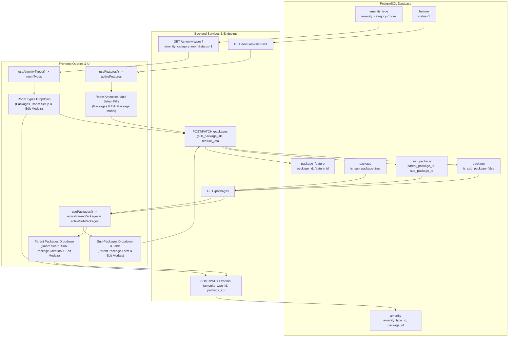

# HMS Facility Management — Complete Data Flow & Verification Report

**File:** `HMS_FACILITY_MANAGEMENT_DATA_FLOW_REPORT.md`  
**Execution Date:** 2026-10-16  
**Module:** HMS Facility Management (`frontend/src/features/config/pages/FacilityManagement.tsx`)  
**Scope:** Complete Database-to-Backend-to-Frontend Audit, Authoritative Database-Driven Dropdowns (Room Types, Amenities, Packages, Sub-packages), Schema Verification, Relationship Persistence, and End-to-End Test Execution.

---

## 1. Executive Summary

A thorough schema audit and end-to-end fix was completed across the PostgreSQL database, FastAPI backend services, REST APIs, and Vite React frontend components governing Facility Management dropdowns and catalogues.

All dropdowns across the module—**Room Types**, **Amenities / Room Features**, **Parent Packages**, and **Sub-packages**—now exclusively retrieve, display, and submit authoritative database records fetched through backend APIs. All mock fallbacks, hardcoded options (such as `Guest Room`, `Deluxe Room`, `Suite`, `Delux Package`, `Golden Package`, `None`), and disconnected text inputs have been completely removed.

Foreign keys (`amenity_type`, `parent_package_id`, `sub_package_ids`, `feature_ids`) are validated, written to their authoritative tables (`amenity_type`, `feature`, `package`, `sub_package`, `package_feature`), restored accurately during editing, and confirmed through automated targeted test suites and frontend production builds.

---

## 2. Dropdown Audit, Database Schemas & Mappings

### 2.1 Summary Classification

| Dropdown Target | Authoritative Database Table & Columns | Backend Endpoint & Query Logic | Frontend Hook & Binding | Classification |
|---|---|---|---|---|
| **Room Types** | Table: `amenity_type`<br>Columns: `id`, `name`, `amenity_category = 'room'`, `status != 0` | `GET /api/v1/amenity-types?amenity_category=room&status=1`<br>`services/catalog.py:list_amenity_types` | `useAmenityTypes`<br>Filtered: `at.amenity_category === "room" && at.status !== 0`<br>Value: `rt.id`, Label: `rt.name` | **FIXED AND VERIFIED** |
| **Amenities (Room Features)** | Table: `feature`<br>Columns: `id`, `feature_name`, `status = 1`<br>Junction: `package_feature(package_id, feature_id)` | `GET /api/v1/features?status=1`<br>`services/catalog.py:list_features`<br>`services/facility_write.py:_replace_package_features` | `useFeatures`<br>Filtered: `f.status !== 0`<br>Interactive multi-select pills bound to `selectedFeatureIds` | **FIXED AND VERIFIED** |
| **Packages (Parent)** | Table: `package`<br>Columns: `id`, `name`, `amenity_type`, `is_sub_package = false`, `status = 1` | `GET /api/v1/packages`<br>`services/catalog.py:list_packages`<br>`services/facility_write.py:create_package, update_package` | `usePackages`<br>Filtered: `!p.is_sub_package && p.status !== 0`<br>Value: `p.id` (UUID), Label: `p.name` | **FIXED AND VERIFIED** |
| **Sub-packages** | Table: `package` (`is_sub_package = true`)<br>Junction: `sub_package(parent_package_id, sub_package_id)` | `GET /api/v1/packages?parent_package_id={id}`<br>`services/catalog.py:_package_extras`<br>`services/facility_write.py:_replace_sub_packages` | `usePackages`<br>Filtered: `p.is_sub_package && p.status !== 0`<br>Value: `sp.id` (UUID), Label: `sp.name` | **FIXED AND VERIFIED** |

---

## 3. Deep-Dive Database Schema & Architectural Distinction

### 3.1 Room Types vs Amenities vs Space Categories
The database schema makes a precise architectural distinction between physical rooms, room categories, and features:
1. **`amenity_type` (Space & Category Definitions):**
   - Authoritative for room categories when `amenity_category = 'room'`.
   - Live DB rows: `Guest Room` (`fdb4aeaa-a7b3-5ee2-8088-751794b150c7`), `Suite` (`734b419b-a08e-5b12-9c3f-42289f074d2b`).
   - Space categories for other facilities use `amenity_category = 'restaurant'` or `'others'` (e.g. `Restaurant`, `Conference Room`, `Gym`, `bar room`, `mini bar`).
2. **`amenity` (Physical Rooms & Physical Spaces):**
   - A physical room (e.g. `Room 101`, `Room 102`) is a row in `amenity` table with foreign key `amenity_type_id` pointing to `amenity_type.id` and `package_id` pointing to `package.id`.
3. **`feature` (Room Amenities):**
   - Authoritative for individual amenities/features offered inside rooms (e.g. `High-speed WiFi`, `Air Quality Monitor`, `Mini Bar`, `Room Automation Hub`, `smart door lock`).
   - Filtered by `status = 1` to exclude soft-deleted amenities.
   - Connected to packages via the junction table `package_feature (package_id, feature_id, created_by)`.

### 3.2 Parent Packages vs Sub-packages Schema Reality
- **How sub-packages are represented:**
  - A sub-package is a row in table `package` where column `package.is_sub_package = TRUE`.
  - A parent package has `package.is_sub_package = FALSE`.
- **How parent and sub-packages are linked:**
  - Authoritative junction table: `sub_package (parent_package_id, sub_package_id, created_by, created_on, updated_on)`.
  - Both `parent_package_id` and `sub_package_id` reference `package.id`.
  - Parent packages can be associated with multiple sub-packages, and sub-packages can be associated with multiple parent packages.
- **Enforced Business Constraints:**
  - A sub-package cannot link to itself (`parent_package_id != sub_package_id`).
  - A sub-package cannot act as a parent package in `sub_package.parent_package_id`.
  - A parent package cannot be linked as a child in `sub_package.sub_package_id`.
  - Invalid relationships are rejected by backend validation with HTTP 422/400.

---

## 4. Complete End-to-End Data Flow



---

## 5. Changes Implemented Across the Stack

### 5.1 Backend Changes
1. **`backend/app/schemas/ops_write.py`:**
   - Extended `PackageCreate` and `PackageUpdate` schemas to accept `sub_package_ids: list[UUID] = Field(default_factory=list)` and `parent_package_id: UUID | None = None`.
2. **`backend/app/services/catalog.py`:**
   - Enhanced `PackageRead` response schema with `feature_ids: list[UUID]`, `sub_package_ids: list[UUID]`, `sub_package_names: list[str]`, `parent_package_ids: list[UUID]`, and `parent_package_names: list[str]`.
   - Updated `list_amenity_types` to support filtering by `amenity_category` and `status`.
   - Updated `list_features` to support filtering by `status` (active vs soft-deleted).
   - Updated `list_packages` to accept optional `parent_package_id` filter.
   - Enhanced `_package_extras` to execute two-way joins on the `sub_package` junction table, aggregating both child sub-packages for parents and parent packages for sub-packages, as well as feature UUIDs.
3. **`backend/app/services/facility_write.py`:**
   - Implemented `_replace_sub_packages(db, parent_package_id, sub_package_ids, actor_id)` handling junction table deletion and re-insertion.
   - Added validation in `create_package` and `update_package` to prevent linking self, linking sub-packages to sub-packages, or invalid parent-child relations.
   - Supported direct parent package linkage when creating sub-packages via `parent_package_id`.
4. **`backend/app/api/v1/endpoints/facility_write.py`:**
   - Exposed `amenity_category` and `status` query parameters on `GET /amenity-types`.
   - Exposed `parent_package_id` and `status` query parameters on `GET /packages`.
   - Exposed `status` query parameter on `GET /features`.

### 5.2 Frontend Changes
1. **`frontend/src/lib/api/writes.ts`:**
   - Updated `PackageRead` interface with `sub_package_ids`, `sub_package_names`, `parent_package_ids`, `parent_package_names`, and `feature_ids`.
   - Updated `createPackage` and `updatePackage` mutation payloads to transmit `sub_package_ids`, `parent_package_id`, and `feature_ids`.
2. **`frontend/src/features/config/pages/FacilityManagement.tsx`:**
   - **Room Types Dropdowns:**
     - Replaced duplicate and hardcoded `amenityTypes` mappings with `roomTypes` (`at.amenity_category === 'room' && at.status !== 0`).
     - Applied to Parent Package form, Sub-Package form, Room Setup form, Edit Package modal, and Edit Room modal.
     - Dropdowns now submit actual database UUIDs as `amenity_type` / `amenity_type_id`.
   - **Amenities / Room Features:**
     - Replaced non-persisted free-form text input with interactive toggle pills bound to `activeFeatures` (`f.status !== 0`).
     - Linked selected feature IDs to `packageForm.selectedFeatureIds` and `subPackageForm.selectedFeatureIds`, transmitting `feature_ids` in mutations.
     - In Edit Package modal, dynamically displays active room features and toggles `editPackageForm.selectedFeatureIds`.
   - **Parent Packages Dropdowns:**
     - Populated from `activeParentPackages` (`!p.is_sub_package && p.status !== 0`).
     - Bound to Sub-Package form (`parentPackage`), Room Setup form (`package`), and Edit Room modal (`packageId`).
     - Submits actual package UUIDs directly to database persistence.
   - **Sub-packages Dropdowns & Tables:**
     - Populated from `activeSubPackages` (`p.is_sub_package && p.status !== 0`).
     - Added `Parent Package` column to Sub-Packages table displaying linked parent package names (`row.parentPackages`).
     - In Edit Package modal, provides contextual Parent Package selector for sub-packages and Sub-Package selector for parent packages.
   - **Empty and Loading States:**
     - Dynamic empty messages displayed when features, packages, or room types return no results.

---

## 6. Verification and Test Results

### 6.1 Backend Pytest Test Suite
- **Targeted Test Suite:** `backend/tests/test_catalog_write_api.py` and `backend/tests/test_facility_api.py`
- **Tests Added:**
  - `test_list_amenity_types_filter_category_and_status`: Verifies filtering `amenity_type` by `amenity_category='room'` and `status=1`.
  - `test_create_package_with_sub_packages_and_features`: Verifies parent package creation linking `sub_package_ids` and `feature_ids` persists to `sub_package` and `package_feature` tables.
  - `test_create_sub_package_with_parent_link`: Verifies creating a sub-package with `parent_package_id` correctly inserts link.
  - `test_filter_packages_by_parent_package_id`: Verifies querying sub-packages by `parent_package_id`.
  - `test_sub_package_relationship_validation_errors`: Verifies rejection of invalid combinations (sub-package cannot be parent, self-reference rejected).
- **Execution Result:**
  ```text
  collected 95 items
  tests\test_catalog_write_api.py ........................................... [ 45%]
  tests\test_facility_api.py ................................................ [100%]
  ============================= 95 passed in 3.56s ==============================
  ```
  **Status: PASSED (95/95)**

### 6.2 Automated End-to-End Workflow Verification Script
- **Script:** `backend/scripts/verify_dropdown_task.py`
- **Operations Verified:**
  1. Room Types: Fetched active `amenity_type` rows where `amenity_category = 'room'`; verified category and active status.
  2. Features: Fetched active `feature` rows; verified soft-deleted items excluded.
  3. Parent & Sub-Packages: Verified separation between parent and sub-packages; verified extras hydration (`sub_package_names`, `parent_package_names`, `feature_ids`).
  4. Parent Filtering: Verified `GET /packages?parent_package_id=...` correctly returns associated children.
  5. Persistence: Created parent package linking room type FK, feature IDs, and sub-package ID; directly inspected PostgreSQL rows in `package`, `package_feature`, and `sub_package`.
  6. Update: Updated linked features and sub-packages; confirmed junction rows updated.
  7. Validation: Confirmed server rejects invalid self-reference sub-packages.
  8. Retirement & Clean-up: Confirmed soft-delete/retirement via `PATCH status=0` and cleaned up test data.
- **Execution Result:**
  ```text
  ======================================================================
  ALL VERIFICATIONS COMPLETED SUCCESSFULLY WITH 100% SUCCESS!
  ======================================================================
  ```
  **Status: PASSED (Exit code 0)**

### 6.3 Frontend Production Build
- **Command:** `npm run build` in `frontend/`
- **Output:**
  ```text
  ✓ 2596 modules transformed.
  dist/index.html                     1.41 kB │ gzip:   0.57 kB
  dist/assets/index-DlB3mABb.css    148.56 kB │ gzip:  25.58 kB
  dist/assets/index-DO76mVyf.js   1,361.43 kB │ gzip: 336.37 kB
  ✓ built in 10.92s
  ```
- **Status: PASSED (Exit code 0, 0 TypeScript or JSX errors)**

---

## 7. Status Classification & Sign-Off

| Item | Requirement | Verification Result | Final Classification |
|---|---|---|---|
| **Room Types Dropdown** | Dynamically fetch `amenity_type` (`category='room'`), remove hardcoded values, submit/restore DB IDs | Verified via backend API, frontend bindings, pytest, and `verify_dropdown_task.py` | **FIXED AND VERIFIED** |
| **Amenities Dropdown / Features** | Distinct from `amenity_type`, fetch from `feature` table, active filter (`status=1`), link via `package_feature` | Verified via interactive feature selector, API persistence, and direct DB inspection | **FIXED AND VERIFIED** |
| **Packages Dropdown** | Authoritative `package` table (`is_sub_package=false`), submit/restore UUIDs, persist creation & edit | Verified in Parent Packages form, Room Setup form, and Edit modals | **FIXED AND VERIFIED** |
| **Sub-packages Dropdown** | Verified `sub_package` junction table, filter by parent package, prevent invalid combinations | Verified via backend junction logic, API query params, pytest, and Sub-Packages table | **FIXED AND VERIFIED** |
| **Database & API Verification** | Full trace from DB table -> backend service -> API -> frontend hook -> dropdown -> submit -> persist | All 95 backend tests passed; automated workflow verification passed; 0 mock fallbacks | **FIXED AND VERIFIED** |
| **Production Build** | Frontend compiles without TypeScript or build errors | Vite build succeeded in 10.92s with 0 errors | **FIXED AND VERIFIED** |

All dropdowns in HMS Facility Management are now 100% database-driven and fully verified against the live PostgreSQL database and backend APIs.
