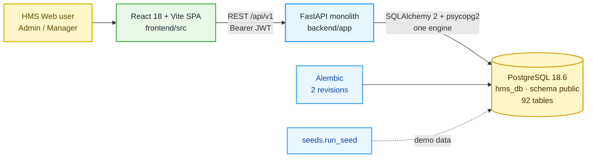

# HMS Database — Current State Audit

**Audit date:** 2026-10-10 · **Branch:** `feature/current-ui` @ `be47396` · **Scope:** analysis only. No code, schema, migration, configuration or data was changed.

## 0. How to read this document

| Label | Meaning |
|---|---|
| **[RUNTIME]** | Confirmed against the live local database in a read-only session (`default_transaction_read_only = on`, confirmed by `SHOW transaction_read_only` → `on`) |
| **[CODE]** | Read from the repository. This is code-defined behaviour and was not exercised at runtime |
| **[DOC]** | Stated in a project document. It is not evidence that the code does it |
| **[NOT VERIFIED]** | Could not be checked. The reason is given |

Probe method: two read-only Python scripts run with the backend's own virtualenv and settings loader (`app.core.config.settings`). They only queried `information_schema` and `pg_catalog`, ran `count(*)` and ran aggregate `GROUP BY` queries. **No credential value, password hash, guest name, e-mail or phone number was read into this report.** The scripts are not part of the repository.

---

## 1. Project architecture (as found)

| Layer | Finding | Evidence |
|---|---|---|
| Frontend | Vite + React + TypeScript + shadcn-ui. 17 routed modules. API client in `frontend/src/lib/api/*`. The dev server proxies `/api/v1` | [CODE] `frontend/src/App.tsx`, `frontend/src/core/rbac/modules.ts`, `frontend/src/lib/api/client.ts` |
| Backend | One FastAPI application. 20 endpoint modules aggregated in one router. About 150 REST operations | [CODE] `backend/app/main.py`, `backend/app/api/v1/router.py`; [RUNTIME] route table enumerated from `app.main.app.routes` |
| Layering | endpoint → service (`app/services/*.py`; writes in `*_write.py`) → SQLAlchemy model → PostgreSQL. There is no repository layer. Services query the ORM directly | [CODE] `backend/app/services/` |
| ORM | SQLAlchemy 2.0.52 declarative `Base` with a naming convention and three PK tiers (SMALLINT lookup / UUID entity / BIGINT identity log) | [CODE] `backend/app/db/base.py` |
| Driver | `psycopg2-binary` 2.9.11 only. **No MySQL driver** (`pymysql`, `mysqlclient`, `aiomysql`) in `requirements.txt` | [CODE] `backend/requirements.txt` |
| Migrations | Alembic, 2 revisions: `0e2687233b59` (92-table foundation) → `7c4e2b9a1d53` (rename service status) | [CODE] `backend/migrations/versions/` |
| Seeds | `python -m seeds.run_seed`, 11 steps (reference, facility, people, rooms, devices, telemetry, alerts, stays, services, operations, activity) | [CODE] `backend/seeds/` |
| Tests | 22 test modules, 691 `def test_` functions. They need a freshly seeded live database, and several POST/PATCH through the write API | [CODE] `backend/tests/`, `RUN_REPORT.md` §8 |
| Containers | **No Dockerfile or docker-compose file** in the repository. Docker Desktop is installed on the machine, but its service is **Stopped** and was not started | [CODE] file search; [RUNTIME] `Get-Service` |

## 2. Database configuration

| Item | Value | Evidence |
|---|---|---|
| Settings loader | `pydantic-settings`, `env_file=".env"` (relative to the working directory, i.e. `backend/`) | [CODE] `backend/app/core/config.py` |
| Variables | `POSTGRES_USER`, `POSTGRES_PASSWORD`, `POSTGRES_HOST`, `POSTGRES_PORT`, `POSTGRES_DB`, `POSTGRES_SCHEMA`, optional `DATABASE_URL` override | [CODE] `config.py`; `backend/.env` holds these 6 keys plus `APP_*` and `JWT_*` (**values not read into this report**) |
| URL builder | `postgresql+psycopg2://…@HOST:PORT/DB`; `DATABASE_URL` wins when set (it is **not** set locally) | [CODE] `Settings.sqlalchemy_url`; [RUNTIME] |
| Engine | One global engine, `pool_pre_ping=True`, SQL echo when `DEBUG` and `APP_ENV=development` | [CODE] `backend/app/db/session.py` |
| Session | Request-scoped `get_db()` exposed as `DbSession` | [CODE] `backend/app/api/deps.py` |
| Transactions | `writes.transaction()` gives one commit per request and a rollback on any error | [CODE] `backend/app/services/writes.py` |
| Schema pinning | `public` is left unqualified. Any other value is pinned on `MetaData(schema=…)` | [CODE] `backend/app/db/base.py` |
| Frontend | `VITE_API_BASE_URL`, `VITE_API_PROXY_TARGET` (values not read) | [CODE] `frontend/.env.local` keys |

**Databases configured in code: exactly one (PostgreSQL `hms_db`). There is no second connection, no MySQL configuration and no outbound API client to an OSS/FleetExplorer service.** [CODE]

## 3. Live database verification

### 3.1 Server and reachability [RUNTIME]

| Check | Result |
|---|---|
| Reachable with the configured settings | **Yes** |
| Engine and version | **PostgreSQL 18.6** (x86_64-windows, MSVC build), port 5432 |
| Other local PostgreSQL services | Windows services `postgresql-x64-17` and `postgresql-x64-18` are both **Running**. Only 5432 was probed, and it answered as 18.6 |
| Documented version | `RUN_REPORT.md` and `backend/docs` say **16.12**; the v3 target says **16 + TimescaleDB**. **Mismatch** (see register B-11) |
| Databases on this server | `hms_db`, `postgres`, and one unrelated database (`Insight-flow`), which **was not inspected** |
| Schemas in `hms_db` | `public` only (no `oss`, `bss` or `platform` schema) |
| Extensions | `plpgsql` only. **TimescaleDB is not installed** |
| Alembic | `alembic_version` = `7c4e2b9a1d53` = repository head |
| MySQL | **No MySQL/MariaDB Windows service, and nothing listening on 3306/33060.** The BSS database does not exist locally |

### 3.2 Objects [RUNTIME]

| Object | Count | Notes |
|---|---:|---|
| Base tables | 93 | 92 application tables + `alembic_version` |
| Columns | 922 | |
| Primary keys | 93 | |
| Foreign keys | 240 | All inside `public` |
| Unique constraints | 76 | |
| NOT NULL (`n`) constraints | 543 | PG 18 catalogs NOT NULL as constraints |
| Indexes | 352 | |
| ENUM types | 34 | e.g. `stay_status`, `role_type`, `device_health_status` |
| Views / materialised views | **0 / 0** | The v3 views `v_occupancy_dashboard`, `v_smart_rooms_summary` and `v_overdue_checkouts` do not exist |
| Triggers | **0** | |
| Functions / procedures in `public` | **0** | |
| Tables with a `oss_` / `bss_` / `platform_` prefix | **0** | |

### 3.3 Repository schema vs live schema [RUNTIME]

The ORM metadata (`app.models` → `Base.metadata`) was compared to the live catalog.

| Comparison | Result |
|---|---|
| ORM tables missing from the database | none |
| Database tables missing from the ORM (excluding `alembic_version`) | none |
| Column-name drift per table | **none** (0 tables differ) |

The live schema matches the code. Type-level and index-level drift was not compared column by column. `alembic check` was **not** run, because it opens a migration context; the read-only probe was preferred.

### 3.4 Data profile [RUNTIME — aggregates only]

- **1,805 rows in total. All 92 tables are non-empty.** This is seed/demo-scale data.
- **1 organisation, 1 facility** (demo hotel). Roles span exactly 1 facility.
- `app_user`: 15 accounts (8 `is_staff = 1`, 7 `is_staff = 0` guests). **1 account has a usable password credential**; the rest carry the seed sentinel (see `RUN_REPORT.md` §5).
- `role`: 7 (`admin` 1, `manager` 1, `staff` 3, `guest` 1, `system_user` 1).
- `amenity`: 27 (24 `room`, 1 `restaurant`, 2 `others`). Room status: 21 Available, 3 Occupied, 1 Allotted, 2 Unavailable.
- `stay`: 7 (4 checked out, 2 cancelled, 1 active).
- `device`: 14 (10 Active, 4 Inactive). **20 of 24 rooms have no device mapped** (`device.amenity_id`).
- `device_stat`: 504 rows, all on a single day (2026-08-17). It is not a hypertable.
- `role_module`: **18** modules, including `firmware_management`, which the frontend no longer routes. The frontend declares 17.
- The longest `amenity.name` in use is 6 characters, and **the live column is `varchar(6)`** (see the comparison doc, F-S10).

**The data is demo/seed data. No evidence of production data was found locally.** Whether any other environment (staging or a customer) holds real data **could not be verified** from this machine.

### 3.5 Table inventory [RUNTIME counts, CODE grouping]

| ORM module | Table | Rows | Cols | FKs | Indexes | PK |
|---|---|---:|---:|---:|---:|---|
| `access.py` | `access_key` | 5 | 13 | 6 | 6 | (id) |
| `access.py` | `key_type` | 4 | 4 | 0 | 1 | (id) |
| `access.py` | `lock_activity_log` | 5 | 13 | 6 | 6 | (id) |
| `access.py` | `user_device_acl` | 5 | 14 | 7 | 9 | (id) |
| `activity.py` | `activity` | 10 | 13 | 5 | 6 | (id) |
| `activity.py` | `activity_notifier` | 15 | 7 | 2 | 5 | (activity_id, app_user_id) |
| `activity.py` | `activity_role_association` | 34 | 4 | 2 | 2 | (activity_type_id, role_id) |
| `activity.py` | `activity_type` | 22 | 7 | 1 | 2 | (id) |
| `activity.py` | `entity_type` | 5 | 4 | 0 | 1 | (id) |
| `activity.py` | `notification` | 6 | 9 | 1 | 5 | (id) |
| `activity.py` | `notification_receiver` | 6 | 11 | 2 | 4 | (id) |
| `activity.py` | `notification_result` | 6 | 9 | 1 | 5 | (id) |
| `activity.py` | `notification_template` | 16 | 7 | 0 | 3 | (id) |
| `alert.py` | `alert_type` | 16 | 4 | 0 | 1 | (id) |
| `alert.py` | `device_alert` | 9 | 10 | 4 | 6 | (id) |
| `alert.py` | `device_incident` | 5 | 14 | 8 | 10 | (id) |
| `alert.py` | `incident_event` | 5 | 4 | 0 | 1 | (id) |
| `alert.py` | `incident_history` | 14 | 8 | 3 | 4 | (id) |
| `alert.py` | `incident_status` | 4 | 4 | 0 | 1 | (id) |
| `alert.py` | `value_alert` | 3 | 16 | 5 | 8 | (id) |
| `alert.py` | `value_alert_limit_config` | 4 | 16 | 2 | 5 | (id) |
| `amenity.py` | `amenity` | 27 | 15 | 7 | 7 | (id) |
| `amenity.py` | `amenity_condition` | 4 | 4 | 0 | 1 | (id) |
| `amenity.py` | `amenity_condition_status` | 13 | 5 | 2 | 2 | (amenity_id, amenity_condition_id) |
| `amenity.py` | `amenity_status` | 4 | 4 | 0 | 1 | (id) |
| `amenity.py` | `amenity_type` | 5 | 10 | 3 | 3 | (id) |
| `amenity.py` | `feature` | 6 | 10 | 3 | 3 | (id) |
| `amenity.py` | `package` | 8 | 12 | 4 | 3 | (id) |
| `amenity.py` | `package_feature` | 17 | 8 | 3 | 4 | (id) |
| `amenity.py` | `sub_package` | 7 | 5 | 3 | 2 | (parent_package_id, sub_package_id) |
| `device.py` | `battery_life_stat` | 12 | 9 | 1 | 3 | (id) |
| `device.py` | `command_type` | 10 | 5 | 1 | 2 | (id) |
| `device.py` | `device` | 14 | 28 | 7 | 9 | (id) |
| `device.py` | `device_command` | 7 | 9 | 3 | 4 | (id) |
| `device.py` | `device_current_stat` | 14 | 7 | 1 | 3 | (id) |
| `device.py` | `device_health_stat` | 168 | 7 | 1 | 4 | (id) |
| `device.py` | `device_param` | 35 | 7 | 1 | 2 | (id) |
| `device.py` | `device_stat` | 504 | 9 | 2 | 5 | (id) |
| `device.py` | `device_type` | 4 | 5 | 0 | 1 | (id) |
| `device.py` | `firmware` | 6 | 17 | 4 | 3 | (id) |
| `device.py` | `mqtt_broker` | 1 | 11 | 1 | 3 | (id) |
| `device.py` | `mqtt_topic` | 12 | 8 | 2 | 4 | (id) |
| `device.py` | `other_device` | 12 | 17 | 0 | 3 | (id) |
| `device.py` | `sensor_operation_stat` | 42 | 6 | 2 | 3 | (device_id, stats_date) |
| `facility.py` | `attachment` | 8 | 8 | 2 | 4 | (id) |
| `facility.py` | `country` | 239 | 9 | 0 | 2 | (id) |
| `facility.py` | `facility` | 1 | 19 | 4 | 4 | (id) |
| `facility.py` | `facility_user` | 13 | 6 | 3 | 2 | (facility_id, app_user_id) |
| `facility.py` | `organisation` | 1 | 7 | 1 | 3 | (id) |
| `facility.py` | `property` | 4 | 9 | 3 | 4 | (id) |
| `facility.py` | `property_chain` | 3 | 10 | 5 | 6 | (id) |
| `facility.py` | `property_type` | 1 | 9 | 2 | 3 | (id) |
| `job_order.py` | `job_order` | 3 | 15 | 2 | 5 | (id) |
| `job_order.py` | `job_order_amenity` | 4 | 4 | 2 | 2 | (job_order_id, amenity_id) |
| `job_order.py` | `job_order_device` | 2 | 4 | 2 | 2 | (job_order_id, device_id) |
| `maintenance.py` | `maintenance_request` | 3 | 25 | 8 | 8 | (id) |
| `maintenance.py` | `maintenance_request_amenity` | 6 | 8 | 3 | 4 | (id) |
| `maintenance.py` | `maintenance_request_assignee` | 4 | 8 | 3 | 4 | (id) |
| `maintenance.py` | `maintenance_request_recurrence` | 1 | 6 | 1 | 1 | (maintenance_request_id) |
| `marketing.py` | `facility_event` | 3 | 17 | 3 | 4 | (id) |
| `marketing.py` | `occasion` | 4 | 17 | 4 | 5 | (id) |
| `marketing.py` | `occasion_type` | 4 | 5 | 0 | 1 | (id) |
| `marketing.py` | `promo_code` | 3 | 16 | 2 | 5 | (id) |
| `marketing.py` | `promo_code_amenity` | 8 | 6 | 3 | 2 | (promo_code_id, amenity_id) |
| `people.py` | `app_user` | 15 | 29 | 6 | 10 | (id) |
| `people.py` | `department` | 5 | 9 | 2 | 3 | (id) |
| `people.py` | `job_function` | 5 | 9 | 2 | 3 | (id) |
| `people.py` | `role` | 7 | 10 | 2 | 3 | (id) |
| `people.py` | `role_module` | 18 | 6 | 0 | 1 | (id) |
| `people.py` | `role_module_permission` | 65 | 6 | 2 | 2 | (role_id, module_id) |
| `people.py` | `user_device` | 4 | 12 | 3 | 4 | (id) |
| `people.py` | `user_role` | 14 | 6 | 4 | 3 | (facility_id, app_user_id, role_id) |
| `people.py` | `user_token` | 3 | 8 | 1 | 4 | (id) |
| `reporting.py` | `daily_dual_data_point` | 35 | 7 | 1 | 2 | (metric_date, metric_type) |
| `reporting.py` | `energy_stat` | 72 | 7 | 2 | 3 | (device_name, facility_id, amenity_id, hour) |
| `scheduler.py` | `scheduler_job` | 5 | 9 | 0 | 3 | (id) |
| `scheduler.py` | `scheduler_job_execution` | 6 | 9 | 1 | 4 | (id) |
| `service.py` | `room_service_request` | 3 | 11 | 4 | 4 | (id) |
| `service.py` | `room_service_request_item` | 4 | 7 | 2 | 4 | (id) |
| `service.py` | `service_category` | 13 | 12 | 4 | 4 | (id) |
| `service.py` | `service_category_item` | 22 | 14 | 5 | 6 | (id) |
| `service.py` | `service_request` | 7 | 25 | 12 | 11 | (id) |
| `service.py` | `service_request_item` | 8 | 11 | 5 | 5 | (id) |
| `service.py` | `service_status` | 5 | 4 | 0 | 1 | (id) |
| `service.py` | `service_type` | 7 | 4 | 0 | 1 | (id) |
| `stay.py` | `import_job` | 3 | 14 | 1 | 3 | (id) |
| `stay.py` | `invoice` | 2 | 19 | 5 | 5 | (id) |
| `stay.py` | `room_allocation` | 6 | 9 | 4 | 5 | (id) |
| `stay.py` | `stay` | 7 | 21 | 4 | 7 | (id) |
| `stay.py` | `stay_package` | 6 | 7 | 2 | 4 | (id) |
| `stay.py` | `stay_user` | 8 | 10 | 4 | 5 | (id) |
| `stay.py` | `user_document` | 3 | 9 | 3 | 4 | (id) |

---

## 4. Application access to the database

### 4.1 Access path [CODE]

Every endpoint gets a `DbSession` and calls a service function that builds SQLAlchemy `select()` statements against the models. **All reads and writes, including device, telemetry and alert data, go straight to PostgreSQL from the HMS backend.** No code path calls another API for platform or device data.

### 4.2 API surface by module [CODE + RUNTIME route table]

| Area | Endpoints (prefix `/api/v1`) | RBAC module enforced | Tables touched (primary) |
|---|---|---|---|
| Health | `GET /health/version`, `GET /health/db` | none | `alembic_version` |
| Auth | `POST /auth/login`, `GET /auth/me` | token only | `app_user`, `user_role`, `role`, `role_module*`, `facility_user` |
| Facility tree | `GET /facilities`, `/properties`, `/buildings`, `/floors`, `/rooms` (+ `/{id}`); `PATCH /facilities/{id}`; `POST/PATCH /rooms` | `facility_management` | `facility`, `property`, `property_chain`, `amenity` |
| Room catalogue | `/amenity-types`, `/packages`, `/features` (GET/POST/PATCH) | `facility_management` | `amenity_type`, `package`, `sub_package`, `feature` |
| Users and RBAC | `/users`, `/roles`, `/modules`, `/permissions`, `/departments`, `/job-functions`; user activate/deactivate/password; `PUT /roles/{id}/permissions` | `user_roles`, `employees` | `app_user`, `role`, `user_role`, `role_module`, `role_module_permission`, `department`, `job_function` |
| Bookings / stays | `GET/POST /stays`, `PATCH /stays/{id}`, `check-in`, `check-out`, `extend`, `status`, `cancel`, `documents/approval`, room allocations, occupants | `bookings` | `stay`, `room_allocation`, `stay_user`, `amenity.status`, `user_document` |
| Invoices | `GET /invoices` (read only) | `bookings` | `invoice` |
| Occupancy | `GET /occupancy`, `PATCH /occupancy/{amenity_id}`, `PUT …/conditions`, `/amenity-statuses`, `/amenity-conditions` | `occupancy` | `amenity`, `amenity_status`, `amenity_condition*` |
| Service tracking | `/service-requests` (GET/POST/PATCH/items/cancel) | `service_tracking` | `service_request`, `service_request_item` |
| Service setup | `/service-types`, `/service-statuses`, `/service-categories`, `/service-items` | `service_setup` | `service_*` lookups |
| Service planning | `/maintenance-requests` (GET/POST/PATCH/cancel/DELETE) | `service_planning` | `maintenance_request*` |
| Job orders | `/job-orders` (CRUD) | `job_order` | `job_order*` |
| Devices | `/device-types`, `/devices`, `/devices/{id}/health`; commission/decommission/maintenance | `caleido_network` | `device`, `device_type`, `device_health_stat` |
| Alerts | `/alert-types`, `/alerts`, `/incidents`, `/value-alerts`, `PATCH /incidents/{id}`, `/limit-configs` | `caleido_network` | `device_alert`, `device_incident`, `value_alert*` |
| Telemetry | `/device-params`, `/device-stats`, `/device-current-stats`, `/other-device-readings` | `caleido_network` | `device_param`, `device_stat`, `device_current_stat`, `other_device` |
| Energy / KPI | `/energy-stats`, `/energy-stats/summary`, `/daily-data-points` (+ `/summary`) | `reports` | `energy_stat`, `daily_dual_data_point` |
| Marketing | `/offers`, `/events`, `/holidays` | `offers`, `events`, `holidays` | `promo_code*`, `facility_event`, `occasion*` |
| Notifications | `/notification-templates`, `/notifications`, `/activities` | `dashboard` | `notification*`, `activity` |
| Reports | `GET /reports`, `/reports/{key}`, `/reports/{key}/export.xlsx` — 9 reports: occupancy, employee, room-status, booking, ticket, housekeeping, sanitization, alert, energy | `reports` | read projections of the above |

### 4.3 Authentication and authorization [CODE]

| Aspect | Current behaviour | Evidence |
|---|---|---|
| Identity store | `app_user` holds staff **and** guests (`is_staff` 0/1). There is no separate guest table | `backend/app/models/people.py`; `stays_write.py` docstring |
| Login | Username/password, bcrypt, HS256 JWT signed with `JWT_SECRET_KEY`, 60-minute expiry | `app/services/auth.py`, `app/core/security.py` |
| Platform gate | Only `role.role_type ∈ {admin, manager}` may use HMS Web. Staff, guest and `system_user` are refused | `app/core/platform.py` |
| Per-request reload | Roles and permissions are re-read from the database on every request; the token carries only the subject | `app/api/deps.py::get_current_user` |
| Module RBAC | `require_permission(module, read/write)` against `role_module_permission` | `app/api/deps.py`; router-level `dependencies=` in every endpoint module |
| Modules not enforced | `tickets` and `default_key` exist in `role_module` but **no backend router enforces them**. The Tickets page calls `/service-requests` (gated by `service_tracking`); Key Settings has **no endpoint** (`NoEndpointNotice`) | grep of `require_permission`; `frontend/src/features/devices/pages/KeySettings.tsx` |
| Facility scoping | `AuthenticatedUser.facility_ids` is computed, but **read endpoints accept an optional `facility_id` filter and do not restrict results to the caller's facilities**. Writes use `default_facility_id()` | `app/api/v1/endpoints/stays.py`, `occupancy.py`, `devices.py`; `access_write.py` |
| Token storage (browser) | `localStorage` | `frontend/src/lib/api/client.ts` |
| Module registry | `role_module` (18 rows) / `role_module_permission` (65 rows). **No `platform_modules`, `platform_permissions` or `platform_role_permissions`** | [RUNTIME] |

### 4.4 Business workflows present [CODE]

| Workflow | Implemented? | Notes |
|---|---|---|
| Booking create / amend / cancel | Yes, as `stay` | There is **no reservation table, rate, availability calendar or price**. `stays_write.py` states "There is no guest table and no booking table" |
| Room allocation, double-booking guard | Yes | 409 when a room is held by a stay that has not checked out (`_assert_room_free`) |
| Check-in / check-out | Yes, single transaction | Sets `amenity.status` Occupied / Available |
| Checkout → housekeeping | **No** | `check_out()` docstring: the room condition is deliberately not touched |
| Housekeeping | Partial | Modelled as `maintenance_request` of type `scheduled` / `planned`, plus `amenity_condition_status`. There is no housekeeping task entity |
| Maintenance | Yes | `maintenance_request` + amenity/assignee/recurrence. **No link to `device_alert`** |
| Device incidents | Yes | `device_incident.latest_alert_id → device_alert.id` |
| Invoicing | Read only | `stays_write.py`: generation not implemented (no tariff, rate or tax data) |
| Payments, folios, loyalty, channels, rate plans | **Absent** | |
| Sustainability / carbon | **Absent** | Only raw `energy_stat` kWh by room and hour, plus the Caleido KPIs in `daily_dual_data_point` |
| Audit trail of writes | **Absent** | Only `created_by` / `modified_by` columns. No service writes `activity` rows (grep for `Activity(` in services returns nothing) |
| Scheduler / background jobs | Schema only | `scheduler_job*` tables exist and are seeded; no service or endpoint uses them |

## 5. Checks not performed, and why

| Check | Reason |
|---|---|
| Any MySQL / BSS inspection | No MySQL server or configuration exists locally |
| OSS / FleetExplorer API reachability | No URL, client or contract exists in the repository; nothing to call |
| `pytest` run | The suite writes through the API, and it needs a freshly re-seeded database. Running it would modify `hms_db`, which this task forbids |
| `alembic check` / `alembic current` | Not needed: the version table was read directly, and ORM drift was compared from metadata |
| Index and type drift per column | Out of proportion to the finding. Name-level drift is zero, and the schema is generated by the same models |
| Other databases on the server (`Insight-flow`) | Not part of HMS; deliberately not inspected |
| PostgreSQL 17 service contents | Not referenced by any HMS configuration |
| Non-local environments | Not accessible from this workstation |
