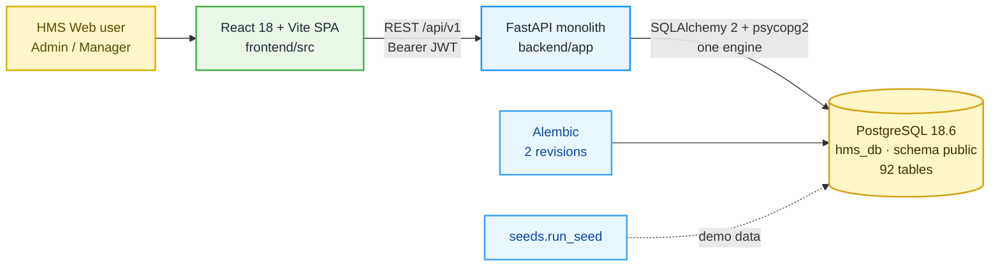
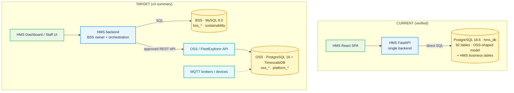
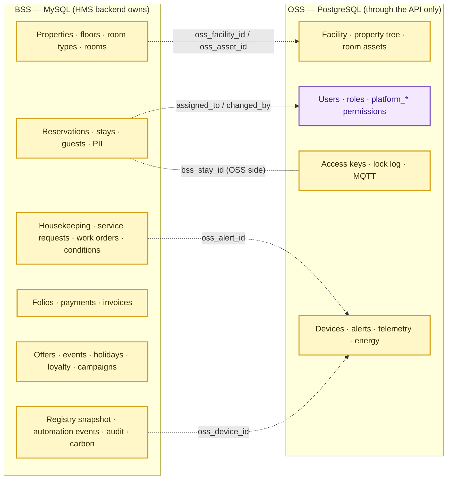
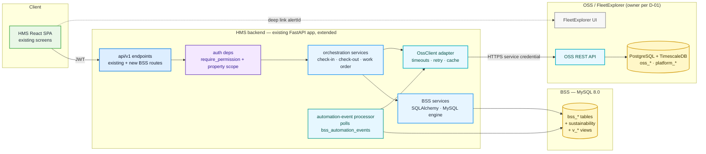
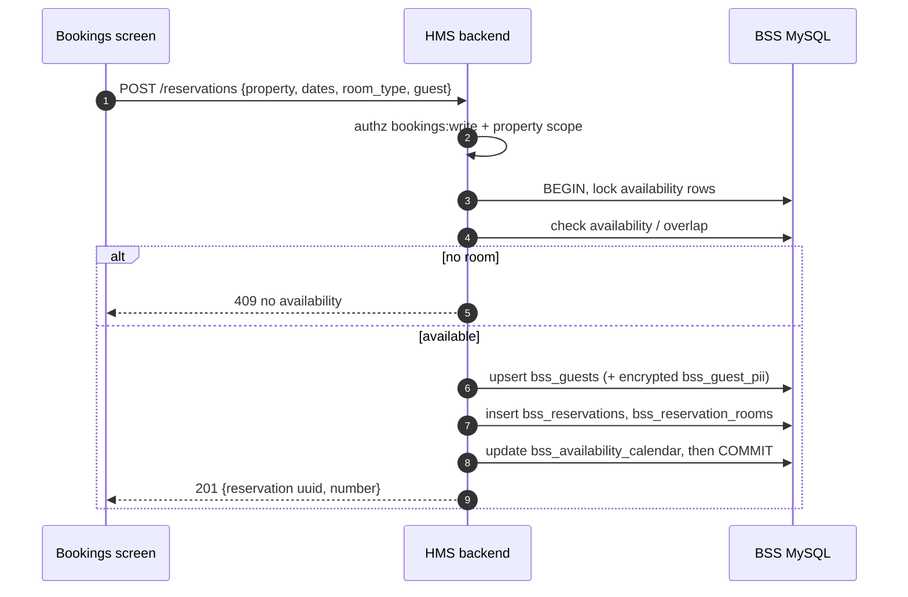
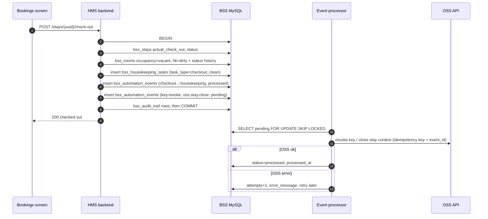
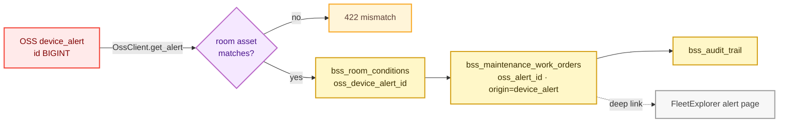
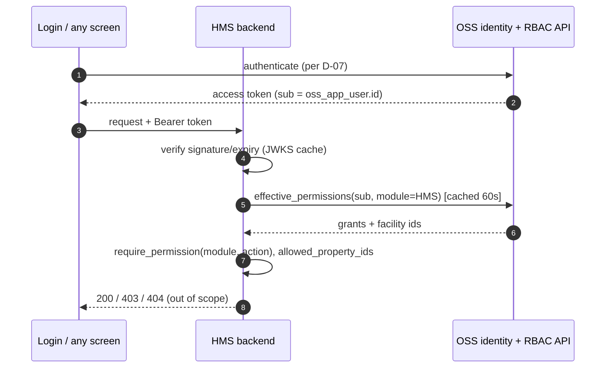

# HMS Local Database Audit & OSS/BSS Platform Integration Analysis — Consolidated Report

**Date:** 2026-10-10 · **Repository:** ACX-Platform, branch `feature/current-ui` · **Type:** analysis only. No application code, schema, migration, configuration or data was changed.

This report concatenates the seven documents in `docs/hms-integration-analysis/`, in reading order:

1. HMS_EXECUTIVE_SUMMARY.md
2. HMS_DATABASE_CURRENT_STATE.md
3. HMS_OSS_BSS_SCHEMA_COMPARISON.md
4. HMS_MODULE_DATABASE_MAPPING.md
5. HMS_PLATFORM_INTEGRATION_APPROACH.md
6. HMS_GAP_AND_BLOCKER_REGISTER.md
7. HMS_INTEGRATION_TEST_PLAN.md

# HMS → OSS/BSS Integration — Executive Summary

**Date:** 2026-10-10 · **For:** project manager and technical lead · **Type:** analysis only. Nothing in the application or the database was changed.

## The short version

- **Today HMS runs on one PostgreSQL database.** The target in the v3 architecture uses **two**: PostgreSQL for the platform (OSS) and MySQL for the hotel business (BSS). **The BSS database, its 54 business tables, the new permission model and the API link to the platform do not exist yet.**
- **A good part of the platform side already exists and can be reused.** The current database already holds almost every table the v3 summary lists for OSS, under names without the `oss_` prefix. The current backend already has about 70 read/write APIs for facilities, rooms, users, roles, devices, alerts and telemetry.
- **The business side is mostly new.** HMS has bookings, check-in/out, service requests, maintenance, offers, events and holidays. It has **no** rates, availability calendar, guest profiles, folios, payments, loyalty, channels or sustainability.
- **One question blocks everything:** is the OSS the separate **FleetExplorer** platform with its own API, or does the current HMS database become the OSS? Neither the repository nor this machine contains a FleetExplorer API, address or contract.

## What was actually found (verified)

| Item | Finding |
|---|---|
| Databases | **1**: PostgreSQL **18.6**, database `hms_db`, schema `public`, 92 tables, Alembic at the latest revision. The docs say version 16 |
| MySQL | **None** on this machine, and no MySQL code in the project |
| TimescaleDB | Not installed |
| Data | **Demo seed data only**: 1 hotel, 24 rooms, 14 devices, 7 bookings, 15 user accounts, 1,805 rows in total |
| Code vs database | **Match exactly** (no missing tables or columns) |
| How HMS reads data | The backend queries **all** data directly, including device and alert data. The v3 rule says platform data must come through an API |
| Security | Permissions are checked per screen module ✔. Data is **not** restricted to the user's own hotel ✘ (no impact today with one hotel). Guest contact details are stored unencrypted and returned by the users API ✘. Two modules (`tickets`, `default_key`) are not checked by the backend ✘ |

## Recommended approach

1. **Keep one HMS backend** and extend it rather than adding new services. It owns the new MySQL BSS database. It reaches platform data **only through an API adapter**, so the answer to the FleetExplorer question changes one component rather than the whole design.
2. **Write the business change and an "event" row together in MySQL.** A background step then calls the platform for side effects such as door keys and room context, with retries. A platform outage never loses a check-in or checkout.
3. **The dashboard reads one summary.** Room and device health come from a BSS snapshot, plus one cached platform call for alerts. Today it sends about 15 requests. Alerts link straight to FleetExplorer.
4. **Fix security before scaling to more hotels:** restrict data to the user's hotels, encrypt guest personal data with an access log, and check every module on the server.

## Decisions needed (top 5)

| # | Decision | Why it matters |
|---|---|---|
| D-01 | Who owns and serves the OSS platform (FleetExplorer vs the current HMS database)? | Everything platform-related depends on it |
| D-07 | Who issues logins/tokens, and how HMS staff are identified | Affects every screen |
| D-02 | Confirm the two-database target. An earlier internal document recommended one PostgreSQL database | Avoids teams building to different targets |
| B-25 | Which of the 54 BSS tables are in the first release (rates? folios? loyalty?) | Most have no screen today; it drives cost |
| D-14 / B-18 | Obtain the machine-readable schema export, and fix the ID-type mismatches in the diagram | The diagram image cannot be built from safely |

## Proposed sequence

| Phase | Outcome |
|---|---|
| 1. Baseline | This audit accepted; a clean test baseline recorded |
| 2. Ownership and schema | Decisions signed; corrected schema export |
| 3. API contracts | Agreed platform API and BSS API definitions |
| 4. Backend build | MySQL BSS, platform adapter, check-in/out, housekeeping and work-order flows, security fixes |
| 5. Screens | Bookings, Occupancy, Dashboard and Service Planning moved to the new sources |
| 6. Testing | Integrity, security, failure and regression testing |
| 7. Go-live readiness | Rollback by feature flag, runbooks, sign-off |

**No effort estimate is given yet.** That needs the D-01 answer, the first-release scope, the team size and the MySQL hosting model.

## What could not be checked

MySQL/BSS (it does not exist here), the FleetExplorer API (no address or contract), other environments' data, and the existing automated tests (they modify the database, which this audit was not allowed to do).

## Documents

Current state · Schema comparison · Module mapping · Integration approach and roadmap · Gap and blocker register · Test plan · Consolidated: `HMS_INTEGRATION_ANALYSIS_REPORT.md` / `.pdf`

# HMS Database — Current State Audit

**Audit date:** 2026-10-10 · **Branch:** `feature/current-ui` @ `be47396` · **Scope:** analysis only. No code, schema, migration, configuration or data was changed.

## 0. How to read this document

| Label | Meaning |
|---|---|
| **[RUNTIME]** | Confirmed against the live local database in a read-only session (`default_transaction_read_only = on`, confirmed by `SHOW transaction_read_only` → `on`) |
| **[CODE]** | Read from the repository. This is code-defined behaviour and was not exercised at runtime |
| **[DOC]** | Stated in a project document. It is not evidence that the code does it |
| **[NOT VERIFIED]** | Could not be checked. The reason is given |

Probe method: two read-only Python scripts run with the backend's own virtualenv and settings loader (`app.core.config.settings`). They only queried `information_schema` and `pg_catalog`, ran `count(*)` and ran aggregate `GROUP BY` queries. **No credential value, password hash, guest name, e-mail or phone number was read into this report.** The scripts are not part of the repository.

---

## 1. Project architecture (as found)

| Layer | Finding | Evidence |
|---|---|---|
| Frontend | Vite + React + TypeScript + shadcn-ui. 17 routed modules. API client in `frontend/src/lib/api/*`. The dev server proxies `/api/v1` | [CODE] `frontend/src/App.tsx`, `frontend/src/core/rbac/modules.ts`, `frontend/src/lib/api/client.ts` |
| Backend | One FastAPI application. 20 endpoint modules aggregated in one router. About 150 REST operations | [CODE] `backend/app/main.py`, `backend/app/api/v1/router.py`; [RUNTIME] route table enumerated from `app.main.app.routes` |
| Layering | endpoint → service (`app/services/*.py`; writes in `*_write.py`) → SQLAlchemy model → PostgreSQL. There is no repository layer. Services query the ORM directly | [CODE] `backend/app/services/` |
| ORM | SQLAlchemy 2.0.52 declarative `Base` with a naming convention and three PK tiers (SMALLINT lookup / UUID entity / BIGINT identity log) | [CODE] `backend/app/db/base.py` |
| Driver | `psycopg2-binary` 2.9.11 only. **No MySQL driver** (`pymysql`, `mysqlclient`, `aiomysql`) in `requirements.txt` | [CODE] `backend/requirements.txt` |
| Migrations | Alembic, 2 revisions: `0e2687233b59` (92-table foundation) → `7c4e2b9a1d53` (rename service status) | [CODE] `backend/migrations/versions/` |
| Seeds | `python -m seeds.run_seed`, 11 steps (reference, facility, people, rooms, devices, telemetry, alerts, stays, services, operations, activity) | [CODE] `backend/seeds/` |
| Tests | 22 test modules, 691 `def test_` functions. They need a freshly seeded live database, and several POST/PATCH through the write API | [CODE] `backend/tests/`, `RUN_REPORT.md` §8 |
| Containers | **No Dockerfile or docker-compose file** in the repository. Docker Desktop is installed on the machine, but its service is **Stopped** and was not started | [CODE] file search; [RUNTIME] `Get-Service` |

## 2. Database configuration

| Item | Value | Evidence |
|---|---|---|
| Settings loader | `pydantic-settings`, `env_file=".env"` (relative to the working directory, i.e. `backend/`) | [CODE] `backend/app/core/config.py` |
| Variables | `POSTGRES_USER`, `POSTGRES_PASSWORD`, `POSTGRES_HOST`, `POSTGRES_PORT`, `POSTGRES_DB`, `POSTGRES_SCHEMA`, optional `DATABASE_URL` override | [CODE] `config.py`; `backend/.env` holds these 6 keys plus `APP_*` and `JWT_*` (**values not read into this report**) |
| URL builder | `postgresql+psycopg2://…@HOST:PORT/DB`; `DATABASE_URL` wins when set (it is **not** set locally) | [CODE] `Settings.sqlalchemy_url`; [RUNTIME] |
| Engine | One global engine, `pool_pre_ping=True`, SQL echo when `DEBUG` and `APP_ENV=development` | [CODE] `backend/app/db/session.py` |
| Session | Request-scoped `get_db()` exposed as `DbSession` | [CODE] `backend/app/api/deps.py` |
| Transactions | `writes.transaction()` gives one commit per request and a rollback on any error | [CODE] `backend/app/services/writes.py` |
| Schema pinning | `public` is left unqualified. Any other value is pinned on `MetaData(schema=…)` | [CODE] `backend/app/db/base.py` |
| Frontend | `VITE_API_BASE_URL`, `VITE_API_PROXY_TARGET` (values not read) | [CODE] `frontend/.env.local` keys |

**Databases configured in code: exactly one (PostgreSQL `hms_db`). There is no second connection, no MySQL configuration and no outbound API client to an OSS/FleetExplorer service.** [CODE]

## 3. Live database verification

### 3.1 Server and reachability [RUNTIME]

| Check | Result |
|---|---|
| Reachable with the configured settings | **Yes** |
| Engine and version | **PostgreSQL 18.6** (x86_64-windows, MSVC build), port 5432 |
| Other local PostgreSQL services | Windows services `postgresql-x64-17` and `postgresql-x64-18` are both **Running**. Only 5432 was probed, and it answered as 18.6 |
| Documented version | `RUN_REPORT.md` and `backend/docs` say **16.12**; the v3 target says **16 + TimescaleDB**. **Mismatch** (see register B-11) |
| Databases on this server | `hms_db`, `postgres`, and one unrelated database (`Insight-flow`), which **was not inspected** |
| Schemas in `hms_db` | `public` only (no `oss`, `bss` or `platform` schema) |
| Extensions | `plpgsql` only. **TimescaleDB is not installed** |
| Alembic | `alembic_version` = `7c4e2b9a1d53` = repository head |
| MySQL | **No MySQL/MariaDB Windows service, and nothing listening on 3306/33060.** The BSS database does not exist locally |

### 3.2 Objects [RUNTIME]

| Object | Count | Notes |
|---|---:|---|
| Base tables | 93 | 92 application tables + `alembic_version` |
| Columns | 922 | |
| Primary keys | 93 | |
| Foreign keys | 240 | All inside `public` |
| Unique constraints | 76 | |
| NOT NULL (`n`) constraints | 543 | PG 18 catalogs NOT NULL as constraints |
| Indexes | 352 | |
| ENUM types | 34 | e.g. `stay_status`, `role_type`, `device_health_status` |
| Views / materialised views | **0 / 0** | The v3 views `v_occupancy_dashboard`, `v_smart_rooms_summary` and `v_overdue_checkouts` do not exist |
| Triggers | **0** | |
| Functions / procedures in `public` | **0** | |
| Tables with a `oss_` / `bss_` / `platform_` prefix | **0** | |

### 3.3 Repository schema vs live schema [RUNTIME]

The ORM metadata (`app.models` → `Base.metadata`) was compared to the live catalog.

| Comparison | Result |
|---|---|
| ORM tables missing from the database | none |
| Database tables missing from the ORM (excluding `alembic_version`) | none |
| Column-name drift per table | **none** (0 tables differ) |

The live schema matches the code. Type-level and index-level drift was not compared column by column. `alembic check` was **not** run, because it opens a migration context; the read-only probe was preferred.

### 3.4 Data profile [RUNTIME — aggregates only]

- **1,805 rows in total. All 92 tables are non-empty.** This is seed/demo-scale data.
- **1 organisation, 1 facility** (demo hotel). Roles span exactly 1 facility.
- `app_user`: 15 accounts (8 `is_staff = 1`, 7 `is_staff = 0` guests). **1 account has a usable password credential**; the rest carry the seed sentinel (see `RUN_REPORT.md` §5).
- `role`: 7 (`admin` 1, `manager` 1, `staff` 3, `guest` 1, `system_user` 1).
- `amenity`: 27 (24 `room`, 1 `restaurant`, 2 `others`). Room status: 21 Available, 3 Occupied, 1 Allotted, 2 Unavailable.
- `stay`: 7 (4 checked out, 2 cancelled, 1 active).
- `device`: 14 (10 Active, 4 Inactive). **20 of 24 rooms have no device mapped** (`device.amenity_id`).
- `device_stat`: 504 rows, all on a single day (2026-08-17). It is not a hypertable.
- `role_module`: **18** modules, including `firmware_management`, which the frontend no longer routes. The frontend declares 17.
- The longest `amenity.name` in use is 6 characters, and **the live column is `varchar(6)`** (see the comparison doc, F-S10).

**The data is demo/seed data. No evidence of production data was found locally.** Whether any other environment (staging or a customer) holds real data **could not be verified** from this machine.

### 3.5 Table inventory [RUNTIME counts, CODE grouping]

| ORM module | Table | Rows | Cols | FKs | Indexes | PK |
|---|---|---:|---:|---:|---:|---|
| `access.py` | `access_key` | 5 | 13 | 6 | 6 | (id) |
| `access.py` | `key_type` | 4 | 4 | 0 | 1 | (id) |
| `access.py` | `lock_activity_log` | 5 | 13 | 6 | 6 | (id) |
| `access.py` | `user_device_acl` | 5 | 14 | 7 | 9 | (id) |
| `activity.py` | `activity` | 10 | 13 | 5 | 6 | (id) |
| `activity.py` | `activity_notifier` | 15 | 7 | 2 | 5 | (activity_id, app_user_id) |
| `activity.py` | `activity_role_association` | 34 | 4 | 2 | 2 | (activity_type_id, role_id) |
| `activity.py` | `activity_type` | 22 | 7 | 1 | 2 | (id) |
| `activity.py` | `entity_type` | 5 | 4 | 0 | 1 | (id) |
| `activity.py` | `notification` | 6 | 9 | 1 | 5 | (id) |
| `activity.py` | `notification_receiver` | 6 | 11 | 2 | 4 | (id) |
| `activity.py` | `notification_result` | 6 | 9 | 1 | 5 | (id) |
| `activity.py` | `notification_template` | 16 | 7 | 0 | 3 | (id) |
| `alert.py` | `alert_type` | 16 | 4 | 0 | 1 | (id) |
| `alert.py` | `device_alert` | 9 | 10 | 4 | 6 | (id) |
| `alert.py` | `device_incident` | 5 | 14 | 8 | 10 | (id) |
| `alert.py` | `incident_event` | 5 | 4 | 0 | 1 | (id) |
| `alert.py` | `incident_history` | 14 | 8 | 3 | 4 | (id) |
| `alert.py` | `incident_status` | 4 | 4 | 0 | 1 | (id) |
| `alert.py` | `value_alert` | 3 | 16 | 5 | 8 | (id) |
| `alert.py` | `value_alert_limit_config` | 4 | 16 | 2 | 5 | (id) |
| `amenity.py` | `amenity` | 27 | 15 | 7 | 7 | (id) |
| `amenity.py` | `amenity_condition` | 4 | 4 | 0 | 1 | (id) |
| `amenity.py` | `amenity_condition_status` | 13 | 5 | 2 | 2 | (amenity_id, amenity_condition_id) |
| `amenity.py` | `amenity_status` | 4 | 4 | 0 | 1 | (id) |
| `amenity.py` | `amenity_type` | 5 | 10 | 3 | 3 | (id) |
| `amenity.py` | `feature` | 6 | 10 | 3 | 3 | (id) |
| `amenity.py` | `package` | 8 | 12 | 4 | 3 | (id) |
| `amenity.py` | `package_feature` | 17 | 8 | 3 | 4 | (id) |
| `amenity.py` | `sub_package` | 7 | 5 | 3 | 2 | (parent_package_id, sub_package_id) |
| `device.py` | `battery_life_stat` | 12 | 9 | 1 | 3 | (id) |
| `device.py` | `command_type` | 10 | 5 | 1 | 2 | (id) |
| `device.py` | `device` | 14 | 28 | 7 | 9 | (id) |
| `device.py` | `device_command` | 7 | 9 | 3 | 4 | (id) |
| `device.py` | `device_current_stat` | 14 | 7 | 1 | 3 | (id) |
| `device.py` | `device_health_stat` | 168 | 7 | 1 | 4 | (id) |
| `device.py` | `device_param` | 35 | 7 | 1 | 2 | (id) |
| `device.py` | `device_stat` | 504 | 9 | 2 | 5 | (id) |
| `device.py` | `device_type` | 4 | 5 | 0 | 1 | (id) |
| `device.py` | `firmware` | 6 | 17 | 4 | 3 | (id) |
| `device.py` | `mqtt_broker` | 1 | 11 | 1 | 3 | (id) |
| `device.py` | `mqtt_topic` | 12 | 8 | 2 | 4 | (id) |
| `device.py` | `other_device` | 12 | 17 | 0 | 3 | (id) |
| `device.py` | `sensor_operation_stat` | 42 | 6 | 2 | 3 | (device_id, stats_date) |
| `facility.py` | `attachment` | 8 | 8 | 2 | 4 | (id) |
| `facility.py` | `country` | 239 | 9 | 0 | 2 | (id) |
| `facility.py` | `facility` | 1 | 19 | 4 | 4 | (id) |
| `facility.py` | `facility_user` | 13 | 6 | 3 | 2 | (facility_id, app_user_id) |
| `facility.py` | `organisation` | 1 | 7 | 1 | 3 | (id) |
| `facility.py` | `property` | 4 | 9 | 3 | 4 | (id) |
| `facility.py` | `property_chain` | 3 | 10 | 5 | 6 | (id) |
| `facility.py` | `property_type` | 1 | 9 | 2 | 3 | (id) |
| `job_order.py` | `job_order` | 3 | 15 | 2 | 5 | (id) |
| `job_order.py` | `job_order_amenity` | 4 | 4 | 2 | 2 | (job_order_id, amenity_id) |
| `job_order.py` | `job_order_device` | 2 | 4 | 2 | 2 | (job_order_id, device_id) |
| `maintenance.py` | `maintenance_request` | 3 | 25 | 8 | 8 | (id) |
| `maintenance.py` | `maintenance_request_amenity` | 6 | 8 | 3 | 4 | (id) |
| `maintenance.py` | `maintenance_request_assignee` | 4 | 8 | 3 | 4 | (id) |
| `maintenance.py` | `maintenance_request_recurrence` | 1 | 6 | 1 | 1 | (maintenance_request_id) |
| `marketing.py` | `facility_event` | 3 | 17 | 3 | 4 | (id) |
| `marketing.py` | `occasion` | 4 | 17 | 4 | 5 | (id) |
| `marketing.py` | `occasion_type` | 4 | 5 | 0 | 1 | (id) |
| `marketing.py` | `promo_code` | 3 | 16 | 2 | 5 | (id) |
| `marketing.py` | `promo_code_amenity` | 8 | 6 | 3 | 2 | (promo_code_id, amenity_id) |
| `people.py` | `app_user` | 15 | 29 | 6 | 10 | (id) |
| `people.py` | `department` | 5 | 9 | 2 | 3 | (id) |
| `people.py` | `job_function` | 5 | 9 | 2 | 3 | (id) |
| `people.py` | `role` | 7 | 10 | 2 | 3 | (id) |
| `people.py` | `role_module` | 18 | 6 | 0 | 1 | (id) |
| `people.py` | `role_module_permission` | 65 | 6 | 2 | 2 | (role_id, module_id) |
| `people.py` | `user_device` | 4 | 12 | 3 | 4 | (id) |
| `people.py` | `user_role` | 14 | 6 | 4 | 3 | (facility_id, app_user_id, role_id) |
| `people.py` | `user_token` | 3 | 8 | 1 | 4 | (id) |
| `reporting.py` | `daily_dual_data_point` | 35 | 7 | 1 | 2 | (metric_date, metric_type) |
| `reporting.py` | `energy_stat` | 72 | 7 | 2 | 3 | (device_name, facility_id, amenity_id, hour) |
| `scheduler.py` | `scheduler_job` | 5 | 9 | 0 | 3 | (id) |
| `scheduler.py` | `scheduler_job_execution` | 6 | 9 | 1 | 4 | (id) |
| `service.py` | `room_service_request` | 3 | 11 | 4 | 4 | (id) |
| `service.py` | `room_service_request_item` | 4 | 7 | 2 | 4 | (id) |
| `service.py` | `service_category` | 13 | 12 | 4 | 4 | (id) |
| `service.py` | `service_category_item` | 22 | 14 | 5 | 6 | (id) |
| `service.py` | `service_request` | 7 | 25 | 12 | 11 | (id) |
| `service.py` | `service_request_item` | 8 | 11 | 5 | 5 | (id) |
| `service.py` | `service_status` | 5 | 4 | 0 | 1 | (id) |
| `service.py` | `service_type` | 7 | 4 | 0 | 1 | (id) |
| `stay.py` | `import_job` | 3 | 14 | 1 | 3 | (id) |
| `stay.py` | `invoice` | 2 | 19 | 5 | 5 | (id) |
| `stay.py` | `room_allocation` | 6 | 9 | 4 | 5 | (id) |
| `stay.py` | `stay` | 7 | 21 | 4 | 7 | (id) |
| `stay.py` | `stay_package` | 6 | 7 | 2 | 4 | (id) |
| `stay.py` | `stay_user` | 8 | 10 | 4 | 5 | (id) |
| `stay.py` | `user_document` | 3 | 9 | 3 | 4 | (id) |

---

## 4. Application access to the database

### 4.1 Access path [CODE]

Every endpoint gets a `DbSession` and calls a service function that builds SQLAlchemy `select()` statements against the models. **All reads and writes, including device, telemetry and alert data, go straight to PostgreSQL from the HMS backend.** No code path calls another API for platform or device data.

### 4.2 API surface by module [CODE + RUNTIME route table]

| Area | Endpoints (prefix `/api/v1`) | RBAC module enforced | Tables touched (primary) |
|---|---|---|---|
| Health | `GET /health/version`, `GET /health/db` | none | `alembic_version` |
| Auth | `POST /auth/login`, `GET /auth/me` | token only | `app_user`, `user_role`, `role`, `role_module*`, `facility_user` |
| Facility tree | `GET /facilities`, `/properties`, `/buildings`, `/floors`, `/rooms` (+ `/{id}`); `PATCH /facilities/{id}`; `POST/PATCH /rooms` | `facility_management` | `facility`, `property`, `property_chain`, `amenity` |
| Room catalogue | `/amenity-types`, `/packages`, `/features` (GET/POST/PATCH) | `facility_management` | `amenity_type`, `package`, `sub_package`, `feature` |
| Users and RBAC | `/users`, `/roles`, `/modules`, `/permissions`, `/departments`, `/job-functions`; user activate/deactivate/password; `PUT /roles/{id}/permissions` | `user_roles`, `employees` | `app_user`, `role`, `user_role`, `role_module`, `role_module_permission`, `department`, `job_function` |
| Bookings / stays | `GET/POST /stays`, `PATCH /stays/{id}`, `check-in`, `check-out`, `extend`, `status`, `cancel`, `documents/approval`, room allocations, occupants | `bookings` | `stay`, `room_allocation`, `stay_user`, `amenity.status`, `user_document` |
| Invoices | `GET /invoices` (read only) | `bookings` | `invoice` |
| Occupancy | `GET /occupancy`, `PATCH /occupancy/{amenity_id}`, `PUT …/conditions`, `/amenity-statuses`, `/amenity-conditions` | `occupancy` | `amenity`, `amenity_status`, `amenity_condition*` |
| Service tracking | `/service-requests` (GET/POST/PATCH/items/cancel) | `service_tracking` | `service_request`, `service_request_item` |
| Service setup | `/service-types`, `/service-statuses`, `/service-categories`, `/service-items` | `service_setup` | `service_*` lookups |
| Service planning | `/maintenance-requests` (GET/POST/PATCH/cancel/DELETE) | `service_planning` | `maintenance_request*` |
| Job orders | `/job-orders` (CRUD) | `job_order` | `job_order*` |
| Devices | `/device-types`, `/devices`, `/devices/{id}/health`; commission/decommission/maintenance | `caleido_network` | `device`, `device_type`, `device_health_stat` |
| Alerts | `/alert-types`, `/alerts`, `/incidents`, `/value-alerts`, `PATCH /incidents/{id}`, `/limit-configs` | `caleido_network` | `device_alert`, `device_incident`, `value_alert*` |
| Telemetry | `/device-params`, `/device-stats`, `/device-current-stats`, `/other-device-readings` | `caleido_network` | `device_param`, `device_stat`, `device_current_stat`, `other_device` |
| Energy / KPI | `/energy-stats`, `/energy-stats/summary`, `/daily-data-points` (+ `/summary`) | `reports` | `energy_stat`, `daily_dual_data_point` |
| Marketing | `/offers`, `/events`, `/holidays` | `offers`, `events`, `holidays` | `promo_code*`, `facility_event`, `occasion*` |
| Notifications | `/notification-templates`, `/notifications`, `/activities` | `dashboard` | `notification*`, `activity` |
| Reports | `GET /reports`, `/reports/{key}`, `/reports/{key}/export.xlsx` — 9 reports: occupancy, employee, room-status, booking, ticket, housekeeping, sanitization, alert, energy | `reports` | read projections of the above |

### 4.3 Authentication and authorization [CODE]

| Aspect | Current behaviour | Evidence |
|---|---|---|
| Identity store | `app_user` holds staff **and** guests (`is_staff` 0/1). There is no separate guest table | `backend/app/models/people.py`; `stays_write.py` docstring |
| Login | Username/password, bcrypt, HS256 JWT signed with `JWT_SECRET_KEY`, 60-minute expiry | `app/services/auth.py`, `app/core/security.py` |
| Platform gate | Only `role.role_type ∈ {admin, manager}` may use HMS Web. Staff, guest and `system_user` are refused | `app/core/platform.py` |
| Per-request reload | Roles and permissions are re-read from the database on every request; the token carries only the subject | `app/api/deps.py::get_current_user` |
| Module RBAC | `require_permission(module, read/write)` against `role_module_permission` | `app/api/deps.py`; router-level `dependencies=` in every endpoint module |
| Modules not enforced | `tickets` and `default_key` exist in `role_module` but **no backend router enforces them**. The Tickets page calls `/service-requests` (gated by `service_tracking`); Key Settings has **no endpoint** (`NoEndpointNotice`) | grep of `require_permission`; `frontend/src/features/devices/pages/KeySettings.tsx` |
| Facility scoping | `AuthenticatedUser.facility_ids` is computed, but **read endpoints accept an optional `facility_id` filter and do not restrict results to the caller's facilities**. Writes use `default_facility_id()` | `app/api/v1/endpoints/stays.py`, `occupancy.py`, `devices.py`; `access_write.py` |
| Token storage (browser) | `localStorage` | `frontend/src/lib/api/client.ts` |
| Module registry | `role_module` (18 rows) / `role_module_permission` (65 rows). **No `platform_modules`, `platform_permissions` or `platform_role_permissions`** | [RUNTIME] |

### 4.4 Business workflows present [CODE]

| Workflow | Implemented? | Notes |
|---|---|---|
| Booking create / amend / cancel | Yes, as `stay` | There is **no reservation table, rate, availability calendar or price**. `stays_write.py` states "There is no guest table and no booking table" |
| Room allocation, double-booking guard | Yes | 409 when a room is held by a stay that has not checked out (`_assert_room_free`) |
| Check-in / check-out | Yes, single transaction | Sets `amenity.status` Occupied / Available |
| Checkout → housekeeping | **No** | `check_out()` docstring: the room condition is deliberately not touched |
| Housekeeping | Partial | Modelled as `maintenance_request` of type `scheduled` / `planned`, plus `amenity_condition_status`. There is no housekeeping task entity |
| Maintenance | Yes | `maintenance_request` + amenity/assignee/recurrence. **No link to `device_alert`** |
| Device incidents | Yes | `device_incident.latest_alert_id → device_alert.id` |
| Invoicing | Read only | `stays_write.py`: generation not implemented (no tariff, rate or tax data) |
| Payments, folios, loyalty, channels, rate plans | **Absent** | |
| Sustainability / carbon | **Absent** | Only raw `energy_stat` kWh by room and hour, plus the Caleido KPIs in `daily_dual_data_point` |
| Audit trail of writes | **Absent** | Only `created_by` / `modified_by` columns. No service writes `activity` rows (grep for `Activity(` in services returns nothing) |
| Scheduler / background jobs | Schema only | `scheduler_job*` tables exist and are seeded; no service or endpoint uses them |

## 5. Checks not performed, and why

| Check | Reason |
|---|---|
| Any MySQL / BSS inspection | No MySQL server or configuration exists locally |
| OSS / FleetExplorer API reachability | No URL, client or contract exists in the repository; nothing to call |
| `pytest` run | The suite writes through the API, and it needs a freshly re-seeded database. Running it would modify `hms_db`, which this task forbids |
| `alembic check` / `alembic current` | Not needed: the version table was read directly, and ORM drift was compared from metadata |
| Index and type drift per column | Out of proportion to the finding. Name-level drift is zero, and the schema is generated by the same models |
| Other databases on the server (`Insight-flow`) | Not part of HMS; deliberately not inspected |
| PostgreSQL 17 service contents | Not referenced by any HMS configuration |
| Non-local environments | Not accessible from this workstation |

# HMS Existing vs Target OSS/BSS — Schema and Capability Comparison

**Date:** 2026-10-10 · **Analysis only.**

**Target references**
- `docs/HMS_OSS_BSS_v3_Architecture_Summary.docx` (the "v3 summary"): OSS = PostgreSQL 16 + TimescaleDB; BSS = MySQL 8.0; no cross-database FKs; HMS reads platform/device data through APIs.
- The dbdiagram.io ER image (10429 × 7287 px). A table-by-table reading of it already exists in `docs/NEW_SCHEMA_TRANSCRIPTION.md` and is reused here. The image was **not** re-transcribed; the known unreadable areas listed there still apply.

**Current-state reference:** HMS_DATABASE_CURRENT_STATE.md.

**Classification:** **VEC** verified existing capability · **VG** verified gap · **PE** proposed enhancement · **PD** pending decision · **UV** unable to verify.
**Evidence:** **R** = runtime (read-only DB probe) · **C** = code · **D** = target document/diagram.

---

## 1. Relationship to the earlier integration document

`docs/HMS_NEW_SCHEMA_INTEGRATION_APPROACH.md` (commits `d823121`, `be47396`) analysed the same ER diagram **before the v3 summary was available**. It recommended **one PostgreSQL database for OSS and BSS** (its §5.1 and decision D2). The v3 summary sets the opposite target: **separate MySQL BSS, API-level bridge, no cross-database FKs**.

| Earlier statement | Status after this audit |
|---|---|
| §5.1 "One database, not two"; D2 "PostgreSQL 16, as today" | **Superseded by the v3 target.** It remains a valid *alternative* and is recorded as decision **D-02** in the register. It is not the baseline |
| C6 "`oss_amenity.name` is `varchar(6)` … keep HMS's current length" | **Incorrect.** The live HMS column is also `varchar(6)` [R]. Both sides have the limit (F-S10) |
| "Live DB PostgreSQL 16" | The live server is **18.6** [R] |
| Overlap analysis (§4), diagram defects C1–C5, C7–C12 | Still valid. They are reused below with v3 adjustments |

That file was **not edited**, because the task rules forbid overwriting existing documentation. This document set takes precedence where they differ.

---

## 2. Architecture: current vs target

| ID | Dimension | Current | Target | Class | Evidence |
|---|---|---|---|---|---|
| F-A1 | Number of databases | 1 (PostgreSQL `hms_db`) | 2 (OSS PostgreSQL, BSS MySQL) | **VG** | R: `pg_database`; C: `config.py` single URL |
| F-A2 | MySQL / BSS | Absent: no server, driver or config | MySQL 8.0 | **VG** | R: no service, port 3306 closed; C: `requirements.txt` |
| F-A3 | PostgreSQL version | 18.6 | 16 (+ TimescaleDB) | **PD** (D-11) | R: `version()`; D: v3 §2 |
| F-A4 | TimescaleDB | Not installed; `device_stat` is a plain table | `oss_device_stat` hypertable | **VG** | R: `pg_extension` |
| F-A5 | HMS reads OSS through an API | No. HMS queries device, alert and telemetry tables directly | Required (v3 §8 "Boundary") | **VG** | C: `services/device.py`, `alert.py`, `telemetry.py` |
| F-A6 | Who owns the OSS database? | `hms_db` *is* the only OSS-shaped store and the HMS backend owns its migrations | FleetExplorer owns OSS; HMS is a module on top | **PD** (D-01, critical) | C: `migrations/`; D: v3 §1 |
| F-A7 | Cross-database FKs | None (only one database exists) | None allowed | **VEC** (trivially) | R: all 240 FKs are within `public` |
| F-A8 | Cross-system reference columns | None (`bss_*_id` / `oss_*_id` columns absent) | 5 bridge columns (v3 §5) + others in the diagram | **VG** | R: column catalog |
| F-A9 | Docker / container topology | None in the repository | Not specified by v3 | **UV** | C: file search |

---

## 3. Table-level comparison

### 3.1 OSS tables listed in the v3 summary vs `hms_db` [R + D]

| v3 OSS table | Current table | Status | Differences that matter |
|---|---|---|---|
| `oss_organisation` | `organisation` | VEC | Name prefix only |
| `oss_facility` | `facility` | VEC | — |
| `oss_property`, `oss_property_chain` | `property`, `property_chain` | VEC | — |
| `oss_amenity` | `amenity` | VEC | `name varchar(6)` on both sides (F-S10) |
| `oss_app_user` | `app_user` | VEC + VG | Diagram adds `user_type`, `is_hms_staff` (NN), `bss_legacy_user_id`; absent today |
| `oss_role` | `role` | VEC + VG | Diagram adds `module_id`; absent. Rule 4 depends on it |
| `oss_department` | `department` | VEC | — |
| `platform_modules`, `platform_permissions`, `platform_role_permissions` | `role_module`, `role_module_permission` | **VG** | Different model: today a module × role boolean (read/write) matrix; target is a permission catalogue (`resource`, `action`) granted to a role, optionally per facility |
| `oss_device`, `oss_device_type`, `oss_device_command`, `oss_device_alert` | `device`, `device_type`, `device_command`, `device_alert` | VEC | Diagram type defect: `oss_device.device_type int` vs `oss_device_type.id varchar(36)`; HMS uses SMALLINT on both sides (F-S03) |
| `oss_device_stat` | `device_stat` | VEC + VG | Diagram adds `unit_id`; not a hypertable |
| `oss_mqtt_broker`, `oss_mqtt_topic` | `mqtt_broker`, `mqtt_topic` | VEC | Schema only. No MQTT client code in the backend [C] |
| `oss_access_key`, `oss_lock_activity_log` | `access_key`, `lock_activity_log` | VEC + VG | Diagram adds `access_key.bss_digital_key_id` |

### 3.2 OSS-prefixed tables that also have a BSS counterpart (duplicate ownership) [D]

The ER diagram draws these as `oss_*`, but **the v3 summary's OSS list does not include them**, and BSS owns the same business concept.

| Diagram OSS table | Current table | BSS counterpart | Class | Note |
|---|---|---|---|---|
| `oss_stay` | `stay` (7 rows) | `bss_stays` + `bss_reservations` | **PD** (D-05) | v3 Rule 3: BSS owns the stay; `oss_stay` is "lightweight IoT context". Cardinality conflict: `stay` is per booking (`no_of_rooms`), `bss_stays` is per room (F-S05) |
| `oss_room_allocation` | `room_allocation` | `bss_reservation_rooms` | PD | |
| `oss_stay_user` | `stay_user` | `bss_reservation_guests` | PD | |
| `oss_service_request` | `service_request` | `bss_service_requests` | PD | v3: "Services → BSS" |
| `oss_maintenance_request` | `maintenance_request` | `bss_maintenance_work_orders` | PD | v3: BSS owns repairs |
| `oss_invoice` | `invoice` | `bss_invoices` | PD | v3: BSS owns money |
| `oss_package`, `oss_amenity_type` | `package`, `amenity_type` | `bss_packages`, `bss_room_types` | PD | Different concepts with the same name ("package") |

### 3.3 HMS tables with no place in the target (65 tables) [R + D]

These are absent from both the diagram and the v3 summary. Grouped by fate:

| Group | Tables | Recommended classification |
|---|---|---|
| OSS lookups the diagram still references | `alert_type`, `command_type`, `key_type`, `device_param`, `job_function`, `country`, `incident_status` | **PD** (D-03). Keep in OSS; the diagram's FK columns point at them. Note: `facility.currency_id` is an unconstrained SMALLINT with **no currency table** in HMS [C: `models/facility.py`] |
| OSS device operations | `device_incident`, `incident_event`, `incident_history`, `value_alert*`, `device_health_stat`, `device_current_stat`, `battery_life_stat`, `sensor_operation_stat`, `other_device`, `firmware`, `user_device*`, `energy_stat` | PD. These are naturally OSS. **`energy_stat` is the only energy source for sustainability** (F-S14) |
| HMS business that BSS replaces | `promo_code*` → `bss_promotions`; `occasion*` → `bss_public_holidays`; `facility_event` → `bss_events`; `service_*` catalogue → BSS services; `job_order*` → `bss_maintenance_work_orders` (?) | PD (D-06) |
| HMS business with no BSS home | `amenity_status`, `amenity_condition*` (room state); `stay_package`, `sub_package`, `package_feature`, `feature`; `user_document` (guest ID approvals) | **VG**. Each needs an owner. Room state maps to `bss_rooms.housekeeping_status/occupancy_status` + `bss_room_conditions` |
| Platform services | `notification*`, `activity*`, `attachment`, `scheduler_job*`, `import_job`, `user_token`, `facility_user`, `daily_dual_data_point` | PD. Platform vs BSS ownership is undecided |

### 3.4 BSS tables (54) and sustainability (4) vs `hms_db`

**None of the 54 `bss_*` tables or the 4 sustainability tables exists today** [R]. Coverage of the business capability they model:

| BSS capability | Tables | Current coverage | Class |
|---|---|---|---|
| Brand / property / floors / room types / rooms | `bss_brands`, `bss_properties`, `bss_floors`, `bss_room_types`, `bss_rooms`, `bss_room_status_history` | Physical tree only (`facility` → `property` → `amenity`); no brand, star rating, timezone or check-in time; no room status history | VG |
| Room ↔ device registry | `bss_room_device_registry` | `device.amenity_id` (FK, NOT NULL) [R]. **20 of 24 rooms have no device** | VG (registry), VEC (source mapping) |
| Rates and distribution | `bss_rate_plans`, `bss_rate_plan_room_types`, `bss_seasonal_rates`, `bss_cancellation_policies`, `bss_availability_calendar`, `bss_booking_channels`, `bss_ota_channels`, `bss_property_channel_configs`, `bss_channel_inbound_reservations`, `bss_packages`, `bss_group_blocks` | **None.** `package` has no price [C: `stays_write.py`] | VG |
| Reservations and stays | `bss_reservations`, `bss_reservation_rooms`, `bss_reservation_guests`, `bss_stays` | `stay`, `room_allocation`, `stay_user` | VG (re-model) |
| Guests and PII | `bss_guests`, `bss_guest_pii`, `bss_corporate_accounts` | Guests are `app_user` rows with plaintext PII columns | VG |
| Finance | `bss_folios`, `bss_folio_charges`, `bss_orders`, `bss_payments`, `bss_invoices`, `bss_revenue_categories`, `bss_payment_methods_config` | `invoice` (read only), `service_request.net_amount/total_tax/total_amount` | VG |
| Loyalty / marketing | 4 loyalty + `bss_promotions`, `bss_promo_redemptions`, `bss_campaigns`, `bss_campaign_enrollments`, `bss_events`, `bss_public_holidays` | `promo_code`, `facility_event`, `occasion` | VG |
| Operations | `bss_housekeeping_tasks`, `bss_service_requests`, `bss_maintenance_work_orders`, `bss_room_conditions`, `bss_digital_keys`, `bss_smart_access_log`, `bss_iot_control_events` | `maintenance_request`, `service_request`, `amenity_condition_status`, `access_key`, `lock_activity_log`, `device_command` | VG |
| Governance | `bss_audit_trail`, `bss_pii_access_log`, `bss_automation_events`, `bss_users`, `bss_roles` | **No write audit, PII access log or event log** [C] | VG |
| Sustainability | `measurement_units`, `emission_factors`, `carbon_calculations`, `cm_points_ledger` | `energy_stat` (kWh/room/hour) only | VG |
| Operational views | `v_occupancy_dashboard`, `v_smart_rooms_summary`, `v_overdue_checkouts` | No views exist [R]; **their definitions are not in the diagram or the docx** | **UV** |

---

## 4. Schema-level findings on the target design

| ID | Finding | Class | Evidence | Impact |
|---|---|---|---|---|
| F-S01 | **The diagram draws FK icons on bridge columns** (`bss_properties.oss_facility_id`, `bss_rooms.oss_asset_id`, `bss_room_device_registry.oss_device_id`, `bss_room_conditions.oss_device_alert_id`, `bss_maintenance_work_orders.oss_alert_id`, `bss_digital_keys.oss_device_id`, `oss_stay.bss_stay_id`, and every BSS "who" column → `oss_app_user`). The v3 summary forbids cross-database FKs | PD | D: transcription vs v3 §5 | DDL generated from the diagram will fail in MySQL, or will be built wrongly |
| F-S02 | **Bridge column type mismatch:** `bss_maintenance_work_orders.oss_alert_id` and `bss_room_conditions.oss_device_alert_id` are `varchar(36)`, but `oss_device_alert.id` is `bigint` (also BIGINT identity in HMS [R]) | VG (design) | D; R: `device_alert.id int8` | Joins and validation need casts; the ID semantics are ambiguous |
| F-S03 | `oss_device.device_type int` → `oss_device_type.id varchar(36)` | VG (design) | D; R: HMS `device_type.id int2` | Same mismatch |
| F-S04 | `bss_audit_trail.record_id`, `bss_automation_events.source_id/target_id`, `bss_pii_access_log.entity_id` are `bigint`; they cannot hold an OSS UUID | VG (design) | D | OSS-side events (alert raised, key issued) cannot be recorded as automation sources |
| F-S05 | **Stay cardinality:** `oss_stay.bss_stay_id bigint` is 1:1, but `bss_stays` is one row per room (`room_id` NN) and the current `stay` is per booking | VG (design) | D; R: `stay.no_of_rooms` | A multi-room booking cannot be bridged as drawn |
| F-S06 | **Identity overlap:** `bss_users` (MFA, lockout, bigint) is still drawn. v3 Rule 1 deprecates it | PD | D; v3 Rule 1 | Must not be built; the MFA/lockout columns need a home on OSS |
| F-S07 | **Role model overlap:** `oss_role.module_id`, `oss_user_role.module_id`, `platform_permissions.module_id`, `bss_roles` | PD | D | One role belongs to one module (Rule 4), but the permissions table also carries a module. Pick one source |
| F-S08 | `bss_guests` has no link to `oss_app_user` (guest app login) | VG (design) | D | Guest mobile identity cannot be resolved to a BSS guest |
| F-S09 | `bss_floors` has no link to `oss_property` (floor) | VG (design) | D | Room ↔ floor consistency cannot be checked |
| F-S10 | `amenity.name` is `varchar(6)` **in the live database** (max length used 6). `bss_rooms.room_number` is `varchar(10)` | VEC (constraint exists) / PD | R: column catalog | Room labels longer than 6 characters cannot exist in OSS. BSS can hold labels OSS cannot |
| F-S11 | `bss_rooms.oss_facility_id` duplicates `bss_properties.oss_facility_id` | PE | D | Drift risk. Drop it or validate equality |
| F-S12 | Tenancy: `bss_guests`, `bss_corporate_accounts`, `bss_booking_channels`, `bss_revenue_categories`, `bss_payment_methods_config` have no property/brand key | PD (D-04) | D | Cross-property data leakage if HMS goes multi-property |
| F-S13 | `bss_reservations.status` and `status_cancelled` both exist; `bss_events` is "cancel-only lifecycle" | PE | D; v3 §7 | Ambiguous state machine |
| F-S14 | **Sustainability input is OSS data.** `carbon_calculations.energy_consumed` must come from OSS telemetry. The v3 OSS list has no `energy_stat`, and `oss_device_stat.unit_id → measurement_units` crosses into BSS | PD (D-09) | D; R: `energy_stat` 72 rows | Needs an OSS energy API or export, plus a unit-of-measure owner |
| F-S15 | Known unreadable parts of the diagram (`bss_promotions` 8 columns, the tail of `bss_maintenance_work_orders`, the `bss_service_requests` header) | UV | `NEW_SCHEMA_TRANSCRIPTION.md` header | Build only from the DBML/SQL export |
| F-S16 | Types are MySQL-flavoured (`datetime`, `int` flags, `json`, `char(36)`). This **is consistent** with a MySQL BSS; `datetime` has no timezone | PE | D | Store UTC; convert with `bss_properties.timezone` |

---

## 5. Identity and authorization comparison

| ID | Topic | Current | Target | Class | Evidence |
|---|---|---|---|---|---|
| F-I1 | Single identity for staff, guests and admins | `app_user` already serves all three | `oss_app_user` (Rule 1) | **VEC** | R: `is_staff` 8/7 split; C: `models/people.py` |
| F-I2 | `is_hms_staff` flag | Absent; HMS Web access is decided by `role.role_type ∈ {admin, manager}` | `is_hms_staff = 1` | VG + PD (D-07) | C: `core/platform.py` |
| F-I3 | Who issues tokens | HMS backend (HS256, local secret) | Unspecified; OSS owns identity | **PD** (D-07, critical) | C: `core/security.py`; D: v3 Rule 1 |
| F-I4 | Module-aware RBAC | 18 modules × role boolean read/write, enforced per router | `platform_*` + `oss_role.module_id` | VG (model) / VEC (enforcement pattern is reusable) | C: `api/deps.py::require_permission` |
| F-I5 | HMS roles cannot reach FleetExplorer pages | Not applicable (no FleetExplorer in the app) | Rule 4 | UV | — |
| F-I6 | Facility/property scoping of reads | **Not enforced** (only an optional filter) | Property-level access implied by `platform_role_permissions.facility_id` | **VG** | C: `endpoints/stays.py`, `occupancy.py`, `devices.py` |
| F-I7 | Modules without enforcement | `tickets`, `default_key` | All modules enforced | VG | C: grep of `require_permission` |
| F-I8 | MFA / lockout | Absent | On `bss_users` only (deprecated) | PD | D |
| F-I9 | Guest PII protection | Plaintext `email`, `phone_number`, `dob`, `address` on `app_user`; returned by the `UserRead` schema under the `user_roles` module | `bss_guest_pii` encrypted + `bss_pii_access_log` | **VG** | C: `schemas/access.py::UserRead` |
| F-I10 | Token storage | `localStorage` | Unspecified | PE | C: `frontend/src/lib/api/client.ts` |

## 6. Room ↔ device and device-health comparison

| ID | Topic | Current | Target | Class | Evidence |
|---|---|---|---|---|---|
| F-D1 | Device → room mapping | `device.amenity_id` NOT NULL FK; `device_alert.amenity_id` | `bss_room_device_registry` (BSS) referencing `oss_device_id` | VEC (source), VG (registry) | R |
| F-D2 | Rooms without devices | 20 / 24 | — | VEC (fact) | R |
| F-D3 | Health snapshot | Live `device.health_status` (Active/Inactive) read directly | `last_known_health_status`, `health_synced_at` in BSS | VG | R; v3 Rule 2 |
| F-D4 | Alert → FleetExplorer link | Dashboard `AlertsPanel` lists `/alerts` with **no navigation link** | Rule 5: clickable link to FleetExplorer | VG | C: `features/dashboard/components/AlertsPanel.tsx` |
| F-D5 | Alert → maintenance | `device_incident.latest_alert_id` only; `maintenance_request` has no alert column | `bss_maintenance_work_orders.oss_alert_id`, `bss_room_conditions.oss_device_alert_id` | VG | R |
| F-D6 | Device commands | `device_command` table; no command-issuing endpoint | `bss_iot_control_events` + OSS execution | VG | C: route table |

## 7. Consistency checks across systems

| ID | Check | Current | Class |
|---|---|---|---|
| F-C1 | Reconciliation between room state and stays | None. `amenity.status` is written by stay services and by `PATCH /occupancy`; there is no checker | VG [C: `stays_write.py::update_room_state`] |
| F-C2 | Validation of cross-system IDs | Not applicable today; FKs enforce it inside one database | VEC today, **VG** in the target (FKs disappear) |
| F-C3 | Dashboard KPI verification | `backend/scripts/verify_dashboard_kpis.py` exists | VEC [C] (not executed in this audit) |

## 8. Dashboard and report data sources

| Widget / report | Current source (endpoint → table) | Target source | Class |
|---|---|---|---|
| KPI tiles (`DashboardKPIs`) | `useCount` → list endpoints' `total` for `devices`, `alerts`, `incidents`, `value-alerts`, `occupancy`, `stays`, `service-requests`, `rooms`; `/amenity-statuses`; `/energy-stats/summary` | BSS views + registry snapshot + OSS alert-count API | VG |
| Occupancy donut / status (`StatusSection`) | `/occupancy`, `/floors` → `amenity`, `amenity_status` | `bss_rooms` / `v_occupancy_dashboard` | VG |
| Alerts panel | `/alerts`, `/service-requests` | OSS alert API (counts + deep link) + BSS service requests | VG |
| Energy chart | `/energy-stats/summary` → `energy_stat` | OSS telemetry API → BSS `carbon_calculations` for carbon | PD |
| Caleido at work | `/daily-data-points/summary` → `daily_dual_data_point` | Unassigned in target | PD |
| Recent activity | `/activities` → `activity` (seeded; never written by services) | `bss_automation_events` / `bss_audit_trail` | VG |
| Reports (9) | `/reports/{key}` in `services/reports.py`; `housekeeping` and `sanitization` read `maintenance_request` | Business reports from BSS; `alert` and `energy` reports through the OSS API | VG |

The dashboard fires about **10 count requests plus 5 data requests** on load. Each count request runs a full list query to read `total` [C: `lib/api/hooks.ts::COUNT_SOURCES`]. In the target, any count that crosses into OSS becomes a network call.

## 9. Migrations: existing vs required

| Item | Current | Required | Class |
|---|---|---|---|
| Migration tool | Alembic, one env, one `Base` | Alembic for BSS (new env/`Base` for MySQL) **or** ownership of OSS migrations moved to the platform team | PD (D-01) |
| History | 2 revisions | BSS baseline (≈58 tables) + any OSS additions (`is_hms_staff`, `module_id`, `bss_*_id` bridge columns, `platform_*`) | VG |
| OSS-side additions | — | They require the **OSS owner's** migration pipeline if FleetExplorer owns OSS | PD |
| Data migration | Seed/demo data only [R] | Re-seed rather than migrate locally; production migration scope unknown | UV |
| Seeds | PostgreSQL only | BSS seed + bridge IDs that match OSS seed IDs | VG |
| Schema test (`test_schema_foundation.py`) | Asserts the approved 92-table set | Must split per database | VG |

# HMS Module → Database Mapping (Current → Target OSS/BSS)

**Date:** 2026-10-10 · **Analysis only.**

The modules are the ones **actually found** in `frontend/src/App.tsx` + `frontend/src/core/rbac/modules.ts` (17 routed modules) and `role_module` (18 rows, live). Modules the target implies but the codebase does not have are listed separately in §2, marked **NOT IMPLEMENTED**.

Status values: **Implemented** (UI + API + DB) · **Partial** · **UI only** · **Not implemented**.
Ownership: **BSS-W** BSS writes · **OSS-R** OSS read through the API · **OSS-W** OSS write through the API.
Identifiers: API IDs are `uuid` for BSS rows (never the bigint) and OSS ids as issued.

## 1. Modules found in the codebase

| # | HMS module (route · RBAC module) | Business capability | Current status | Existing source tables | Target OSS/BSS tables | Required columns / identifiers | Read/write ownership | Existing API / service | Required API / service change | Dependencies | Risks / open questions | Acceptance criteria |
|---|---|---|---|---|---|---|---|---|---|---|---|---|
| M1 | Dashboard (`/HMS` · `dashboard`) | KPI tiles, occupancy donut, alerts, energy, Caleido KPIs, activity | Implemented | `amenity`, `amenity_status`, `device`, `device_alert`, `device_incident`, `value_alert`, `stay`, `service_request`, `energy_stat`, `daily_dual_data_point`, `activity`, `notification` | BSS: `bss_rooms`, `bss_stays`, `bss_service_requests`, `bss_room_device_registry`, `v_occupancy_dashboard`, `v_smart_rooms_summary`, `v_overdue_checkouts`, `bss_automation_events`; OSS-R: alert summary | `property_id`, `oss_facility_id`, `last_known_health_status`, `health_synced_at`, alert id + FleetExplorer URL | BSS read; OSS-R (alerts) | `useCount` over 10 list endpoints; `/energy-stats/summary`; `/daily-data-points/summary`; `/activities` | **New** `GET /dashboard/summary`; OSS `alerts/summary`; alert deep link | D-01, D-10; view definitions | Views undefined (UV); Caleido KPI owner unknown | One summary request on load; counts equal the BSS + OSS sources; stale health shown as unknown; alert tile opens FleetExplorer |
| M2 | Occupancy (`/occupancy` · `occupancy`) | Room grid, room status, conditions, DND, room details with telemetry | Implemented | `amenity`, `amenity_status`, `amenity_condition*`, `property`, `property_chain`, `device*` | BSS-W: `bss_rooms.housekeeping_status/occupancy_status`, `bss_room_status_history`, `bss_room_conditions`; OSS-R: devices/telemetry | `bss_rooms.uuid`, `oss_asset_id`, `floor_id` | BSS-W room business state; OSS-R device data | `GET/PATCH /occupancy`, `PUT …/conditions`, `/amenity-statuses`, `/amenity-conditions` (`services/occupancy.py`, `stays_write.update_room_state`) | Re-point to BSS; status history on every change; telemetry via `OssClient` | Property/room bridge (Phase 4 slice 1) | `amenity.status` today has 2 writers (stays + manual PATCH); DND lives on OSS `amenity.is_dnd` vs `bss_stays.do_not_disturb` | Grid matches seed; each status change writes history; no direct OSS SQL |
| M3 | Bookings (`/bookings` · `bookings`) | Create/edit/cancel bookings, allocate rooms, occupants, check-in/out, extend, document approval, invoices | Partial (no rates, availability, payments) | `stay`, `room_allocation`, `stay_user`, `app_user` (guests), `user_document`, `invoice`, `amenity.status` | BSS-W: `bss_reservations`, `bss_reservation_rooms`, `bss_reservation_guests`, `bss_stays`, `bss_guests`, `bss_guest_pii`, `bss_digital_keys`, `bss_availability_calendar`, `bss_rate_plans`; OSS-W (events): stay context, keys | `reservation_number`, `bss_reservations.uuid`, `bss_stays.uuid`, `guest uuid`, `oss_stay.bss_stay_id` (per D-05) | BSS-W; OSS-W via the processor | `/stays*`, `/room-allocations`, `/stay-occupants`, `/invoices` (`services/stays_write.py`, `stay.py`) | New `/reservations`, `/stays/{uuid}/check-in|check-out`, `/guests`; orchestration + outbox | D-05, D-08, rates scope | Cardinality (per-booking vs per-room); guest creation currently via `/users` | Overbooking rejected; check-in/out atomic in BSS; key events processed; no guest PII outside `bss_guest_pii` |
| M4 | Service Tracking (`/services/tracking` · `service_tracking`) | Guest service requests, items, assignment, cancel | Implemented | `service_request`, `service_request_item`, `service_category*`, `service_type`, `service_status` | BSS-W: `bss_service_requests` (SLA), `bss_orders`, `bss_folio_charges` (chargeable) | `request uuid`, `stay_id`, `room_id`, `assigned_to` (OSS user id) | BSS-W; OSS-R user validation | `/service-requests*` (`services/service.py`, `services_write.py`) | Re-point to BSS; SLA fields; post charges to folio | Billing slice; D-05 | `bss_service_requests` header unreadable in the image (F-S15); item model has no BSS table | Request lifecycle unchanged for the user; `assigned_to` validated against OSS; SLA breach computed |
| M5 | Tickets (`/tickets` · `tickets`) | Raise tickets for rooms | UI on the service-request API; **module not enforced by the backend** | `service_request` | Same as M4 | as M4 | as M4 | Uses `/service-requests` (`service_tracking`) | Decide: merge into M4 or a dedicated router enforcing `tickets` | F-I7 | Users with `tickets` but without `service_tracking` are blocked | Backend enforces the module the UI checks |
| M6 | Service Planning (`/services/planning` · `service_planning`) | Housekeeping and maintenance schedules, recurrence, assignees | Implemented | `maintenance_request`, `maintenance_request_amenity`, `maintenance_request_assignee`, `maintenance_request_recurrence` | BSS-W: `bss_housekeeping_tasks`, `bss_maintenance_work_orders`, `bss_room_conditions`; OSS-R alerts | `task uuid`, `work_order uuid`, `oss_alert_id` (BIGINT, F-S02), `assigned_to` | BSS-W; OSS-R | `/maintenance-requests*` (`services/maintenance*.py`) | Split housekeeping vs maintenance; alert → work-order endpoint; checkout automation | D-06, F-S02 | Recurrence has no BSS table; `job_order` overlap | Checkout creates a task; a work order from an alert is linked and validated; recurrence preserved or explicitly dropped |
| M7 | Job Order (`/config/job-order` · `job_order`) | Device installation/replacement/troubleshoot orders | Implemented | `job_order`, `job_order_amenity`, `job_order_device` | **No target table.** Candidate: OSS (device work) or `bss_maintenance_work_orders` | `job_order.id`, `device_id` | PD (D-06) | `/job-orders*` (`services/job_order*.py`) | Depends on D-06 | D-06 | Duplicates work orders | Owner decided; no orphaned screen |
| M8 | Facility Management (`/config/facility` · `facility_management`) | Facility, building/floor tree, rooms, amenity types, packages, features | Implemented | `facility`, `property*`, `amenity`, `amenity_type`, `package`, `sub_package`, `feature`, `package_feature` | OSS-W physical tree (OSS owner); BSS-W `bss_properties`, `bss_floors`, `bss_room_types`, `bss_rooms`, `bss_packages` | `oss_facility_id`, `oss_asset_id`, `bss_floors.oss_property_id` (missing, F-S09) | Split: physical = OSS, sellable = BSS | `/facilities`, `/properties`, `/buildings`, `/floors`, `/rooms`, `/amenity-types`, `/packages`, `/features` | Physical edits move to OSS (or FleetExplorer UI); BSS room-type and room mapping screens; ID validation | D-01, F-S09, F-S10 | "Package" means two things; `amenity.name` limited to 6 chars | Every `bss_rooms` row maps to exactly one OSS room asset; reconciliation = 0 |
| M9 | User Roles (`/config/user-roles` · `user_roles`) | Roles, module permissions, users | Implemented (`role_module*` model) | `role`, `user_role`, `role_module`, `role_module_permission`, `app_user` | OSS: `oss_role` (+`module_id`), `oss_user_role`, `platform_modules`, `platform_permissions`, `platform_role_permissions` | `module_code` = today's `module_name`; `role.id` | OSS-W (owner) | `/roles*`, `/modules`, `/permissions`, `PUT /roles/{id}/permissions` (`services/access*.py`) | Through `OssClient`, or hand over to FleetExplorer admin | D-01, D-07, F-S07 | HMS admins editing platform roles may break Rule 4 | Module codes unchanged; HMS can only grant HMS modules |
| M10 | Employees (`/config/employees` · `employees`) | Staff CRUD, departments, job functions, activation, passwords | Implemented | `app_user`, `department`, `job_function`, `facility_user` | OSS: `oss_app_user` (`is_hms_staff`, `user_type`), `oss_department` | `oss_app_user.id` | OSS-W | `/users*`, `/departments`, `/job-functions` | Through the OSS API; **password setting leaves HMS** | D-07 | `/users` returns guest PII today (F-I9) | No password hash handled by HMS; guests excluded or masked |
| M11 | Service Setup (`/config/services-setup` · `service_setup`) | Service types, categories, items | Implemented | `service_type`, `service_status`, `service_category`, `service_category_item` | BSS (catalogue for `bss_service_requests` / `bss_orders`); **no explicit BSS catalogue table** | category/item ids | BSS-W (proposed) | `/service-types`, `/service-categories`, `/service-items`, `/service-statuses` | New BSS catalogue tables or JSON config | D-03 | Gap in the target schema | Catalogue preserved after the move |
| M12 | Offers (`/offers` · `offers`) | Promo codes for rooms | Implemented | `promo_code`, `promo_code_amenity` | BSS-W `bss_promotions`, `bss_promo_redemptions` | promotion uuid, room type ids | BSS-W | `/offers` (`facility_write.py`) | Re-point | D-06; F-S15 (8 unreadable columns) | Redemption rules undefined in HMS today | Existing offers migrated or re-seeded; redemption recorded |
| M13 | Events (`/events` · `events`) | Facility events | Implemented | `facility_event` | BSS-W `bss_events` (cancel-only lifecycle) | event uuid | BSS-W | `/events` | Re-point; remove edit-after-cancel | D-06 | Lifecycle change for users | Cancelled events cannot be edited |
| M14 | Holidays (`/holidays` · `holidays`) | Holiday/occasion calendar | Implemented | `occasion`, `occasion_type` | BSS-W `bss_public_holidays` | holiday id, date | BSS-W | `/holidays`, `/holidays/types` | Re-point; optional API ingestion | D-06 | `occasion_type` has no target | Calendar identical after the move |
| M15 | Limit Config Alert (`/config/limit-alert` · `caleido_network`) | Device value-limit configs and value alerts | Implemented | `value_alert_limit_config`, `value_alert` | OSS (device rules) | config id, device type | OSS-W through the API | `/limit-configs`, `/value-alerts` | Through `OssClient`, or move to FleetExplorer | D-01 | Not in the v3 OSS list | Configs editable only through OSS |
| M16 | Key Settings (`/key-settings` · `default_key`) | Default key user settings | **UI only** (`NoEndpointNotice`); module not enforced | `facility.default_key_user` (column exists) | OSS `oss_access_key` / facility setting; BSS `bss_digital_keys` | facility id, user id | OSS-W | none | Implement through OSS or remove | D-01 | Dead screen | Screen works or is removed; module enforced |
| M17 | Reports (`/reports/*` · `reports`) | 9 reports + XLSX export | Implemented | Projections over M2–M8 tables; `energy_stat` | BSS (occupancy, booking, ticket, housekeeping, sanitization, employee*); OSS-R (alert, energy, room-status device parts) | as source modules | BSS read + OSS-R | `/reports`, `/reports/{key}`, `/reports/{key}/export.xlsx` (`services/reports.py`, `report_export.py`) | Switch each `fetch` to its owner; join by id in the app; mask PII | All slices | Mixed-freshness reports | Each report states its source and as-of time; totals reconcile |
| M18 | Auth / Login (`/login`) | Authentication, `/auth/me` | Implemented | `app_user`, `user_role`, `role`, `role_module*`, `facility_user` | OSS identity + `platform_*` | `sub` = `oss_app_user.id` | OSS | `/auth/login`, `/auth/me` (`services/auth.py`, `api/deps.py`) | Token validation of OSS tokens; permissions from OSS | D-07 | Login outage if OSS is down | Existing module gating unchanged for users |
| M19 | About / Health | Version, DB health | Implemented | `alembic_version` | Both databases + OSS API | — | — | `/health/version`, `/health/db` | Per-dependency health (`oss`, `bss`) | — | — | Health shows each dependency separately |

## 2. Target capabilities with no module in the codebase (NOT IMPLEMENTED)

| Capability | Target tables | Current equivalent | Note |
|---|---|---|---|
| Rates and pricing | `bss_rate_plans`, `bss_rate_plan_room_types`, `bss_seasonal_rates`, `bss_cancellation_policies`, `bss_availability_calendar` | none (`package` has no price) | Required for real reservations (scenario B) |
| Revenue / folios / payments / invoices | `bss_folios`, `bss_folio_charges`, `bss_payments`, `bss_invoices`, `bss_orders`, `bss_revenue_categories`, `bss_payment_methods_config` | `invoice` (read only, 2 rows) | Payment gateway out of scope until decided |
| Guest management | `bss_guests`, `bss_guest_pii`, `bss_corporate_accounts` | guests as `app_user` | PII controls (D-08) |
| Channels / OTA | `bss_booking_channels`, `bss_ota_channels`, `bss_property_channel_configs`, `bss_channel_inbound_reservations` | `stay.request_source` (`ikanos`/`porta`) | External integration project |
| Loyalty | 4 `bss_loyalty_*` tables | none | |
| Campaigns | `bss_campaigns`, `bss_campaign_enrollments` | none | |
| Group blocks | `bss_group_blocks` | none | |
| Smart-room control | `bss_iot_control_events`, `bss_smart_access_log`, `bss_digital_keys` | `device_command`, `lock_activity_log`, `access_key` (no command endpoint) | Requires OSS command API |
| Sustainability | `measurement_units`, `emission_factors`, `carbon_calculations`, `cm_points_ledger` | `energy_stat` only | D-09 |
| Audit / PII access log | `bss_audit_trail`, `bss_pii_access_log` | none | Cross-cutting; arrives with the first BSS write |

## 3. Ownership summary

# HMS Platform Integration Approach — OSS (PostgreSQL) + BSS (MySQL)

**Date:** 2026-10-10 · **Status:** recommendation for review. Nothing here is implemented.
**Inputs:** current state · comparison · module mapping · register · v3 summary (docx) · ER diagram.

Statement types are marked **FACT** (verified; see the current-state doc), **ASSUMPTION**, **PROPOSAL** or **DECISION** (open, with an ID in the register).

---

## 1. Starting point in one paragraph

**FACT.** Today HMS is one FastAPI backend over one PostgreSQL database (`hms_db`, 92 tables). That database contains the OSS-shaped IKANOS model (facility, rooms as `amenity`, users, roles, devices, alerts, telemetry) *and* the HMS business tables (stays, service and maintenance requests, invoices, offers, events, holidays). The backend queries all of it directly with SQLAlchemy. There is no MySQL, no BSS table, no `platform_*` RBAC, no OSS/FleetExplorer API client and no TimescaleDB. All local data is demo seed data (1 facility, 1,805 rows).

**Implication.** The v3 target is not a refactor of a few queries. It moves business ownership into a new MySQL BSS, and it puts an API boundary between HMS and the platform data HMS reads today. The most important unknown is **who owns and serves OSS** (decision **D-01**).

## 2. Guiding principles (from v3, applied to this codebase)

1. **One owner per fact.** OSS: building, identity, permissions, devices, telemetry, access events. BSS: anything about money, bookings, guests, operations workflows or business reports.
2. **No cross-database FKs.** Bridge columns are plain columns, validated by the HMS backend.
3. **HMS never reads the OSS database directly.** All platform and device data comes through an approved OSS API.
4. **No new runtime component unless needed.** The proposal stays inside the existing FastAPI backend, adding modules rather than services. The only new infrastructure is the MySQL BSS database, which is the target itself.
5. **Additive and reversible delivery.** Add new paths, switch reads, then retire old paths a release later.

## 3. Recommended target integration architecture

### 3.1 Components (all PROPOSAL)

| Component | What it is | Why it is needed | Reuses |
|---|---|---|---|
| **MySQL engine + BSS models** | A second SQLAlchemy engine/`Base` (`app/db/bss_session.py`, `app/models/bss/`) and a second Alembic environment | The target places business data in MySQL | `db/base.py` naming convention, PK-tier idea, `writes.transaction()` |
| **`OssClient` adapter** | An in-process Python interface (`get_facility`, `list_rooms`, `get_devices_by_ids`, `alert_counts`, `issue_key`, `resolve_user`, `effective_permissions` …) with one HTTP implementation | Enforces "no direct OSS DB reads" and isolates the D-01 outcome | Response shapes of today's `/facilities`, `/rooms`, `/devices`, `/alerts`, `/users` endpoints |
| **Orchestration services** | Functions that own a cross-system use case | No distributed transaction exists across MySQL and PostgreSQL | `stays_write.py` state rules (409 on double booking, check-in/out order) |
| **Automation-event processor** | Polls `bss_automation_events WHERE status='pending'`, calls `OssClient`, marks the row processed or failed | Gives reliable, auditable side effects after a BSS commit (v3 §7) | Unused `scheduler_job*` design (optional) |
| **Property-scope dependency** | Resolves the caller's allowed `bss_properties.property_id`s from OSS facility grants | Closes F-I6 (reads are not scoped today) | `AuthenticatedUser.facility_ids`, `require_permission` |

**Processor hosting — DECISION D-12.** Option 1: a FastAPI lifespan background task. No new deployable, but it only fits a single backend instance and needs a row lock (`SELECT … FOR UPDATE SKIP LOCKED`, MySQL 8 supports it). Option 2: a separate worker process from the same codebase. It survives API restarts and scales independently, but it is one more process to deploy and monitor. **Recommendation:** Option 1 first, with `SKIP LOCKED` so moving to Option 2 later needs no change.

### 3.2 Resolving D-01 — two viable shapes

| | **Option A — FleetExplorer is the OSS** (v3 reading) | **Option B — `hms_db` is promoted to OSS** |
|---|---|---|
| Meaning | A separate platform team runs OSS PostgreSQL + TimescaleDB and an API. HMS stops owning OSS tables | The current `hms_db` OSS tables become the OSS store. Today's facility, device, alert, telemetry and user endpoints become the OSS API |
| HMS work | Build `OssClient` against the FleetExplorer API contract. Remove OSS models and migrations from the HMS backend after cut-over | Separate those endpoints into an OSS API boundary (initially a separate router, and possibly a separately deployed app). HMS business code calls them only through `OssClient` |
| Evidence | The v3 summary names FleetExplorer as the platform. **No FleetExplorer API, URL or contract exists in the repository** | The 92-table model matches v3's OSS list almost 1:1 (comparison §3.1) |
| Risk | The API's availability, auth and coverage are unknown (B-01) | Duplicates FleetExplorer if it exists |

**Recommendation:** confirm Option A or B before any build work (Phase 2). In both cases, write all HMS business code against `OssClient`, so the choice only changes the adapter's base URL and its contract tests.

## 4. Which modules read or write what

The full table is in HMS_MODULE_DATABASE_MAPPING.md. In summary:

| Writes **BSS** (owner) | Reads **OSS** through the API | Reads **OSS only** (no BSS) |
|---|---|---|
| Bookings → reservations/stays, Occupancy (room business status, conditions), Service Tracking, Service Planning (housekeeping, work orders), Offers, Events, Holidays, Reports (business), invoices/folios (new), sustainability (new) | Occupancy (device health, DND/power state), Dashboard (alert counts, device health), Service Planning (alert → work order), Bookings (key issue), Facility Management (rooms ↔ assets) | User Roles, Employees, Limit Config Alert, Key Settings, alert/energy reports, login |

## 5. Orchestration rules

1. **BSS-first local transaction plus an outbox.** A user action commits its BSS rows **and** a `bss_automation_events` row in **one MySQL transaction**. Every OSS side effect (issue or revoke a key, set power-save, write the OSS `stay` context) is executed by the processor, which is idempotent and retried. There is never a two-phase commit.
2. **Synchronous OSS calls only where the user must see the answer immediately.** Examples: validating a room's asset at creation, or reading device health for a room detail. These use a timeout and a fallback (§7).
3. **Batch, don't loop.** List screens gather the OSS IDs on a page and make **one** `OssClient` call (for example `GET /devices?ids=…`). There is never one call per row.
4. **Idempotency keys.** Every outbound mutation carries the `bss_automation_events.event_id` as an idempotency key (**the OSS API must support this**; contract item in B-01).
5. **Saga compensation** when OSS rejects a side effect permanently, for example a key-issue failure: the BSS state remains true (the guest *is* checked in), the event is marked `failed` with `error_message`, and the UI shows "key pending — retry", rather than rolling back the check-in.

## 6. Cross-system identifier validation

| Bridge column (BSS) | Validated against | When | Rule |
|---|---|---|---|
| `bss_properties.oss_facility_id` | OSS `GET /facilities/{id}` | Property create/edit | Must exist; 1:1 (unique in BSS) |
| `bss_rooms.oss_asset_id` | OSS room/amenity | Room create/edit | Must exist; amenity category `room`; facility = the property's facility; unique in BSS |
| `bss_room_device_registry.oss_device_id` | OSS device | Registry sync | Device's room = the registry row's room asset |
| `bss_maintenance_work_orders.oss_alert_id`, `bss_room_conditions.oss_device_alert_id` | OSS alert | Work-order/condition create | Alert exists; alert's room = the work order's room. **Type fixed to BIGINT first (F-S02)** |
| Every `*_by` / `assigned_to` `varchar(36)` | OSS user | Write time | Active user with an HMS module grant on that property |
| `oss_stay.bss_stay_id` (OSS side) | — | Written by the processor | Resolve the cardinality first (D-05) |

**Canonical form:** OSS UUIDs stored as lowercase `CHAR(36)`; numeric OSS IDs as `BIGINT`. **Reconciliation job (PROPOSAL):** a daily read-only comparison producing a report of orphan references, facility mismatches, rooms with no asset, devices missing from the registry and stays whose OSS context is missing. Zero findings on fresh seed data is a release gate.

## 7. Failure handling

| Situation | Behaviour | User sees |
|---|---|---|
| OSS timeout (proposal: 2 s connect / 5 s read) on a **read** | One retry for idempotent GETs, then fall back to the BSS snapshot (registry health) | Data, with an "as of <health_synced_at>" badge |
| OSS unavailable (circuit open after N consecutive failures, PROPOSAL N = 5, 30 s half-open) | Reads use snapshots. Writes that need OSS **validation** (new room-asset mapping) return **503 `oss_unavailable`**. Check-in/out proceeds and its OSS effects queue | Clear banner; no silent success |
| Snapshot stale (`health_synced_at` older than the threshold, **D-12/value TBD**, e.g. 15 min) | Health shown as "unknown (stale)" and not counted as healthy | Grey status, not green |
| Missing mapping (room without `oss_asset_id`, room without devices) | Not an error. Room shows "No devices mapped". Counted in reconciliation | Neutral state |
| OSS ID not found on write | **422** with field-level error; nothing committed | Validation message |
| Event processing fails | Exponential back-off; after max attempts `status='failed'`; visible in an ops list | "Key pending" style indicator |
| BSS (MySQL) unavailable | `/health/db` reports per database; business endpoints 503 | Error envelope (existing `api/errors.py`) |

The existing error envelope and the domain errors (`NotFound` / `Conflict` / `Invalid` → 404/409/422 in `services/writes.py`) are reused; one new `UpstreamUnavailable` → 503 is added.

## 8. Authorization and tenant/property access

1. **Identity (D-07).** Recommended: OSS issues or verifies the identity, and the HMS backend validates the token (shared JWKS or introspection), mapping `sub` to `oss_app_user.id`. Until OSS issues tokens, HMS login could call an OSS authentication API. **The HMS backend must stop reading `app_user.password_hash` once OSS owns identity.**
2. **Module permissions.** `require_permission(module, action)` keeps its signature. Its data source moves from `role_module_permission` to the OSS `effective_permissions` API, cached per request (and optionally for 60 s). Today's 18 module names become `platform_modules.module_code`, so `frontend/src/core/rbac/modules.ts` keeps working.
3. **HMS vs FleetExplorer separation (Rule 4).** A role whose `module_id` ≠ HMS gets no HMS grants. Keep the existing `role_type ∈ {admin, manager}` gate until `is_hms_staff` exists (D-07).
4. **Property scope (fixes F-I6).** A new dependency resolves `allowed_property_ids` = BSS properties whose `oss_facility_id` is in the caller's facility grants. **Every BSS service query takes it as a mandatory filter.** A request for another property's resource returns 404, not 403, to avoid leaking that it exists.
5. **Close the unenforced modules.** `tickets` gets its own router or is merged into `service_tracking`. `default_key` is either implemented or removed (F-I7).

## 9. Protecting guest information

| Control | Proposal |
|---|---|
| Storage | Guest contact and ID data only in `bss_guest_pii`, application-encrypted (AES-GCM; key in a secret store, never in `.env` or git); `email_hash` = SHA-256 of the normalised e-mail for lookup |
| OSS copy | Guests keep an `oss_app_user` login (Rule 1) with the **minimum** fields. The plaintext `email`, `phone_number`, `dob` and `address` on guest `app_user` rows are retired or emptied (D-08) |
| API | List endpoints return masked contact data. A separate `GET /guests/{uuid}/pii?purpose=…` requires a dedicated permission and writes `bss_pii_access_log` |
| Current exposure | `/users` returns guest PII under the `user_roles` module today [CODE]. Filter guests out of `/users`, or mask them, in the first integration release |
| Logs | Keep SQL echo off outside development (already conditional in `db/session.py`); never log request bodies containing PII |
| Exports | `export.xlsx` reports mask PII unless the caller holds the PII permission |
| Browser | Consider moving the JWT from `localStorage` to an httpOnly cookie (PE, F-I10) |

## 10. Dashboards and reports without unnecessary queries

| Need | Source | Pattern |
|---|---|---|
| Occupancy, arrivals, departures, overdue | BSS views `v_occupancy_dashboard`, `v_overdue_checkouts` (**definitions to be written — UV today**) | One BSS query each |
| Smart-room / device health counts | `bss_room_device_registry` snapshot (`v_smart_rooms_summary`) | No OSS call on dashboard load (v3 rationale) |
| Alert counts and links | One OSS call: `GET /alerts/summary?facility_id=…` → counts + FleetExplorer URLs | 30–60 s server-side cache |
| KPI tiles | **New `GET /dashboard/summary`** that returns every tile in one response | Replaces the ~10 count-by-list requests the dashboard sends today (`COUNT_SOURCES`) |
| Business reports | BSS (MySQL) | Existing `/reports/{key}` + `export.xlsx` framework (`services/reports.py`) reused, with the source switched |
| Alert and energy reports | OSS API export | Joined to BSS by ID in the app; never cross-database SQL |
| Consistency | Each response carries `generated_at` and, for OSS-derived numbers, `oss_as_of` | Users see how fresh mixed data is |

---

## 11. Critical integration scenarios

Legend: **EXISTING** = supported by today's code; **PROPOSED** = target workflow, not implemented.

### A. Property and room information loading

| Aspect | Detail |
|---|---|
| Status | **EXISTING** (single database) → **PROPOSED** (BSS + OSS) |
| Trigger | User opens Occupancy, Facility Management or the dashboard |
| Frontend | `features/occupancy/pages/Occupancy.tsx` (`useAllOccupancy`, `useBuildings`, `useFloors`); `config/pages/FacilityManagement.tsx` |
| Today | `GET /buildings`, `/floors`, `/occupancy` → `property`, `property_chain`, `amenity`, `amenity_status` (direct SQL) |
| Target | `GET /occupancy` (BSS service) → `bss_properties`, `bss_floors`, `bss_rooms` (+ status), scoped by `allowed_property_ids`; device health from the registry snapshot; optional room detail → `OssClient.get_devices(asset_id)` |
| Identifiers | `bss_rooms.uuid` (API), `bss_rooms.oss_asset_id` (bridge), `bss_floors.floor_id` |
| Validation / authz | `occupancy:read`; property scope |
| Failure cases | Room missing `oss_asset_id` → shown, flagged; OSS down → snapshot with `as of` |
| Expected outcome | Room grid identical to today for seed data; no OSS call needed for the grid |
| Tests | T-A1…T-A4 in the test plan |

### B. Reservation creation, room allocation and availability

| Aspect | Detail |
|---|---|
| Status | **EXISTING (partial)**: `POST /stays`, `POST /stays/{id}/room-allocations` with a double-booking 409. **No rates, availability calendar or reservation entity** → **PROPOSED** |
| Frontend | `features/bookings/pages/Bookings.tsx` (`useCreateStay`, `useRooms`, `useCreateUser` for guests) |
| Target | `POST /reservations` → BSS transaction: availability check (`bss_availability_calendar` / overlap query on `bss_reservation_rooms`), rate from `bss_rate_plans` / `bss_seasonal_rates`, guest from `bss_guests` (create if new, PII to `bss_guest_pii`), insert reservation + rooms. **No OSS call** |
| Identifiers | `reservation_number`, `bss_reservations.uuid`, `room_type_id`, optional `room_id` |
| Validation | Dates (departure > arrival, as `stays_write.create_stay` does today), capacity, rate-plan validity, cancellation policy, property scope, `bookings:write` |
| Failure cases | Overbooking → 409; stale calendar → recompute in the same transaction under a row lock |
| Tests | T-B1…T-B6 |

### C. Check-in, active stay and checkout

| Aspect | Detail |
|---|---|
| Status | **EXISTING**: `POST /stays/{id}/check-in` / `check-out` set `stay` times/status and `amenity.status` in one PostgreSQL transaction (`stays_write.check_in/check_out`) → **PROPOSED** cross-system version |
| Target check-in | BSS transaction: `bss_stays` (one per room, `actual_check_in`), `bss_rooms.occupancy_status`, `bss_room_status_history`, `bss_digital_keys` (pending), `bss_automation_events` (`checkin.oss_context`, `key.issue`). Processor → `OssClient.create_stay_context` + `issue_key` → writes back `bss_digital_keys.oss_device_id`/state |
| Target checkout | BSS transaction: `bss_stays.actual_check_out`, status, folio close check, `bss_rooms.occupancy_status = vacant`, `housekeeping_status = dirty`, history, events `key.revoke`, `housekeeping.create` (D), `oss.stay.close` |
| Validation | State machine as today (cannot check in twice, cannot check out before check-in); folio balance rule (**business decision**); `bookings:write` |
| Failure cases | OSS key failure → stay stays checked-in, key "pending" with retry; revoke failure on checkout → **security-relevant**: alert ops; retry until success |
| Tests | T-C1…T-C8 |

### D. Checkout → housekeeping automation and audit events

| Aspect | Detail |
|---|---|
| Status | **PROPOSED.** Today `check_out()` deliberately does *not* create housekeeping work (docstring in `stays_write.py`). Housekeeping exists only as `maintenance_request` (scheduled/planned) |
| Flow | The checkout transaction writes `bss_automation_events(trigger_type='checkout', source_table='bss_stays', source_id=stay_id, target_table='bss_housekeeping_tasks')`. Because this is BSS → BSS, it can be done **in the same transaction** (task inserted directly, event row = audit), or by the processor. Recommended: same transaction (simpler, atomic), with the event row stored as the audit |
| Audit | `bss_audit_trail` row per changed table (application-level hook on the BSS session); `changed_by` = OSS user id |
| Tests | T-D1…T-D4 |

### E. Room → device mapping, device health and alert navigation

| Aspect | Detail |
|---|---|
| Status | **EXISTING (direct)**: `device.amenity_id`, `GET /devices?amenity_id=…`, `/devices/{id}/health`, `/alerts`. **No FleetExplorer link** (F-D4) → **PROPOSED** |
| Target | Registry sync: processor or scheduled job → `OssClient.list_devices(facility)` → upsert `bss_room_device_registry` (match on `oss_asset_id` → `bss_rooms`), update `last_known_health_status`, `health_synced_at`. Dashboard reads the registry. The alert panel shows counts from `OssClient.alert_summary` and links to `FLEETEXPLORER_BASE_URL + alert path` (**D-10**) |
| Failure cases | Device on an unmapped asset → registry row skipped and reported; stale sync → "unknown" |
| Tests | T-E1…T-E5 |

### F. Maintenance work order linked to an OSS alert

| Aspect | Detail |
|---|---|
| Status | **PROPOSED.** Today `maintenance_request` has no alert reference; `device_incident.latest_alert_id` links incidents to alerts inside OSS |
| Flow | User clicks "Create work order" on an alert (or the processor does it on alert severity `critical`, **business decision**) → `OssClient.get_alert(id)` (validate it exists and its room ↔ `bss_rooms.oss_asset_id`) → BSS transaction: `bss_room_conditions(oss_device_alert_id)`, `bss_maintenance_work_orders(oss_alert_id, origin='device_alert')`, history, audit |
| Validation | Alert ID type BIGINT (F-S02 fix); one open work order per alert (unique on `oss_alert_id` where status is open — enforced in the application, because MySQL has no partial index) |
| Tests | T-F1…T-F5 |

### G. Login, identity resolution and module authorization

| Aspect | Detail |
|---|---|
| Status | **EXISTING**: `POST /auth/login` (bcrypt over `app_user`), JWT HS256, per-request reload of roles and permissions, `role_type` platform gate, module RBAC. **Not property-scoped on reads** |
| Target | Token from OSS (D-07) → HMS `get_current_user` validates it → `OssClient.effective_permissions(user)` (`platform_*`, HMS module only) → property scope → endpoint |
| Failure cases | OSS identity down → no new logins (existing tokens accepted until expiry, if verified locally with JWKS) |
| Tests | T-G1…T-G7 |

### H. Dashboard reporting and sustainability

| Aspect | Detail |
|---|---|
| Status | **EXISTING**: the dashboard sends ~15 requests (counts, energy summary, Caleido KPIs, activities); energy from `energy_stat`. **No carbon/sustainability** → **PROPOSED** |
| Target dashboard | `GET /dashboard/summary` → BSS views + registry + one cached OSS alert summary |
| Target sustainability | Scheduled job: `OssClient.energy(facility, period)` (per room asset, kWh) → map asset → `bss_rooms` → stays overlapping the period → `carbon_calculations` (factor from `emission_factors`, unit from `measurement_units`) → `cm_points_ledger`. Idempotent per (room, period, `calculation_version`) |
| Open | Energy source and unit ownership (D-09); the views' definitions (UV) |
| Tests | T-H1…T-H6 |

---

## 12. Implementation roadmap

Effort is **not estimated**: the evidence is insufficient (see "Information required" in each phase). Roles: **PO** product owner · **BA** business analyst · **ARCH** architect · **PLAT** OSS/FleetExplorer platform team · **BE** backend · **FE** frontend · **DBA** · **QA** · **SEC** security · **OPS** DevOps.

| Phase | Deliverables | Responsible | Entry criteria | Exit criteria | Dependencies | Risks |
|---|---|---|---|---|---|---|
| **1. Existing-state audit and baseline** | This document set; baseline test run on a **re-seeded** DB; reconciliation of the docs' version claims (PG 16 vs 18.6) | BA, BE, QA | Repository access | Current state accepted; baseline green test run recorded | None | Tests not runnable on the shared DB (needs a re-seed) |
| **2. Target schema and ownership validation** | Decisions D-01…D-15 signed; corrected DBML/SQL export (fix F-S01…F-S16); ownership matrix final; data-migration scope (D-15) | ARCH, PO, PLAT, DBA, SEC | Phase 1 accepted | Signed decision log; DDL generated from the DBML (not from the image) | PLAT availability | D-01 unresolved blocks everything after it |
| **3. API contracts and integration design** | OpenAPI for the OSS endpoints HMS consumes (facility, rooms/assets, devices, alerts + summary, energy, users, permissions, keys, stay context); BSS endpoint contracts; event catalogue; error/timeout policy; JWKS/auth contract | ARCH, PLAT, BE | D-01, D-07, D-13 decided | Contracts reviewed; contract-test stubs exist | PLAT API roadmap | OSS API gaps discovered late |
| **4. Schema migrations and backend integration** | MySQL BSS baseline migration; OSS additions through the OSS owner; `OssClient` + contract tests; BSS services; orchestration (check-in/out, work order); event processor; property scope; PII encryption + access log; audit hook | BE, DBA, SEC | Phase 3 contracts | Integration tests green against MySQL + OSS stub; reconciliation report = 0 on seed | MySQL environment (OPS) | Two-database test setup; type mismatches |
| **5. Frontend module integration** | Bookings → reservations; Occupancy → BSS rooms + snapshot badges; dashboard → `/dashboard/summary` + FleetExplorer links; Service Planning → work orders/housekeeping; masked PII; error/stale states | FE, BA | Phase 4 endpoints on a test environment | UAT scripts pass per module | Design for new screens (rates, folios) | Scope creep into PMS features |
| **6. Integrity, authorization, regression and integration testing** | Full test plan executed (test plan); security review (PII, scope); performance check of the dashboard | QA, SEC, BE | Phase 4–5 code complete | All P1/P2 tests pass; no open critical/high defects | Test data in both databases with matching IDs | Flaky cross-system tests |
| **7. Deployment readiness, rollback and sign-off** | Runbooks; MySQL backup/restore; feature flags per module (old path kept one release); rollback = flag off + BSS schema left in place (additive); monitoring for event backlog and OSS error rate; sign-off | OPS, ARCH, PO | Phase 6 exit | Go/no-go signed; rollback rehearsed | Production access, change approval | Data divergence during a partial rollout |

**Information required before estimating:** the D-01 outcome and the OSS API's current coverage; whether rates, folios, payments, loyalty, channels and marketing are **in scope for the first release** (the v3 schema has 54 BSS tables, most with no screen today); the team size; the MySQL hosting model; whether any production data must be migrated (D-15); and the UI designs for new capabilities.

**Recommended release slicing inside Phases 4–5:** (1) BSS foundation + property/room bridge + registry snapshot + dashboard summary; (2) reservations, stays, check-in/out, checkout → housekeeping; (3) work orders from alerts + room conditions; (4) folios/invoices; (5) marketing/loyalty; (6) sustainability. This matches the capability phasing of the earlier `HMS_NEW_SCHEMA_INTEGRATION_APPROACH.md` §8, now with a two-database boundary.

# HMS OSS/BSS Integration — Gap, Risk and Blocker Register

**Date:** 2026-10-10 · **All items Open** unless stated otherwise.

**Severity:** Critical (blocks the target) · High · Medium · Low. **Priority:** P1 (before build) · P2 (during build) · P3 (later).
**Evidence prefix:** R = runtime read-only DB probe · C = code · D = v3 summary / ER diagram.
**Defect vs concern:** an item is called a *defect* only when the evidence shows it. Design concerns about the target are marked **(design)**.

## 1. Register

| ID | Description | Evidence | Business impact | Technical impact | Sev / Pri | Recommended resolution | Responsible | Approval / decision | Dependency | Status |
|---|---|---|---|---|---|---|---|---|---|---|
| B-01 | **No OSS/FleetExplorer API, URL, contract or client exists**, and it is undecided who owns OSS | C: no HTTP client to another service in `backend/app`; D: v3 §1, §8 | The v3 rule "HMS reads the platform through APIs" cannot be met | Every OSS-dependent module (M1, M2, M8–M10, M15–M18) is blocked | **Critical / P1** | Decide Option A/B (approach §3.2); publish the OpenAPI for the required OSS endpoints; include idempotency and service auth | ARCH, PLAT, PO | **D-01**, D-13 | — | Open |
| B-02 | The v3 target (two databases) contradicts the earlier repo recommendation (one PostgreSQL, D2 in `HMS_NEW_SCHEMA_INTEGRATION_APPROACH.md`) | D; `docs/HMS_NEW_SCHEMA_INTEGRATION_APPROACH.md` §5.1 | Teams may build to different targets | Wasted migrations | High / P1 | Confirm v3 formally; add a superseded note to the old document (the owner's action; not edited here) | ARCH, PO | **D-02** | — | Open |
| B-03 | No MySQL environment, driver, engine or migration environment | R: no service, port 3306 closed; C: `requirements.txt`, `config.py` | BSS cannot start | New dependency (e.g. PyMySQL), second Alembic env, CI database | High / P1 | Provision MySQL 8.0 for dev/test/CI; add the driver in Phase 4 under change control | OPS, BE, DBA | Hosting choice | D-02 | Open |
| B-04 | **(design)** Bridge/type mismatches: `oss_alert_id` / `oss_device_alert_id` varchar(36) vs alert `bigint`; `oss_device.device_type` int vs `oss_device_type.id` varchar(36); BSS audit/event ids bigint cannot hold OSS UUIDs | D: transcription; R: `device_alert.id int8`, `device_type.id int2` | Work orders and conditions cannot be reliably linked to alerts | Casts, broken validation, unauditable OSS events | High / P1 | Alert refs → BIGINT; device type → SMALLINT/INT; `record_id`/`source_id`/`target_id` → VARCHAR(36) or a (type, id) pair | ARCH, DBA | **D-14** | DBML (B-18) | Open |
| B-05 | **(design)** The diagram draws FK icons on cross-database bridge columns, which v3 forbids | D | — | DDL from the diagram fails or misleads | High / P1 | Strip cross-database FKs from the BSS DDL; document the bridge validation rules (approach §6) | DBA | D-14 | B-18 | Open |
| B-06 | **(design)** Stay cardinality and duplicate ownership: `oss_stay.bss_stay_id` is 1:1 but `bss_stays` is per room; `oss_stay`, `oss_room_allocation`, `oss_stay_user`, `oss_service_request`, `oss_maintenance_request`, `oss_invoice` duplicate BSS concepts | D; R: `stay.no_of_rooms` | Double entry; conflicting occupancy | Two writers for the same fact | High / P1 | Keep only an IoT stay context in OSS (Rule 3); link per room (`bss_stays` ↔ OSS context per room asset); retire the others in OSS after cut-over | ARCH, PLAT | **D-05** | D-01 | Open |
| B-07 | Identity: HMS issues its own HS256 JWT from `app_user.password_hash`; `is_hms_staff` / `user_type` absent; unclear who issues tokens in the target | C: `services/auth.py`, `core/security.py`, `core/platform.py`; R: no such columns | Single sign-on and Rule 1 not met | Auth rework touches every endpoint dependency | **Critical / P1** | OSS issues tokens; HMS validates them with JWKS; keep `require_permission` and swap its data source | ARCH, PLAT, SEC | **D-07** | D-01 | Open |
| B-08 | RBAC model change `role_module*` → `platform_*`, with a module id in three places (F-S07) | R: 18 modules / 65 grants; D | Users could lose or gain screens | Permission semantics differ (boolean matrix vs resource/action) | High / P2 | `module_code` = current `module_name`; read/write → two permissions per module; parallel-run comparison for one release | BE, PLAT | F-S07 resolution | D-07 | Open |
| B-09 | **Read endpoints are not scoped to the caller's facilities** (only an optional `facility_id` filter) | C: `endpoints/stays.py`, `occupancy.py`, `devices.py`; `AuthenticatedUser.facility_ids` is unused on reads | Cross-property data exposure once more than 1 property exists (today 1 facility, R) | All list services need a mandatory scope | High / P1 | Property-scope dependency (approach §8.4) on every BSS query | BE, SEC | — | — | Open (**verified defect**, latent with 1 facility) |
| B-10 | **Guest PII stored in plaintext on `app_user`, and returned by `/users`** (`email`, `phone_number`, `dob`, `address`) | C: `schemas/access.py::UserRead`; R: 7 guest accounts | Privacy/compliance exposure | Migrating PII to `bss_guest_pii`; masking | High / P1 | Exclude or mask guests in `/users` now; encrypted `bss_guest_pii` + `bss_pii_access_log` in the first BSS release | SEC, BE | **D-08** (key management) | — | Open (verified) |
| B-11 | PostgreSQL version: live 18.6, docs say 16.12, v3 says 16 + TimescaleDB; TimescaleDB not installed; two PG services (17, 18) running locally | R: `version()`, `pg_extension`, `Get-Service`; `RUN_REPORT.md` | Environment drift | Hypertable features and version-specific behaviour untested | Medium / P2 | Pin one version for all environments; install TimescaleDB where OSS runs (OSS owner) | OPS, PLAT | **D-11** | D-01 | Open |
| B-12 | `tickets` and `default_key` modules are not enforced by the backend; Key Settings has no endpoint | C: grep of `require_permission`; `KeySettings.tsx` | A permission granted in the UI has no server meaning | Authorization inconsistency | Medium / P2 | Enforce or remove; implement Key Settings through OSS, or drop it | BE, PO | Scope | — | Open (verified) |
| B-13 | No audit trail of writes; `activity` is never written by services | C: no `Activity(` in services; only `created_by`/`modified_by` columns | No traceability for business changes | `bss_audit_trail` hook needed from the first BSS write | Medium / P2 | SQLAlchemy session hook on the BSS engine writing `bss_audit_trail` | BE | — | B-03 | Open (verified) |
| B-14 | Checkout → housekeeping automation does not exist (deliberately not inferred) | C: `stays_write.check_out` docstring | Manual housekeeping scheduling | — | Medium / P2 | Implement scenario D in BSS | BE, BA | Business rule (task type, SLA) | B-03 | Open (verified) |
| B-15 | No alert → maintenance link; no FleetExplorer deep link | R: `maintenance_request` has no alert column; C: `AlertsPanel.tsx` has no link | Rule 5 not met; manual correlation | — | Medium / P2 | Scenarios E and F; config `FLEETEXPLORER_BASE_URL` + route contract | BE, FE, PLAT | **D-10** | B-01, B-04 | Open (verified) |
| B-16 | Room state has two writers (stay services and manual `PATCH /occupancy`) and no reconciliation | C: `stays_write.update_room_state`, `_set_room_status` | Occupancy can disagree with stays | Target adds more copies (BSS status, OSS amenity) | Medium / P2 | One writer per fact (BSS); status history; reconciliation report | BE | — | B-06 | Open |
| B-17 | v3 views `v_occupancy_dashboard`, `v_smart_rooms_summary`, `v_overdue_checkouts` have no definitions anywhere | R: 0 views; D: names only in v3 §7 | Dashboard target undefined | — | Medium / P2 | Write view specs (columns, filters, definitions of "overdue") | BA, DBA | PO sign-off | B-03 | Open (**unable to verify** content) |
| B-18 | ER diagram only exists as an image; parts are unreadable (8 `bss_promotions` columns, the tail of `bss_maintenance_work_orders`, the `bss_service_requests` header) | `docs/NEW_SCHEMA_TRANSCRIPTION.md` | Wrong columns built | DDL cannot be generated | High / P1 | Obtain the DBML/SQL export from dbdiagram.io | ARCH | — | — | Open |
| B-19 | 65 HMS tables have no owner in the target (service catalogue, recurrence, job orders, notifications, scheduler, room conditions/status lookups, documents …) | R + D: comparison §3.3 | Screens M7, M11 and parts of M6 lose their data model | Unplanned schema work | High / P2 | Classify each table: keep OSS / move BSS / retire | ARCH, BA | **D-03**, **D-06** | D-01 | Open |
| B-20 | **(design)** Tenancy of global BSS tables (`bss_guests`, `bss_corporate_accounts`, `bss_booking_channels`, `bss_revenue_categories`, `bss_payment_methods_config`) | D | Data leakage between brands/properties | Scope filter cannot be applied | Medium / P2 | Brand-level guests/accounts; property-level for the rest | ARCH, PO | **D-04** | — | Open |
| B-21 | Sustainability input: energy is OSS telemetry (`energy_stat`, not in the v3 OSS list); `measurement_units` lives in BSS but `oss_device_stat.unit_id` references it | R: `energy_stat` 72 rows; D | Carbon figures not computable | Cross-system unit ownership | Medium / P3 | OSS energy API (kWh per asset per period); units owned by OSS or duplicated as a reference list | ARCH, PLAT | **D-09** | B-01 | Open |
| B-22 | `amenity.name` is varchar(6) in OSS (live) vs `bss_rooms.room_number` varchar(10); the earlier doc said HMS was wider (incorrect) | R: column catalog | Room labels > 6 characters impossible in OSS | Bridge label mismatch | Low / P3 | Align lengths, or treat BSS `room_number` as display-only | DBA | — | — | Open |
| B-23 | The test suite (691 tests) assumes one seeded PostgreSQL database and writes to it | C: `backend/tests`, `RUN_REPORT.md` §8 | Slower feedback | A split test harness (MySQL + OSS stub) is needed | Medium / P2 | Per-database fixtures; OSS contract stub; isolated test databases | QA, BE | — | B-03 | Open |
| B-24 | The dashboard issues ~15 requests, ~10 of them count-by-list | C: `lib/api/hooks.ts::COUNT_SOURCES`, dashboard components | Slow dashboard once OSS calls are remote | N network round trips | Medium / P2 | `GET /dashboard/summary` + registry snapshot + cached OSS alert summary | BE, FE | — | B-01 | Open |
| B-25 | Scope: 54 BSS tables, most without a screen (rates, folios, payments, channels, loyalty, campaigns) | D; C: no such UI | Release date risk | Cannot estimate | High / P1 | Define the MVP scope and slices (approach §12) | PO, BA | Scope sign-off | — | Open |
| B-26 | Unknown whether any non-local environment holds real data to migrate | R: local data = seed/demo only | Migration effort unknown | Migration scripts may be needed | Medium / P1 | Confirm per environment; prefer re-seed if all demo | PO, OPS | **D-15** | — | Open (**unable to verify**) |
| B-27 | Event processor hosting and staleness thresholds undecided | — | — | Operational design | Low / P3 | In-process poller with `SKIP LOCKED` first (approach §3.1) | ARCH, OPS | **D-12** | B-03 | Open |
| B-28 | JWT stored in `localStorage` | C: `frontend/src/lib/api/client.ts` | XSS token-theft exposure | — | Low / P3 | httpOnly cookie or short-lived token + refresh, aligned with D-07 | SEC, FE | D-07 | — | Open |
| B-29 | Documentation drift: PG 16 claims; the earlier approach doc's C6 and single-database recommendation | R; docs | Misleading onboarding | — | Low / P3 | Owners update `RUN_REPORT.md` and the earlier docs (not edited by this analysis) | BA | — | — | Open |
| B-30 | **(design)** `bss_users` (MFA, lockout) is deprecated by Rule 1 but still drawn; MFA/lockout have no home on OSS | D | Security features lost | — | Medium / P2 | Do not build `bss_users`/`bss_roles`; add MFA/lockout to the OSS identity | PLAT, SEC | D-07 | — | Open |

## 2. Decision log (all pending)

| ID | Decision | Options | Recommendation | Owner | Needed by |
|---|---|---|---|---|---|
| **D-01** | Who owns and serves OSS? | A: FleetExplorer is OSS (HMS stops owning OSS tables) · B: `hms_db` becomes OSS behind an API boundary | Confirm A or B; code against `OssClient` either way | ARCH + PLAT + PO | Phase 2 start |
| D-02 | Two databases (v3) vs one PostgreSQL (earlier doc) | v3 · single PG | v3, as the stated target | ARCH + PO | Phase 2 |
| D-03 | Fate of the 65 HMS tables outside the target | keep OSS / move BSS / retire, per table | Lookups and device operations stay OSS; business tables move to BSS | ARCH + BA | Phase 2 |
| D-04 | Tenancy level of global BSS tables | global / brand / property | Brand for guests and corporate accounts; property for the rest | ARCH + PO | Phase 2 |
| D-05 | Stay linkage and OSS stay context | per booking / per room | Per room (matches `bss_stays`); OSS keeps IoT context only | ARCH + PLAT | Phase 2 |
| D-06 | Offers, events, holidays, job orders, service catalogue → BSS? | move / keep | Move offers/events/holidays/catalogue to BSS; job orders to OSS (device work) or merge into work orders | PO + BA | Phase 2 |
| D-07 | Token issuer and HMS staff gate | OSS-issued JWT · HMS login calling the OSS API; `is_hms_staff` vs `role_type` | OSS-issued, JWKS-verified; keep the `role_type` gate until `is_hms_staff` exists | ARCH + SEC + PLAT | Phase 3 |
| D-08 | PII encryption and key management; PII on OSS guest users | app-level AES-GCM + secret store · DB-level | App-level; minimise PII on OSS | SEC | Phase 3 |
| D-09 | Energy source, unit ownership, carbon calculation owner | OSS API · export | OSS energy API; carbon computed in BSS | ARCH + PLAT | Phase 3 |
| D-10 | FleetExplorer deep-link contract | URL pattern, auth hand-off | `FLEETEXPLORER_BASE_URL` + `/alerts/{id}` (to be confirmed) | PLAT | Phase 3 |
| D-11 | PostgreSQL version and TimescaleDB | 16 · 18 | One pinned version for all environments, chosen by the OSS owner | OPS + PLAT | Phase 2 |
| D-12 | Event processor hosting; staleness threshold | in-process · worker; e.g. 15 min | In-process + `SKIP LOCKED`; threshold set by ops | ARCH + OPS | Phase 3 |
| D-13 | HMS → OSS service authentication and limits | client credentials · mTLS · token forwarding | Client credentials for system calls; forward the user token for user-scoped reads | ARCH + SEC + PLAT | Phase 3 |
| D-14 | Corrected bridge column types and FK removal | — | As B-04/B-05 | DBA | Phase 2 |
| D-15 | Data migration scope per environment | re-seed · migrate | Re-seed where all data is demo | PO + OPS | Phase 2 |

## 3. Top blockers (for the executive summary)

1. **B-01 / D-01** — no OSS API and undecided OSS ownership.
2. **B-07 / D-07** — the identity and token model in the target.
3. **B-18 + B-04/B-05** — no machine-readable schema; bridge types and cross-database FKs wrong in the diagram.
4. **B-25** — first-release scope of the 54 BSS tables.
5. **B-10 / B-09** — guest PII exposure and the missing property scoping (verified in today's code).

# HMS OSS/BSS Integration — Test Plan

**Date:** 2026-10-10 · **Status:** a plan for the target integration. **No test in this plan exists or was run yet.**

## 1. Baseline (current state)

| Item | Fact | Evidence |
|---|---|---|
| Existing suite | 22 modules, 691 test functions, pytest 9.1.1, FastAPI `TestClient` | `backend/tests/` |
| Database | Live PostgreSQL; the tests assert seeded row counts and statuses | `RUN_REPORT.md` §8, `tests/test_seed_data.py` |
| Writes | `*_write_api.py` tests POST/PATCH through the API | `backend/tests/test_*_write_api.py` |
| Run in this audit | **No.** The tests write to `hms_db` and need a fresh re-seed; both are forbidden by this task | — |
| Frontend | `npx tsc -b --noEmit`, `npm run build`, `npm run lint`; no unit-test runner configured | `README.md`, `RUN_REPORT.md` |

**Phase 1 exit action:** re-seed a *disposable* database and record a green baseline before any integration change.

## 2. Test environments and data

| Environment | Composition | Purpose |
|---|---|---|
| Unit | No database; `OssClient` mocked | Orchestration logic, state machines, validation |
| Contract | `OssClient` against the OSS OpenAPI (consumer-driven contract tests or a recorded stub) | Detect OSS API drift (B-01) |
| Integration | MySQL 8.0 (disposable) + OSS stub server seeded with **matching IDs** + the existing PostgreSQL (until D-01 cut-over) | Cross-system flows A–H |
| UAT | Real OSS test instance + BSS test database | Business acceptance |

**Seed rule:** one seed manifest generates both the OSS fixtures and the BSS rows, so every `oss_facility_id`, `oss_asset_id` and `oss_device_id` in BSS resolves. Reconciliation on a fresh seed must report **0** findings.

## 3. Scenario tests

Priority: **P1** = release gate · **P2** = must pass before UAT sign-off · **P3** = nice to have.

### A. Property and room loading
| ID | Test | Pri |
|---|---|---|
| T-A1 | Occupancy grid from BSS equals the seeded rooms (count, floor, status) | P1 |
| T-A2 | Caller with grants on facility X sees no room of property Y (list → absent, detail → 404) | P1 |
| T-A3 | Room with no `oss_asset_id` / no devices renders as "no devices mapped", not as an error | P2 |
| T-A4 | OSS stub down → grid still loads from BSS; device health shows "as of" / unknown | P1 |

### B. Reservation and availability
| ID | Test | Pri |
|---|---|---|
| T-B1 | Create a reservation → reservation, rooms, guest and calendar rows written atomically | P1 |
| T-B2 | Overlapping booking of the last room → 409; calendar unchanged | P1 |
| T-B3 | Two concurrent requests for the last room → exactly one succeeds | P1 |
| T-B4 | Departure ≤ arrival → 422 (parity with the current `stays_write.create_stay`) | P1 |
| T-B5 | Guest PII stored encrypted; `email_hash` lookup finds a returning guest | P1 |
| T-B6 | Cancel within policy → status and calendar restored | P2 |

### C. Check-in / stay / checkout
| ID | Test | Pri |
|---|---|---|
| T-C1 | Check-in without a room → 422; double check-in → 409 (parity with today) | P1 |
| T-C2 | Check-in commits BSS rows + `key.issue` event in one transaction (fault-inject after insert → nothing persisted) | P1 |
| T-C3 | Processor issues the key through the stub, with the idempotency key = `event_id`; a replay does not create a second key | P1 |
| T-C4 | OSS rejects the key → stay remains checked in; event `failed`; UI shows "key pending" | P1 |
| T-C5 | Checkout before check-in → 409; checkout twice → 409 | P1 |
| T-C6 | Checkout emits `key.revoke`; a revoke failure retries and raises an ops alert | P1 |
| T-C7 | Multi-room reservation → one `bss_stays` row per room; OSS context per room (D-05) | P2 |
| T-C8 | Extend stay updates planned checkout and availability | P2 |

### D. Checkout → housekeeping and audit
| ID | Test | Pri |
|---|---|---|
| T-D1 | Checkout creates exactly one housekeeping task per room, with status history `occupied→vacant`, `clean→dirty` | P1 |
| T-D2 | `bss_automation_events` row links source stay → target task | P1 |
| T-D3 | `bss_audit_trail` rows for every changed table, with `user_id` = the caller's OSS id | P1 |
| T-D4 | Retried checkout request (same idempotency key) does not duplicate tasks | P2 |

### E. Room ↔ device, health and alert navigation
| ID | Test | Pri |
|---|---|---|
| T-E1 | Registry sync maps devices to rooms via `oss_asset_id`; an unmapped device is reported, not inserted | P1 |
| T-E2 | Health snapshot updates `last_known_health_status` and `health_synced_at` | P1 |
| T-E3 | Snapshot older than the threshold → reported as unknown, not as healthy | P1 |
| T-E4 | Dashboard alert tile count = OSS stub alert summary; each link = configured FleetExplorer URL + alert id | P2 |
| T-E5 | The dashboard makes **no** per-room OSS call (assert the stub call count) | P2 |

### F. Work order from an OSS alert
| ID | Test | Pri |
|---|---|---|
| T-F1 | Create a work order from alert id (BIGINT) → condition + work order linked | P1 |
| T-F2 | Alert room ≠ work-order room → 422 | P1 |
| T-F3 | Unknown alert id → 422; OSS down → 503 and nothing written | P1 |
| T-F4 | Second open work order for the same alert → 409 | P2 |
| T-F5 | Closing the work order resolves the room condition | P2 |

### G. Identity and authorization
| ID | Test | Pri |
|---|---|---|
| T-G1 | Valid OSS token → `/auth/me` returns the OSS user and HMS grants | P1 |
| T-G2 | Expired or tampered token → 401 (envelope unchanged) | P1 |
| T-G3 | Role with no HMS module (FleetExplorer-only) → 403 on every HMS route (Rule 4) | P1 |
| T-G4 | Staff, guest or system role → refused for HMS Web (parity with `core/platform.py`) | P1 |
| T-G5 | Revoking a grant in OSS takes effect within the cache TTL | P2 |
| T-G6 | **Every router enforces its module**, including `tickets` and `default_key` (route-table test that fails on any unguarded business route) | P1 |
| T-G7 | Permission parity: for every role, old `role_module_permission` grants = new `platform_*` grants (migration check) | P1 |

### H. Dashboard and sustainability
| ID | Test | Pri |
|---|---|---|
| T-H1 | `/dashboard/summary` returns all tiles in one call; values equal the sources | P1 |
| T-H2 | Response carries `generated_at` and `oss_as_of` | P2 |
| T-H3 | Carbon calculation: kWh × factor = `carbon_kg` for a fixed fixture; rerun is idempotent | P2 |
| T-H4 | Energy for a room with no stay in the period is attributed to the property, not to a guest | P2 |
| T-H5 | Reports: each report's totals reconcile with its source (BSS or OSS) | P2 |
| T-H6 | XLSX export masks PII for callers without the PII permission | P1 |

## 4. Cross-cutting suites

| Suite | Tests | Pri |
|---|---|---|
| **Data integrity / reconciliation** | Reconciliation job returns 0 on fresh seed; injects each orphan type (missing asset, facility mismatch, deleted device, stale stay context) and asserts it is reported | P1 |
| **Identifier validation** | Each bridge column in approach §6: valid, unknown, wrong facility, wrong type | P1 |
| **PII** | `/users` no longer returns guest PII; PII endpoint requires a purpose and writes `bss_pii_access_log`; logs contain no PII (log capture) | P1 |
| **Property scope** | For every BSS list endpoint: another property's rows are never returned (parametrised over the route table) | P1 |
| **Resilience** | OSS timeout, 5xx, slow response, circuit open/half-open; MySQL down → 503 with the envelope | P1 |
| **Event processor** | Concurrent processors (`SKIP LOCKED`) never double-process; back-off; max attempts → failed | P1 |
| **Migration** | BSS baseline migration up/down on an empty database; OSS additive changes are backward compatible with the current HMS reads | P1 |
| **Regression** | The existing 691 tests (adapted) stay green for behaviour that does not move | P1 |
| **Frontend** | Typecheck/build/lint; UAT scripts per module (mapping doc acceptance criteria); stale/pending/error states visible | P2 |
| **Performance** | Dashboard p95 with a remote OSS stub (latency injected) under the agreed budget (**budget TBD**) | P2 |

## 5. Entry and exit criteria

- **Entry:** decisions D-01, D-05, D-07, D-14 signed; OSS OpenAPI available; MySQL test instance available.
- **Exit:** all P1 tests pass in CI; no open Critical/High defects; reconciliation = 0 on seed; security review of the PII and scope suites signed by SEC.
