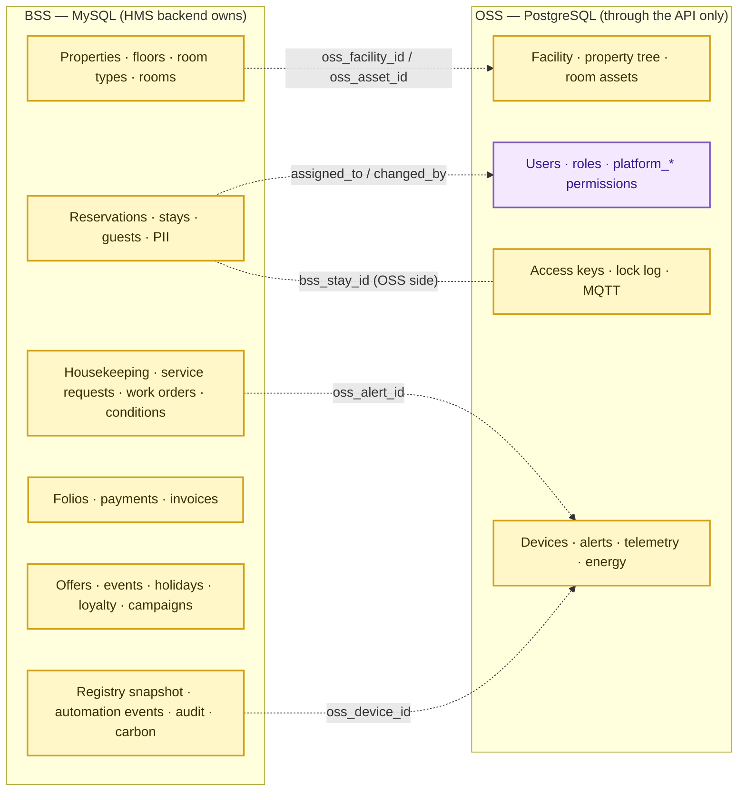

# HMS Module → Database Mapping (Current → Target OSS/BSS)

**Date:** 2026-10-10 · **Analysis only.**

The modules are the ones **actually found** in `frontend/src/App.tsx` + `frontend/src/core/rbac/modules.ts` (17 routed modules) and `role_module` (18 rows, live). Modules the target implies but the codebase does not have are listed separately in §2, marked **NOT IMPLEMENTED**.

Status values: **Implemented** (UI + API + DB) · **Partial** · **UI only** · **Not implemented**.
Ownership: **BSS-W** BSS writes · **OSS-R** OSS read through the API · **OSS-W** OSS write through the API.
Identifiers: API IDs are `uuid` for BSS rows (never the bigint) and OSS ids as issued.

## 1. Modules found in the codebase

| # | HMS module (route · RBAC module) | Business capability | Current status | Existing source tables | Target OSS/BSS tables | Required columns / identifiers | Read/write ownership | Existing API / service | Required API / service change | Dependencies | Risks / open questions | Acceptance criteria |
|---|---|---|---|---|---|---|---|---|---|---|---|---|
| M1 | Dashboard (`/HMS` · `dashboard`) | KPI tiles, occupancy donut, alerts, energy, Caleido KPIs, activity | Implemented | `amenity`, `amenity_status`, `device`, `device_alert`, `device_incident`, `value_alert`, `stay`, `service_request`, `energy_stat`, `daily_dual_data_point`, `activity`, `notification` | BSS: `bss_rooms`, `bss_stays`, `bss_service_requests`, `bss_room_device_registry`, `v_occupancy_dashboard`, `v_smart_rooms_summary`, `v_overdue_checkouts`, `bss_automation_events`; OSS-R: alert summary | `property_id`, `oss_facility_id`, `last_known_health_status`, `health_synced_at`, alert id + FleetExplorer URL | BSS read; OSS-R (alerts) | `useCount` over 10 list endpoints; `/energy-stats/summary`; `/daily-data-points/summary`; `/activities` | **New** `GET /dashboard/summary`; OSS `alerts/summary`; alert deep link | D-01, D-10; view definitions | Views undefined (UV); Caleido KPI owner unknown | One summary request on load; counts equal the BSS + OSS sources; stale health shown as unknown; alert tile opens FleetExplorer |
| M2 | Occupancy (`/occupancy` · `occupancy`) | Room grid, room status, conditions, DND, room details with telemetry | Implemented | `amenity`, `amenity_status`, `amenity_condition*`, `property`, `property_chain`, `device*` | BSS-W: `bss_rooms.housekeeping_status/occupancy_status`, `bss_room_status_history`, `bss_room_conditions`; OSS-R: devices/telemetry | `bss_rooms.uuid`, `oss_asset_id`, `floor_id` | BSS-W room business state; OSS-R device data | `GET/PATCH /occupancy`, `PUT …/conditions`, `/amenity-statuses`, `/amenity-conditions` (`services/occupancy.py`, `stays_write.update_room_state`) | Re-point to BSS; status history on every change; telemetry via `OssClient` | Property/room bridge (Phase 4 slice 1) | `amenity.status` today has 2 writers (stays + manual PATCH); DND lives on OSS `amenity.is_dnd` vs `bss_stays.do_not_disturb` | Grid matches seed; each status change writes history; no direct OSS SQL |
| M3 | Bookings (`/bookings` · `bookings`) | Create/edit/cancel bookings, allocate rooms, occupants, check-in/out, extend, document approval, invoices | Partial (no rates, availability, payments) | `stay`, `room_allocation`, `stay_user`, `app_user` (guests), `user_document`, `invoice`, `amenity.status` | BSS-W: `bss_reservations`, `bss_reservation_rooms`, `bss_reservation_guests`, `bss_stays`, `bss_guests`, `bss_guest_pii`, `bss_digital_keys`, `bss_availability_calendar`, `bss_rate_plans`; OSS-W (events): stay context, keys | `reservation_number`, `bss_reservations.uuid`, `bss_stays.uuid`, `guest uuid`, `oss_stay.bss_stay_id` (per D-05) | BSS-W; OSS-W via the processor | `/stays*`, `/room-allocations`, `/stay-occupants`, `/invoices` (`services/stays_write.py`, `stay.py`) | New `/reservations`, `/stays/{uuid}/check-in|check-out`, `/guests`; orchestration + outbox | D-05, D-08, rates scope | Cardinality (per-booking vs per-room); guest creation currently via `/users` | Overbooking rejected; check-in/out atomic in BSS; key events processed; no guest PII outside `bss_guest_pii` |
| M4 | Service Tracking (`/services/tracking` · `service_tracking`) | Guest service requests, items, assignment, cancel | Implemented | `service_request`, `service_request_item`, `service_category*`, `service_type`, `service_status` | BSS-W: `bss_service_requests` (SLA), `bss_orders`, `bss_folio_charges` (chargeable) | `request uuid`, `stay_id`, `room_id`, `assigned_to` (OSS user id) | BSS-W; OSS-R user validation | `/service-requests*` (`services/service.py`, `services_write.py`) | Re-point to BSS; SLA fields; post charges to folio | Billing slice; D-05 | `bss_service_requests` header unreadable in the image (F-S15); item model has no BSS table | Request lifecycle unchanged for the user; `assigned_to` validated against OSS; SLA breach computed |
| M5 | Tickets (`/tickets` · `tickets`) | Raise tickets for rooms | UI on the service-request API; **module not enforced by the backend** | `service_request` | Same as M4 | as M4 | as M4 | Uses `/service-requests` (`service_tracking`) | Decide: merge into M4 or a dedicated router enforcing `tickets` | F-I7 | Users with `tickets` but without `service_tracking` are blocked | Backend enforces the module the UI checks |
| M6 | Service Planning (`/services/planning` · `service_planning`) | Housekeeping and maintenance schedules, recurrence, assignees | Implemented | `maintenance_request`, `maintenance_request_amenity`, `maintenance_request_assignee`, `maintenance_request_recurrence` | BSS-W: `bss_housekeeping_tasks`, `bss_maintenance_work_orders`, `bss_room_conditions`; OSS-R alerts | `task uuid`, `work_order uuid`, `oss_alert_id` (BIGINT, F-S02), `assigned_to` | BSS-W; OSS-R | `/maintenance-requests*` (`services/maintenance*.py`) | Split housekeeping vs maintenance; alert → work-order endpoint; checkout automation | D-06, F-S02 | Recurrence has no BSS table; `job_order` overlap | Checkout creates a task; a work order from an alert is linked and validated; recurrence preserved or explicitly dropped |
| M7 | Job Order (`/config/job-order` · `job_order`) | Device installation/replacement/troubleshoot orders | Implemented | `job_order`, `job_order_amenity`, `job_order_device` | **No target table.** Candidate: OSS (device work) or `bss_maintenance_work_orders` | `job_order.id`, `device_id` | PD (D-06) | `/job-orders*` (`services/job_order*.py`) | Depends on D-06 | D-06 | Duplicates work orders | Owner decided; no orphaned screen |
| M8 | Facility Management (`/config/facility` · `facility_management`) | Facility, building/floor tree, rooms, amenity types, packages, features | Implemented | `facility`, `property*`, `amenity`, `amenity_type`, `package`, `sub_package`, `feature`, `package_feature` | OSS-W physical tree (OSS owner); BSS-W `bss_properties`, `bss_floors`, `bss_room_types`, `bss_rooms`, `bss_packages` | `oss_facility_id`, `oss_asset_id`, `bss_floors.oss_property_id` (missing, F-S09) | Split: physical = OSS, sellable = BSS | `/facilities`, `/properties`, `/buildings`, `/floors`, `/rooms`, `/amenity-types`, `/packages`, `/features` | Physical edits move to OSS (or FleetExplorer UI); BSS room-type and room mapping screens; ID validation | D-01, F-S09, F-S10 | "Package" means two things; `amenity.name` limited to 6 chars | Every `bss_rooms` row maps to exactly one OSS room asset; reconciliation = 0 |
| M9 | User Roles (`/config/user-roles` · `user_roles`) | Roles, module permissions, users | Implemented (`role_module*` model) | `role`, `user_role`, `role_module`, `role_module_permission`, `app_user` | OSS: `oss_role` (+`module_id`), `oss_user_role`, `platform_modules`, `platform_permissions`, `platform_role_permissions` | `module_code` = today's `module_name`; `role.id` | OSS-W (owner) | `/roles*`, `/modules`, `/permissions`, `PUT /roles/{id}/permissions` (`services/access*.py`) | Through `OssClient`, or hand over to FleetExplorer admin | D-01, D-07, F-S07 | HMS admins editing platform roles may break Rule 4 | Module codes unchanged; HMS can only grant HMS modules |
| M10 | Employees (`/config/employees` · `employees`) | Staff CRUD, departments, job functions, activation, passwords | Implemented | `app_user`, `department`, `job_function`, `facility_user` | OSS: `oss_app_user` (`is_hms_staff`, `user_type`), `oss_department` | `oss_app_user.id` | OSS-W | `/users*`, `/departments`, `/job-functions` | Through the OSS API; **password setting leaves HMS** | D-07 | `/users` returns guest PII today (F-I9) | No password hash handled by HMS; guests excluded or masked |
| M11 | Service Setup (`/config/services-setup` · `service_setup`) | Service types, categories, items | Implemented | `service_type`, `service_status`, `service_category`, `service_category_item` | BSS (catalogue for `bss_service_requests` / `bss_orders`); **no explicit BSS catalogue table** | category/item ids | BSS-W (proposed) | `/service-types`, `/service-categories`, `/service-items`, `/service-statuses` | New BSS catalogue tables or JSON config | D-03 | Gap in the target schema | Catalogue preserved after the move |
| M12 | Offers (`/offers` · `offers`) | Promo codes for rooms | Implemented | `promo_code`, `promo_code_amenity` | BSS-W `bss_promotions`, `bss_promo_redemptions` | promotion uuid, room type ids | BSS-W | `/offers` (`facility_write.py`) | Re-point | D-06; F-S15 (8 unreadable columns) | Redemption rules undefined in HMS today | Existing offers migrated or re-seeded; redemption recorded |
| M13 | Events (`/events` · `events`) | Facility events | Implemented | `facility_event` | BSS-W `bss_events` (cancel-only lifecycle) | event uuid | BSS-W | `/events` | Re-point; remove edit-after-cancel | D-06 | Lifecycle change for users | Cancelled events cannot be edited |
| M14 | Holidays (`/holidays` · `holidays`) | Holiday/occasion calendar | Implemented | `occasion`, `occasion_type` | BSS-W `bss_public_holidays` | holiday id, date | BSS-W | `/holidays`, `/holidays/types` | Re-point; optional API ingestion | D-06 | `occasion_type` has no target | Calendar identical after the move |
| M15 | Limit Config Alert (`/config/limit-alert` · `caleido_network`) | Device value-limit configs and value alerts | Implemented | `value_alert_limit_config`, `value_alert` | OSS (device rules) | config id, device type | OSS-W through the API | `/limit-configs`, `/value-alerts` | Through `OssClient`, or move to FleetExplorer | D-01 | Not in the v3 OSS list | Configs editable only through OSS |
| M16 | Key Settings (`/key-settings` · `default_key`) | Default key user settings | **UI only** (`NoEndpointNotice`); module not enforced | `facility.default_key_user` (column exists) | OSS `oss_access_key` / facility setting; BSS `bss_digital_keys` | facility id, user id | OSS-W | none | Implement through OSS or remove | D-01 | Dead screen | Screen works or is removed; module enforced |
| M17 | Reports (`/reports/*` · `reports`) | 9 reports + XLSX export | Implemented | Projections over M2–M8 tables; `energy_stat` | BSS (occupancy, booking, ticket, housekeeping, sanitization, employee*); OSS-R (alert, energy, room-status device parts) | as source modules | BSS read + OSS-R | `/reports`, `/reports/{key}`, `/reports/{key}/export.xlsx` (`services/reports.py`, `report_export.py`) | Switch each `fetch` to its owner; join by id in the app; mask PII | All slices | Mixed-freshness reports | Each report states its source and as-of time; totals reconcile |
| M18 | Auth / Login (`/login`) | Authentication, `/auth/me` | Implemented | `app_user`, `user_role`, `role`, `role_module*`, `facility_user` | OSS identity + `platform_*` | `sub` = `oss_app_user.id` | OSS | `/auth/login`, `/auth/me` (`services/auth.py`, `api/deps.py`) | Token validation of OSS tokens; permissions from OSS | D-07 | Login outage if OSS is down | Existing module gating unchanged for users |
| M19 | About / Health | Version, DB health | Implemented | `alembic_version` | Both databases + OSS API | — | — | `/health/version`, `/health/db` | Per-dependency health (`oss`, `bss`) | — | — | Health shows each dependency separately |

## 2. Target capabilities with no module in the codebase (NOT IMPLEMENTED)

| Capability | Target tables | Current equivalent | Note |
|---|---|---|---|
| Rates and pricing | `bss_rate_plans`, `bss_rate_plan_room_types`, `bss_seasonal_rates`, `bss_cancellation_policies`, `bss_availability_calendar` | none (`package` has no price) | Required for real reservations (scenario B) |
| Revenue / folios / payments / invoices | `bss_folios`, `bss_folio_charges`, `bss_payments`, `bss_invoices`, `bss_orders`, `bss_revenue_categories`, `bss_payment_methods_config` | `invoice` (read only, 2 rows) | Payment gateway out of scope until decided |
| Guest management | `bss_guests`, `bss_guest_pii`, `bss_corporate_accounts` | guests as `app_user` | PII controls (D-08) |
| Channels / OTA | `bss_booking_channels`, `bss_ota_channels`, `bss_property_channel_configs`, `bss_channel_inbound_reservations` | `stay.request_source` (`ikanos`/`porta`) | External integration project |
| Loyalty | 4 `bss_loyalty_*` tables | none | |
| Campaigns | `bss_campaigns`, `bss_campaign_enrollments` | none | |
| Group blocks | `bss_group_blocks` | none | |
| Smart-room control | `bss_iot_control_events`, `bss_smart_access_log`, `bss_digital_keys` | `device_command`, `lock_activity_log`, `access_key` (no command endpoint) | Requires OSS command API |
| Sustainability | `measurement_units`, `emission_factors`, `carbon_calculations`, `cm_points_ledger` | `energy_stat` only | D-09 |
| Audit / PII access log | `bss_audit_trail`, `bss_pii_access_log` | none | Cross-cutting; arrives with the first BSS write |

## 3. Ownership summary

