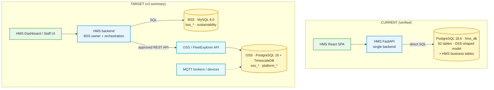

# HMS Existing vs Target OSS/BSS — Schema and Capability Comparison

**Date:** 2026-10-10 · **Analysis only.**

**Target references**
- `docs/HMS_OSS_BSS_v3_Architecture_Summary.docx` (the "v3 summary"): OSS = PostgreSQL 16 + TimescaleDB; BSS = MySQL 8.0; no cross-database FKs; HMS reads platform/device data through APIs.
- The dbdiagram.io ER image (10429 × 7287 px). A table-by-table reading of it already exists in `docs/NEW_SCHEMA_TRANSCRIPTION.md` and is reused here. The image was **not** re-transcribed; the known unreadable areas listed there still apply.

**Current-state reference:** [HMS_DATABASE_CURRENT_STATE.md](HMS_DATABASE_CURRENT_STATE.md).

**Classification:** **VEC** verified existing capability · **VG** verified gap · **PE** proposed enhancement · **PD** pending decision · **UV** unable to verify.
**Evidence:** **R** = runtime (read-only DB probe) · **C** = code · **D** = target document/diagram.

---

## 1. Relationship to the earlier integration document

`docs/HMS_NEW_SCHEMA_INTEGRATION_APPROACH.md` (commits `d823121`, `be47396`) analysed the same ER diagram **before the v3 summary was available**. It recommended **one PostgreSQL database for OSS and BSS** (its §5.1 and decision D2). The v3 summary sets the opposite target: **separate MySQL BSS, API-level bridge, no cross-database FKs**.

| Earlier statement | Status after this audit |
|---|---|
| §5.1 "One database, not two"; D2 "PostgreSQL 16, as today" | **Superseded by the v3 target.** It remains a valid *alternative* and is recorded as decision **D-02** in the register. It is not the baseline |
| C6 "`oss_amenity.name` is `varchar(6)` … keep HMS's current length" | **Incorrect.** The live HMS column is also `varchar(6)` [R]. Both sides have the limit (F-S10) |
| "Live DB PostgreSQL 16" | The live server is **18.6** [R] |
| Overlap analysis (§4), diagram defects C1–C5, C7–C12 | Still valid. They are reused below with v3 adjustments |

That file was **not edited**, because the task rules forbid overwriting existing documentation. This document set takes precedence where they differ.

---

## 2. Architecture: current vs target

| ID | Dimension | Current | Target | Class | Evidence |
|---|---|---|---|---|---|
| F-A1 | Number of databases | 1 (PostgreSQL `hms_db`) | 2 (OSS PostgreSQL, BSS MySQL) | **VG** | R: `pg_database`; C: `config.py` single URL |
| F-A2 | MySQL / BSS | Absent: no server, driver or config | MySQL 8.0 | **VG** | R: no service, port 3306 closed; C: `requirements.txt` |
| F-A3 | PostgreSQL version | 18.6 | 16 (+ TimescaleDB) | **PD** (D-11) | R: `version()`; D: v3 §2 |
| F-A4 | TimescaleDB | Not installed; `device_stat` is a plain table | `oss_device_stat` hypertable | **VG** | R: `pg_extension` |
| F-A5 | HMS reads OSS through an API | No. HMS queries device, alert and telemetry tables directly | Required (v3 §8 "Boundary") | **VG** | C: `services/device.py`, `alert.py`, `telemetry.py` |
| F-A6 | Who owns the OSS database? | `hms_db` *is* the only OSS-shaped store and the HMS backend owns its migrations | FleetExplorer owns OSS; HMS is a module on top | **PD** (D-01, critical) | C: `migrations/`; D: v3 §1 |
| F-A7 | Cross-database FKs | None (only one database exists) | None allowed | **VEC** (trivially) | R: all 240 FKs are within `public` |
| F-A8 | Cross-system reference columns | None (`bss_*_id` / `oss_*_id` columns absent) | 5 bridge columns (v3 §5) + others in the diagram | **VG** | R: column catalog |
| F-A9 | Docker / container topology | None in the repository | Not specified by v3 | **UV** | C: file search |

---

## 3. Table-level comparison

### 3.1 OSS tables listed in the v3 summary vs `hms_db` [R + D]

| v3 OSS table | Current table | Status | Differences that matter |
|---|---|---|---|
| `oss_organisation` | `organisation` | VEC | Name prefix only |
| `oss_facility` | `facility` | VEC | — |
| `oss_property`, `oss_property_chain` | `property`, `property_chain` | VEC | — |
| `oss_amenity` | `amenity` | VEC | `name varchar(6)` on both sides (F-S10) |
| `oss_app_user` | `app_user` | VEC + VG | Diagram adds `user_type`, `is_hms_staff` (NN), `bss_legacy_user_id`; absent today |
| `oss_role` | `role` | VEC + VG | Diagram adds `module_id`; absent. Rule 4 depends on it |
| `oss_department` | `department` | VEC | — |
| `platform_modules`, `platform_permissions`, `platform_role_permissions` | `role_module`, `role_module_permission` | **VG** | Different model: today a module × role boolean (read/write) matrix; target is a permission catalogue (`resource`, `action`) granted to a role, optionally per facility |
| `oss_device`, `oss_device_type`, `oss_device_command`, `oss_device_alert` | `device`, `device_type`, `device_command`, `device_alert` | VEC | Diagram type defect: `oss_device.device_type int` vs `oss_device_type.id varchar(36)`; HMS uses SMALLINT on both sides (F-S03) |
| `oss_device_stat` | `device_stat` | VEC + VG | Diagram adds `unit_id`; not a hypertable |
| `oss_mqtt_broker`, `oss_mqtt_topic` | `mqtt_broker`, `mqtt_topic` | VEC | Schema only. No MQTT client code in the backend [C] |
| `oss_access_key`, `oss_lock_activity_log` | `access_key`, `lock_activity_log` | VEC + VG | Diagram adds `access_key.bss_digital_key_id` |

### 3.2 OSS-prefixed tables that also have a BSS counterpart (duplicate ownership) [D]

The ER diagram draws these as `oss_*`, but **the v3 summary's OSS list does not include them**, and BSS owns the same business concept.

| Diagram OSS table | Current table | BSS counterpart | Class | Note |
|---|---|---|---|---|
| `oss_stay` | `stay` (7 rows) | `bss_stays` + `bss_reservations` | **PD** (D-05) | v3 Rule 3: BSS owns the stay; `oss_stay` is "lightweight IoT context". Cardinality conflict: `stay` is per booking (`no_of_rooms`), `bss_stays` is per room (F-S05) |
| `oss_room_allocation` | `room_allocation` | `bss_reservation_rooms` | PD | |
| `oss_stay_user` | `stay_user` | `bss_reservation_guests` | PD | |
| `oss_service_request` | `service_request` | `bss_service_requests` | PD | v3: "Services → BSS" |
| `oss_maintenance_request` | `maintenance_request` | `bss_maintenance_work_orders` | PD | v3: BSS owns repairs |
| `oss_invoice` | `invoice` | `bss_invoices` | PD | v3: BSS owns money |
| `oss_package`, `oss_amenity_type` | `package`, `amenity_type` | `bss_packages`, `bss_room_types` | PD | Different concepts with the same name ("package") |

### 3.3 HMS tables with no place in the target (65 tables) [R + D]

These are absent from both the diagram and the v3 summary. Grouped by fate:

| Group | Tables | Recommended classification |
|---|---|---|
| OSS lookups the diagram still references | `alert_type`, `command_type`, `key_type`, `device_param`, `job_function`, `country`, `incident_status` | **PD** (D-03). Keep in OSS; the diagram's FK columns point at them. Note: `facility.currency_id` is an unconstrained SMALLINT with **no currency table** in HMS [C: `models/facility.py`] |
| OSS device operations | `device_incident`, `incident_event`, `incident_history`, `value_alert*`, `device_health_stat`, `device_current_stat`, `battery_life_stat`, `sensor_operation_stat`, `other_device`, `firmware`, `user_device*`, `energy_stat` | PD. These are naturally OSS. **`energy_stat` is the only energy source for sustainability** (F-S14) |
| HMS business that BSS replaces | `promo_code*` → `bss_promotions`; `occasion*` → `bss_public_holidays`; `facility_event` → `bss_events`; `service_*` catalogue → BSS services; `job_order*` → `bss_maintenance_work_orders` (?) | PD (D-06) |
| HMS business with no BSS home | `amenity_status`, `amenity_condition*` (room state); `stay_package`, `sub_package`, `package_feature`, `feature`; `user_document` (guest ID approvals) | **VG**. Each needs an owner. Room state maps to `bss_rooms.housekeeping_status/occupancy_status` + `bss_room_conditions` |
| Platform services | `notification*`, `activity*`, `attachment`, `scheduler_job*`, `import_job`, `user_token`, `facility_user`, `daily_dual_data_point` | PD. Platform vs BSS ownership is undecided |

### 3.4 BSS tables (54) and sustainability (4) vs `hms_db`

**None of the 54 `bss_*` tables or the 4 sustainability tables exists today** [R]. Coverage of the business capability they model:

| BSS capability | Tables | Current coverage | Class |
|---|---|---|---|
| Brand / property / floors / room types / rooms | `bss_brands`, `bss_properties`, `bss_floors`, `bss_room_types`, `bss_rooms`, `bss_room_status_history` | Physical tree only (`facility` → `property` → `amenity`); no brand, star rating, timezone or check-in time; no room status history | VG |
| Room ↔ device registry | `bss_room_device_registry` | `device.amenity_id` (FK, NOT NULL) [R]. **20 of 24 rooms have no device** | VG (registry), VEC (source mapping) |
| Rates and distribution | `bss_rate_plans`, `bss_rate_plan_room_types`, `bss_seasonal_rates`, `bss_cancellation_policies`, `bss_availability_calendar`, `bss_booking_channels`, `bss_ota_channels`, `bss_property_channel_configs`, `bss_channel_inbound_reservations`, `bss_packages`, `bss_group_blocks` | **None.** `package` has no price [C: `stays_write.py`] | VG |
| Reservations and stays | `bss_reservations`, `bss_reservation_rooms`, `bss_reservation_guests`, `bss_stays` | `stay`, `room_allocation`, `stay_user` | VG (re-model) |
| Guests and PII | `bss_guests`, `bss_guest_pii`, `bss_corporate_accounts` | Guests are `app_user` rows with plaintext PII columns | VG |
| Finance | `bss_folios`, `bss_folio_charges`, `bss_orders`, `bss_payments`, `bss_invoices`, `bss_revenue_categories`, `bss_payment_methods_config` | `invoice` (read only), `service_request.net_amount/total_tax/total_amount` | VG |
| Loyalty / marketing | 4 loyalty + `bss_promotions`, `bss_promo_redemptions`, `bss_campaigns`, `bss_campaign_enrollments`, `bss_events`, `bss_public_holidays` | `promo_code`, `facility_event`, `occasion` | VG |
| Operations | `bss_housekeeping_tasks`, `bss_service_requests`, `bss_maintenance_work_orders`, `bss_room_conditions`, `bss_digital_keys`, `bss_smart_access_log`, `bss_iot_control_events` | `maintenance_request`, `service_request`, `amenity_condition_status`, `access_key`, `lock_activity_log`, `device_command` | VG |
| Governance | `bss_audit_trail`, `bss_pii_access_log`, `bss_automation_events`, `bss_users`, `bss_roles` | **No write audit, PII access log or event log** [C] | VG |
| Sustainability | `measurement_units`, `emission_factors`, `carbon_calculations`, `cm_points_ledger` | `energy_stat` (kWh/room/hour) only | VG |
| Operational views | `v_occupancy_dashboard`, `v_smart_rooms_summary`, `v_overdue_checkouts` | No views exist [R]; **their definitions are not in the diagram or the docx** | **UV** |

---

## 4. Schema-level findings on the target design

| ID | Finding | Class | Evidence | Impact |
|---|---|---|---|---|
| F-S01 | **The diagram draws FK icons on bridge columns** (`bss_properties.oss_facility_id`, `bss_rooms.oss_asset_id`, `bss_room_device_registry.oss_device_id`, `bss_room_conditions.oss_device_alert_id`, `bss_maintenance_work_orders.oss_alert_id`, `bss_digital_keys.oss_device_id`, `oss_stay.bss_stay_id`, and every BSS "who" column → `oss_app_user`). The v3 summary forbids cross-database FKs | PD | D: transcription vs v3 §5 | DDL generated from the diagram will fail in MySQL, or will be built wrongly |
| F-S02 | **Bridge column type mismatch:** `bss_maintenance_work_orders.oss_alert_id` and `bss_room_conditions.oss_device_alert_id` are `varchar(36)`, but `oss_device_alert.id` is `bigint` (also BIGINT identity in HMS [R]) | VG (design) | D; R: `device_alert.id int8` | Joins and validation need casts; the ID semantics are ambiguous |
| F-S03 | `oss_device.device_type int` → `oss_device_type.id varchar(36)` | VG (design) | D; R: HMS `device_type.id int2` | Same mismatch |
| F-S04 | `bss_audit_trail.record_id`, `bss_automation_events.source_id/target_id`, `bss_pii_access_log.entity_id` are `bigint`; they cannot hold an OSS UUID | VG (design) | D | OSS-side events (alert raised, key issued) cannot be recorded as automation sources |
| F-S05 | **Stay cardinality:** `oss_stay.bss_stay_id bigint` is 1:1, but `bss_stays` is one row per room (`room_id` NN) and the current `stay` is per booking | VG (design) | D; R: `stay.no_of_rooms` | A multi-room booking cannot be bridged as drawn |
| F-S06 | **Identity overlap:** `bss_users` (MFA, lockout, bigint) is still drawn. v3 Rule 1 deprecates it | PD | D; v3 Rule 1 | Must not be built; the MFA/lockout columns need a home on OSS |
| F-S07 | **Role model overlap:** `oss_role.module_id`, `oss_user_role.module_id`, `platform_permissions.module_id`, `bss_roles` | PD | D | One role belongs to one module (Rule 4), but the permissions table also carries a module. Pick one source |
| F-S08 | `bss_guests` has no link to `oss_app_user` (guest app login) | VG (design) | D | Guest mobile identity cannot be resolved to a BSS guest |
| F-S09 | `bss_floors` has no link to `oss_property` (floor) | VG (design) | D | Room ↔ floor consistency cannot be checked |
| F-S10 | `amenity.name` is `varchar(6)` **in the live database** (max length used 6). `bss_rooms.room_number` is `varchar(10)` | VEC (constraint exists) / PD | R: column catalog | Room labels longer than 6 characters cannot exist in OSS. BSS can hold labels OSS cannot |
| F-S11 | `bss_rooms.oss_facility_id` duplicates `bss_properties.oss_facility_id` | PE | D | Drift risk. Drop it or validate equality |
| F-S12 | Tenancy: `bss_guests`, `bss_corporate_accounts`, `bss_booking_channels`, `bss_revenue_categories`, `bss_payment_methods_config` have no property/brand key | PD (D-04) | D | Cross-property data leakage if HMS goes multi-property |
| F-S13 | `bss_reservations.status` and `status_cancelled` both exist; `bss_events` is "cancel-only lifecycle" | PE | D; v3 §7 | Ambiguous state machine |
| F-S14 | **Sustainability input is OSS data.** `carbon_calculations.energy_consumed` must come from OSS telemetry. The v3 OSS list has no `energy_stat`, and `oss_device_stat.unit_id → measurement_units` crosses into BSS | PD (D-09) | D; R: `energy_stat` 72 rows | Needs an OSS energy API or export, plus a unit-of-measure owner |
| F-S15 | Known unreadable parts of the diagram (`bss_promotions` 8 columns, the tail of `bss_maintenance_work_orders`, the `bss_service_requests` header) | UV | `NEW_SCHEMA_TRANSCRIPTION.md` header | Build only from the DBML/SQL export |
| F-S16 | Types are MySQL-flavoured (`datetime`, `int` flags, `json`, `char(36)`). This **is consistent** with a MySQL BSS; `datetime` has no timezone | PE | D | Store UTC; convert with `bss_properties.timezone` |

---

## 5. Identity and authorization comparison

| ID | Topic | Current | Target | Class | Evidence |
|---|---|---|---|---|---|
| F-I1 | Single identity for staff, guests and admins | `app_user` already serves all three | `oss_app_user` (Rule 1) | **VEC** | R: `is_staff` 8/7 split; C: `models/people.py` |
| F-I2 | `is_hms_staff` flag | Absent; HMS Web access is decided by `role.role_type ∈ {admin, manager}` | `is_hms_staff = 1` | VG + PD (D-07) | C: `core/platform.py` |
| F-I3 | Who issues tokens | HMS backend (HS256, local secret) | Unspecified; OSS owns identity | **PD** (D-07, critical) | C: `core/security.py`; D: v3 Rule 1 |
| F-I4 | Module-aware RBAC | 18 modules × role boolean read/write, enforced per router | `platform_*` + `oss_role.module_id` | VG (model) / VEC (enforcement pattern is reusable) | C: `api/deps.py::require_permission` |
| F-I5 | HMS roles cannot reach FleetExplorer pages | Not applicable (no FleetExplorer in the app) | Rule 4 | UV | — |
| F-I6 | Facility/property scoping of reads | **Not enforced** (only an optional filter) | Property-level access implied by `platform_role_permissions.facility_id` | **VG** | C: `endpoints/stays.py`, `occupancy.py`, `devices.py` |
| F-I7 | Modules without enforcement | `tickets`, `default_key` | All modules enforced | VG | C: grep of `require_permission` |
| F-I8 | MFA / lockout | Absent | On `bss_users` only (deprecated) | PD | D |
| F-I9 | Guest PII protection | Plaintext `email`, `phone_number`, `dob`, `address` on `app_user`; returned by the `UserRead` schema under the `user_roles` module | `bss_guest_pii` encrypted + `bss_pii_access_log` | **VG** | C: `schemas/access.py::UserRead` |
| F-I10 | Token storage | `localStorage` | Unspecified | PE | C: `frontend/src/lib/api/client.ts` |

## 6. Room ↔ device and device-health comparison

| ID | Topic | Current | Target | Class | Evidence |
|---|---|---|---|---|---|
| F-D1 | Device → room mapping | `device.amenity_id` NOT NULL FK; `device_alert.amenity_id` | `bss_room_device_registry` (BSS) referencing `oss_device_id` | VEC (source), VG (registry) | R |
| F-D2 | Rooms without devices | 20 / 24 | — | VEC (fact) | R |
| F-D3 | Health snapshot | Live `device.health_status` (Active/Inactive) read directly | `last_known_health_status`, `health_synced_at` in BSS | VG | R; v3 Rule 2 |
| F-D4 | Alert → FleetExplorer link | Dashboard `AlertsPanel` lists `/alerts` with **no navigation link** | Rule 5: clickable link to FleetExplorer | VG | C: `features/dashboard/components/AlertsPanel.tsx` |
| F-D5 | Alert → maintenance | `device_incident.latest_alert_id` only; `maintenance_request` has no alert column | `bss_maintenance_work_orders.oss_alert_id`, `bss_room_conditions.oss_device_alert_id` | VG | R |
| F-D6 | Device commands | `device_command` table; no command-issuing endpoint | `bss_iot_control_events` + OSS execution | VG | C: route table |

## 7. Consistency checks across systems

| ID | Check | Current | Class |
|---|---|---|---|
| F-C1 | Reconciliation between room state and stays | None. `amenity.status` is written by stay services and by `PATCH /occupancy`; there is no checker | VG [C: `stays_write.py::update_room_state`] |
| F-C2 | Validation of cross-system IDs | Not applicable today; FKs enforce it inside one database | VEC today, **VG** in the target (FKs disappear) |
| F-C3 | Dashboard KPI verification | `backend/scripts/verify_dashboard_kpis.py` exists | VEC [C] (not executed in this audit) |

## 8. Dashboard and report data sources

| Widget / report | Current source (endpoint → table) | Target source | Class |
|---|---|---|---|
| KPI tiles (`DashboardKPIs`) | `useCount` → list endpoints' `total` for `devices`, `alerts`, `incidents`, `value-alerts`, `occupancy`, `stays`, `service-requests`, `rooms`; `/amenity-statuses`; `/energy-stats/summary` | BSS views + registry snapshot + OSS alert-count API | VG |
| Occupancy donut / status (`StatusSection`) | `/occupancy`, `/floors` → `amenity`, `amenity_status` | `bss_rooms` / `v_occupancy_dashboard` | VG |
| Alerts panel | `/alerts`, `/service-requests` | OSS alert API (counts + deep link) + BSS service requests | VG |
| Energy chart | `/energy-stats/summary` → `energy_stat` | OSS telemetry API → BSS `carbon_calculations` for carbon | PD |
| Caleido at work | `/daily-data-points/summary` → `daily_dual_data_point` | Unassigned in target | PD |
| Recent activity | `/activities` → `activity` (seeded; never written by services) | `bss_automation_events` / `bss_audit_trail` | VG |
| Reports (9) | `/reports/{key}` in `services/reports.py`; `housekeeping` and `sanitization` read `maintenance_request` | Business reports from BSS; `alert` and `energy` reports through the OSS API | VG |

The dashboard fires about **10 count requests plus 5 data requests** on load. Each count request runs a full list query to read `total` [C: `lib/api/hooks.ts::COUNT_SOURCES`]. In the target, any count that crosses into OSS becomes a network call.

## 9. Migrations: existing vs required

| Item | Current | Required | Class |
|---|---|---|---|
| Migration tool | Alembic, one env, one `Base` | Alembic for BSS (new env/`Base` for MySQL) **or** ownership of OSS migrations moved to the platform team | PD (D-01) |
| History | 2 revisions | BSS baseline (≈58 tables) + any OSS additions (`is_hms_staff`, `module_id`, `bss_*_id` bridge columns, `platform_*`) | VG |
| OSS-side additions | — | They require the **OSS owner's** migration pipeline if FleetExplorer owns OSS | PD |
| Data migration | Seed/demo data only [R] | Re-seed rather than migrate locally; production migration scope unknown | UV |
| Seeds | PostgreSQL only | BSS seed + bridge IDs that match OSS seed IDs | VG |
| Schema test (`test_schema_foundation.py`) | Asserts the approved 92-table set | Must split per database | VG |
