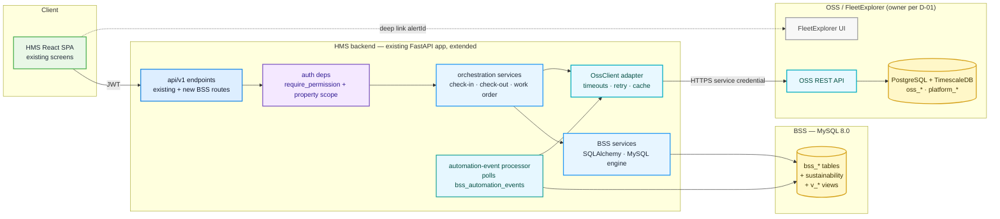
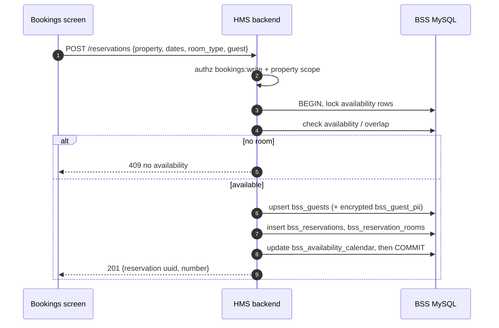
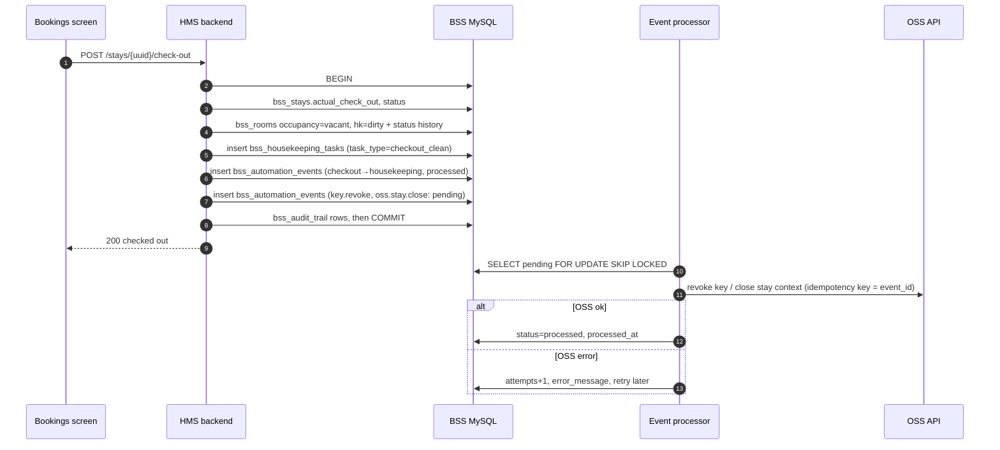
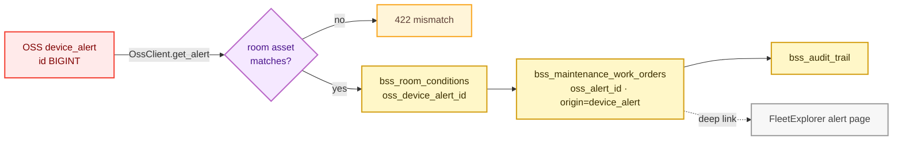
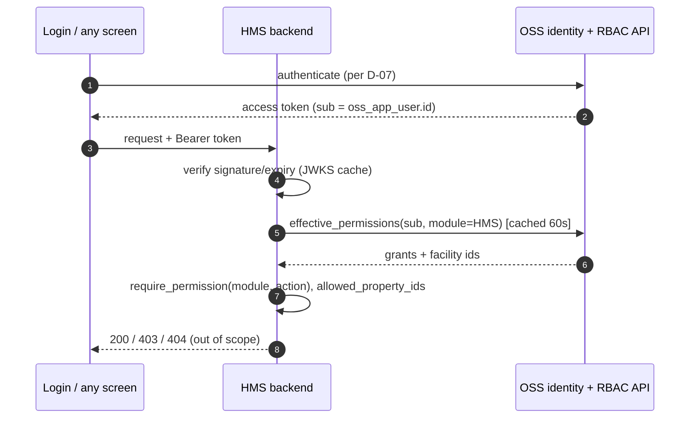

# HMS Platform Integration Approach — OSS (PostgreSQL) + BSS (MySQL)

**Date:** 2026-10-10 · **Status:** recommendation for review. Nothing here is implemented.
**Inputs:** [current state](HMS_DATABASE_CURRENT_STATE.md) · [comparison](HMS_OSS_BSS_SCHEMA_COMPARISON.md) · [module mapping](HMS_MODULE_DATABASE_MAPPING.md) · [register](HMS_GAP_AND_BLOCKER_REGISTER.md) · v3 summary (docx) · ER diagram.

Statement types are marked **FACT** (verified; see the current-state doc), **ASSUMPTION**, **PROPOSAL** or **DECISION** (open, with an ID in the register).

---

## 1. Starting point in one paragraph

**FACT.** Today HMS is one FastAPI backend over one PostgreSQL database (`hms_db`, 92 tables). That database contains the OSS-shaped IKANOS model (facility, rooms as `amenity`, users, roles, devices, alerts, telemetry) *and* the HMS business tables (stays, service and maintenance requests, invoices, offers, events, holidays). The backend queries all of it directly with SQLAlchemy. There is no MySQL, no BSS table, no `platform_*` RBAC, no OSS/FleetExplorer API client and no TimescaleDB. All local data is demo seed data (1 facility, 1,805 rows).

**Implication.** The v3 target is not a refactor of a few queries. It moves business ownership into a new MySQL BSS, and it puts an API boundary between HMS and the platform data HMS reads today. The most important unknown is **who owns and serves OSS** (decision **D-01**).

## 2. Guiding principles (from v3, applied to this codebase)

1. **One owner per fact.** OSS: building, identity, permissions, devices, telemetry, access events. BSS: anything about money, bookings, guests, operations workflows or business reports.
2. **No cross-database FKs.** Bridge columns are plain columns, validated by the HMS backend.
3. **HMS never reads the OSS database directly.** All platform and device data comes through an approved OSS API.
4. **No new runtime component unless needed.** The proposal stays inside the existing FastAPI backend, adding modules rather than services. The only new infrastructure is the MySQL BSS database, which is the target itself.
5. **Additive and reversible delivery.** Add new paths, switch reads, then retire old paths a release later.

## 3. Recommended target integration architecture

### 3.1 Components (all PROPOSAL)

| Component | What it is | Why it is needed | Reuses |
|---|---|---|---|
| **MySQL engine + BSS models** | A second SQLAlchemy engine/`Base` (`app/db/bss_session.py`, `app/models/bss/`) and a second Alembic environment | The target places business data in MySQL | `db/base.py` naming convention, PK-tier idea, `writes.transaction()` |
| **`OssClient` adapter** | An in-process Python interface (`get_facility`, `list_rooms`, `get_devices_by_ids`, `alert_counts`, `issue_key`, `resolve_user`, `effective_permissions` …) with one HTTP implementation | Enforces "no direct OSS DB reads" and isolates the D-01 outcome | Response shapes of today's `/facilities`, `/rooms`, `/devices`, `/alerts`, `/users` endpoints |
| **Orchestration services** | Functions that own a cross-system use case | No distributed transaction exists across MySQL and PostgreSQL | `stays_write.py` state rules (409 on double booking, check-in/out order) |
| **Automation-event processor** | Polls `bss_automation_events WHERE status='pending'`, calls `OssClient`, marks the row processed or failed | Gives reliable, auditable side effects after a BSS commit (v3 §7) | Unused `scheduler_job*` design (optional) |
| **Property-scope dependency** | Resolves the caller's allowed `bss_properties.property_id`s from OSS facility grants | Closes F-I6 (reads are not scoped today) | `AuthenticatedUser.facility_ids`, `require_permission` |

**Processor hosting — DECISION D-12.** Option 1: a FastAPI lifespan background task. No new deployable, but it only fits a single backend instance and needs a row lock (`SELECT … FOR UPDATE SKIP LOCKED`, MySQL 8 supports it). Option 2: a separate worker process from the same codebase. It survives API restarts and scales independently, but it is one more process to deploy and monitor. **Recommendation:** Option 1 first, with `SKIP LOCKED` so moving to Option 2 later needs no change.

### 3.2 Resolving D-01 — two viable shapes

| | **Option A — FleetExplorer is the OSS** (v3 reading) | **Option B — `hms_db` is promoted to OSS** |
|---|---|---|
| Meaning | A separate platform team runs OSS PostgreSQL + TimescaleDB and an API. HMS stops owning OSS tables | The current `hms_db` OSS tables become the OSS store. Today's facility, device, alert, telemetry and user endpoints become the OSS API |
| HMS work | Build `OssClient` against the FleetExplorer API contract. Remove OSS models and migrations from the HMS backend after cut-over | Separate those endpoints into an OSS API boundary (initially a separate router, and possibly a separately deployed app). HMS business code calls them only through `OssClient` |
| Evidence | The v3 summary names FleetExplorer as the platform. **No FleetExplorer API, URL or contract exists in the repository** | The 92-table model matches v3's OSS list almost 1:1 (comparison §3.1) |
| Risk | The API's availability, auth and coverage are unknown (B-01) | Duplicates FleetExplorer if it exists |

**Recommendation:** confirm Option A or B before any build work (Phase 2). In both cases, write all HMS business code against `OssClient`, so the choice only changes the adapter's base URL and its contract tests.

## 4. Which modules read or write what

The full table is in [HMS_MODULE_DATABASE_MAPPING.md](HMS_MODULE_DATABASE_MAPPING.md). In summary:

| Writes **BSS** (owner) | Reads **OSS** through the API | Reads **OSS only** (no BSS) |
|---|---|---|
| Bookings → reservations/stays, Occupancy (room business status, conditions), Service Tracking, Service Planning (housekeeping, work orders), Offers, Events, Holidays, Reports (business), invoices/folios (new), sustainability (new) | Occupancy (device health, DND/power state), Dashboard (alert counts, device health), Service Planning (alert → work order), Bookings (key issue), Facility Management (rooms ↔ assets) | User Roles, Employees, Limit Config Alert, Key Settings, alert/energy reports, login |

## 5. Orchestration rules

1. **BSS-first local transaction plus an outbox.** A user action commits its BSS rows **and** a `bss_automation_events` row in **one MySQL transaction**. Every OSS side effect (issue or revoke a key, set power-save, write the OSS `stay` context) is executed by the processor, which is idempotent and retried. There is never a two-phase commit.
2. **Synchronous OSS calls only where the user must see the answer immediately.** Examples: validating a room's asset at creation, or reading device health for a room detail. These use a timeout and a fallback (§7).
3. **Batch, don't loop.** List screens gather the OSS IDs on a page and make **one** `OssClient` call (for example `GET /devices?ids=…`). There is never one call per row.
4. **Idempotency keys.** Every outbound mutation carries the `bss_automation_events.event_id` as an idempotency key (**the OSS API must support this**; contract item in B-01).
5. **Saga compensation** when OSS rejects a side effect permanently, for example a key-issue failure: the BSS state remains true (the guest *is* checked in), the event is marked `failed` with `error_message`, and the UI shows "key pending — retry", rather than rolling back the check-in.

## 6. Cross-system identifier validation

| Bridge column (BSS) | Validated against | When | Rule |
|---|---|---|---|
| `bss_properties.oss_facility_id` | OSS `GET /facilities/{id}` | Property create/edit | Must exist; 1:1 (unique in BSS) |
| `bss_rooms.oss_asset_id` | OSS room/amenity | Room create/edit | Must exist; amenity category `room`; facility = the property's facility; unique in BSS |
| `bss_room_device_registry.oss_device_id` | OSS device | Registry sync | Device's room = the registry row's room asset |
| `bss_maintenance_work_orders.oss_alert_id`, `bss_room_conditions.oss_device_alert_id` | OSS alert | Work-order/condition create | Alert exists; alert's room = the work order's room. **Type fixed to BIGINT first (F-S02)** |
| Every `*_by` / `assigned_to` `varchar(36)` | OSS user | Write time | Active user with an HMS module grant on that property |
| `oss_stay.bss_stay_id` (OSS side) | — | Written by the processor | Resolve the cardinality first (D-05) |

**Canonical form:** OSS UUIDs stored as lowercase `CHAR(36)`; numeric OSS IDs as `BIGINT`. **Reconciliation job (PROPOSAL):** a daily read-only comparison producing a report of orphan references, facility mismatches, rooms with no asset, devices missing from the registry and stays whose OSS context is missing. Zero findings on fresh seed data is a release gate.

## 7. Failure handling

| Situation | Behaviour | User sees |
|---|---|---|
| OSS timeout (proposal: 2 s connect / 5 s read) on a **read** | One retry for idempotent GETs, then fall back to the BSS snapshot (registry health) | Data, with an "as of <health_synced_at>" badge |
| OSS unavailable (circuit open after N consecutive failures, PROPOSAL N = 5, 30 s half-open) | Reads use snapshots. Writes that need OSS **validation** (new room-asset mapping) return **503 `oss_unavailable`**. Check-in/out proceeds and its OSS effects queue | Clear banner; no silent success |
| Snapshot stale (`health_synced_at` older than the threshold, **D-12/value TBD**, e.g. 15 min) | Health shown as "unknown (stale)" and not counted as healthy | Grey status, not green |
| Missing mapping (room without `oss_asset_id`, room without devices) | Not an error. Room shows "No devices mapped". Counted in reconciliation | Neutral state |
| OSS ID not found on write | **422** with field-level error; nothing committed | Validation message |
| Event processing fails | Exponential back-off; after max attempts `status='failed'`; visible in an ops list | "Key pending" style indicator |
| BSS (MySQL) unavailable | `/health/db` reports per database; business endpoints 503 | Error envelope (existing `api/errors.py`) |

The existing error envelope and the domain errors (`NotFound` / `Conflict` / `Invalid` → 404/409/422 in `services/writes.py`) are reused; one new `UpstreamUnavailable` → 503 is added.

## 8. Authorization and tenant/property access

1. **Identity (D-07).** Recommended: OSS issues or verifies the identity, and the HMS backend validates the token (shared JWKS or introspection), mapping `sub` to `oss_app_user.id`. Until OSS issues tokens, HMS login could call an OSS authentication API. **The HMS backend must stop reading `app_user.password_hash` once OSS owns identity.**
2. **Module permissions.** `require_permission(module, action)` keeps its signature. Its data source moves from `role_module_permission` to the OSS `effective_permissions` API, cached per request (and optionally for 60 s). Today's 18 module names become `platform_modules.module_code`, so `frontend/src/core/rbac/modules.ts` keeps working.
3. **HMS vs FleetExplorer separation (Rule 4).** A role whose `module_id` ≠ HMS gets no HMS grants. Keep the existing `role_type ∈ {admin, manager}` gate until `is_hms_staff` exists (D-07).
4. **Property scope (fixes F-I6).** A new dependency resolves `allowed_property_ids` = BSS properties whose `oss_facility_id` is in the caller's facility grants. **Every BSS service query takes it as a mandatory filter.** A request for another property's resource returns 404, not 403, to avoid leaking that it exists.
5. **Close the unenforced modules.** `tickets` gets its own router or is merged into `service_tracking`. `default_key` is either implemented or removed (F-I7).

## 9. Protecting guest information

| Control | Proposal |
|---|---|
| Storage | Guest contact and ID data only in `bss_guest_pii`, application-encrypted (AES-GCM; key in a secret store, never in `.env` or git); `email_hash` = SHA-256 of the normalised e-mail for lookup |
| OSS copy | Guests keep an `oss_app_user` login (Rule 1) with the **minimum** fields. The plaintext `email`, `phone_number`, `dob` and `address` on guest `app_user` rows are retired or emptied (D-08) |
| API | List endpoints return masked contact data. A separate `GET /guests/{uuid}/pii?purpose=…` requires a dedicated permission and writes `bss_pii_access_log` |
| Current exposure | `/users` returns guest PII under the `user_roles` module today [CODE]. Filter guests out of `/users`, or mask them, in the first integration release |
| Logs | Keep SQL echo off outside development (already conditional in `db/session.py`); never log request bodies containing PII |
| Exports | `export.xlsx` reports mask PII unless the caller holds the PII permission |
| Browser | Consider moving the JWT from `localStorage` to an httpOnly cookie (PE, F-I10) |

## 10. Dashboards and reports without unnecessary queries

| Need | Source | Pattern |
|---|---|---|
| Occupancy, arrivals, departures, overdue | BSS views `v_occupancy_dashboard`, `v_overdue_checkouts` (**definitions to be written — UV today**) | One BSS query each |
| Smart-room / device health counts | `bss_room_device_registry` snapshot (`v_smart_rooms_summary`) | No OSS call on dashboard load (v3 rationale) |
| Alert counts and links | One OSS call: `GET /alerts/summary?facility_id=…` → counts + FleetExplorer URLs | 30–60 s server-side cache |
| KPI tiles | **New `GET /dashboard/summary`** that returns every tile in one response | Replaces the ~10 count-by-list requests the dashboard sends today (`COUNT_SOURCES`) |
| Business reports | BSS (MySQL) | Existing `/reports/{key}` + `export.xlsx` framework (`services/reports.py`) reused, with the source switched |
| Alert and energy reports | OSS API export | Joined to BSS by ID in the app; never cross-database SQL |
| Consistency | Each response carries `generated_at` and, for OSS-derived numbers, `oss_as_of` | Users see how fresh mixed data is |

---

## 11. Critical integration scenarios

Legend: **EXISTING** = supported by today's code; **PROPOSED** = target workflow, not implemented.

### A. Property and room information loading

| Aspect | Detail |
|---|---|
| Status | **EXISTING** (single database) → **PROPOSED** (BSS + OSS) |
| Trigger | User opens Occupancy, Facility Management or the dashboard |
| Frontend | `features/occupancy/pages/Occupancy.tsx` (`useAllOccupancy`, `useBuildings`, `useFloors`); `config/pages/FacilityManagement.tsx` |
| Today | `GET /buildings`, `/floors`, `/occupancy` → `property`, `property_chain`, `amenity`, `amenity_status` (direct SQL) |
| Target | `GET /occupancy` (BSS service) → `bss_properties`, `bss_floors`, `bss_rooms` (+ status), scoped by `allowed_property_ids`; device health from the registry snapshot; optional room detail → `OssClient.get_devices(asset_id)` |
| Identifiers | `bss_rooms.uuid` (API), `bss_rooms.oss_asset_id` (bridge), `bss_floors.floor_id` |
| Validation / authz | `occupancy:read`; property scope |
| Failure cases | Room missing `oss_asset_id` → shown, flagged; OSS down → snapshot with `as of` |
| Expected outcome | Room grid identical to today for seed data; no OSS call needed for the grid |
| Tests | T-A1…T-A4 in the test plan |

### B. Reservation creation, room allocation and availability

| Aspect | Detail |
|---|---|
| Status | **EXISTING (partial)**: `POST /stays`, `POST /stays/{id}/room-allocations` with a double-booking 409. **No rates, availability calendar or reservation entity** → **PROPOSED** |
| Frontend | `features/bookings/pages/Bookings.tsx` (`useCreateStay`, `useRooms`, `useCreateUser` for guests) |
| Target | `POST /reservations` → BSS transaction: availability check (`bss_availability_calendar` / overlap query on `bss_reservation_rooms`), rate from `bss_rate_plans` / `bss_seasonal_rates`, guest from `bss_guests` (create if new, PII to `bss_guest_pii`), insert reservation + rooms. **No OSS call** |
| Identifiers | `reservation_number`, `bss_reservations.uuid`, `room_type_id`, optional `room_id` |
| Validation | Dates (departure > arrival, as `stays_write.create_stay` does today), capacity, rate-plan validity, cancellation policy, property scope, `bookings:write` |
| Failure cases | Overbooking → 409; stale calendar → recompute in the same transaction under a row lock |
| Tests | T-B1…T-B6 |

### C. Check-in, active stay and checkout

| Aspect | Detail |
|---|---|
| Status | **EXISTING**: `POST /stays/{id}/check-in` / `check-out` set `stay` times/status and `amenity.status` in one PostgreSQL transaction (`stays_write.check_in/check_out`) → **PROPOSED** cross-system version |
| Target check-in | BSS transaction: `bss_stays` (one per room, `actual_check_in`), `bss_rooms.occupancy_status`, `bss_room_status_history`, `bss_digital_keys` (pending), `bss_automation_events` (`checkin.oss_context`, `key.issue`). Processor → `OssClient.create_stay_context` + `issue_key` → writes back `bss_digital_keys.oss_device_id`/state |
| Target checkout | BSS transaction: `bss_stays.actual_check_out`, status, folio close check, `bss_rooms.occupancy_status = vacant`, `housekeeping_status = dirty`, history, events `key.revoke`, `housekeeping.create` (D), `oss.stay.close` |
| Validation | State machine as today (cannot check in twice, cannot check out before check-in); folio balance rule (**business decision**); `bookings:write` |
| Failure cases | OSS key failure → stay stays checked-in, key "pending" with retry; revoke failure on checkout → **security-relevant**: alert ops; retry until success |
| Tests | T-C1…T-C8 |

### D. Checkout → housekeeping automation and audit events

| Aspect | Detail |
|---|---|
| Status | **PROPOSED.** Today `check_out()` deliberately does *not* create housekeeping work (docstring in `stays_write.py`). Housekeeping exists only as `maintenance_request` (scheduled/planned) |
| Flow | The checkout transaction writes `bss_automation_events(trigger_type='checkout', source_table='bss_stays', source_id=stay_id, target_table='bss_housekeeping_tasks')`. Because this is BSS → BSS, it can be done **in the same transaction** (task inserted directly, event row = audit), or by the processor. Recommended: same transaction (simpler, atomic), with the event row stored as the audit |
| Audit | `bss_audit_trail` row per changed table (application-level hook on the BSS session); `changed_by` = OSS user id |
| Tests | T-D1…T-D4 |

### E. Room → device mapping, device health and alert navigation

| Aspect | Detail |
|---|---|
| Status | **EXISTING (direct)**: `device.amenity_id`, `GET /devices?amenity_id=…`, `/devices/{id}/health`, `/alerts`. **No FleetExplorer link** (F-D4) → **PROPOSED** |
| Target | Registry sync: processor or scheduled job → `OssClient.list_devices(facility)` → upsert `bss_room_device_registry` (match on `oss_asset_id` → `bss_rooms`), update `last_known_health_status`, `health_synced_at`. Dashboard reads the registry. The alert panel shows counts from `OssClient.alert_summary` and links to `FLEETEXPLORER_BASE_URL + alert path` (**D-10**) |
| Failure cases | Device on an unmapped asset → registry row skipped and reported; stale sync → "unknown" |
| Tests | T-E1…T-E5 |

### F. Maintenance work order linked to an OSS alert

| Aspect | Detail |
|---|---|
| Status | **PROPOSED.** Today `maintenance_request` has no alert reference; `device_incident.latest_alert_id` links incidents to alerts inside OSS |
| Flow | User clicks "Create work order" on an alert (or the processor does it on alert severity `critical`, **business decision**) → `OssClient.get_alert(id)` (validate it exists and its room ↔ `bss_rooms.oss_asset_id`) → BSS transaction: `bss_room_conditions(oss_device_alert_id)`, `bss_maintenance_work_orders(oss_alert_id, origin='device_alert')`, history, audit |
| Validation | Alert ID type BIGINT (F-S02 fix); one open work order per alert (unique on `oss_alert_id` where status is open — enforced in the application, because MySQL has no partial index) |
| Tests | T-F1…T-F5 |

### G. Login, identity resolution and module authorization

| Aspect | Detail |
|---|---|
| Status | **EXISTING**: `POST /auth/login` (bcrypt over `app_user`), JWT HS256, per-request reload of roles and permissions, `role_type` platform gate, module RBAC. **Not property-scoped on reads** |
| Target | Token from OSS (D-07) → HMS `get_current_user` validates it → `OssClient.effective_permissions(user)` (`platform_*`, HMS module only) → property scope → endpoint |
| Failure cases | OSS identity down → no new logins (existing tokens accepted until expiry, if verified locally with JWKS) |
| Tests | T-G1…T-G7 |

### H. Dashboard reporting and sustainability

| Aspect | Detail |
|---|---|
| Status | **EXISTING**: the dashboard sends ~15 requests (counts, energy summary, Caleido KPIs, activities); energy from `energy_stat`. **No carbon/sustainability** → **PROPOSED** |
| Target dashboard | `GET /dashboard/summary` → BSS views + registry + one cached OSS alert summary |
| Target sustainability | Scheduled job: `OssClient.energy(facility, period)` (per room asset, kWh) → map asset → `bss_rooms` → stays overlapping the period → `carbon_calculations` (factor from `emission_factors`, unit from `measurement_units`) → `cm_points_ledger`. Idempotent per (room, period, `calculation_version`) |
| Open | Energy source and unit ownership (D-09); the views' definitions (UV) |
| Tests | T-H1…T-H6 |

---

## 12. Implementation roadmap

Effort is **not estimated**: the evidence is insufficient (see "Information required" in each phase). Roles: **PO** product owner · **BA** business analyst · **ARCH** architect · **PLAT** OSS/FleetExplorer platform team · **BE** backend · **FE** frontend · **DBA** · **QA** · **SEC** security · **OPS** DevOps.

| Phase | Deliverables | Responsible | Entry criteria | Exit criteria | Dependencies | Risks |
|---|---|---|---|---|---|---|
| **1. Existing-state audit and baseline** | This document set; baseline test run on a **re-seeded** DB; reconciliation of the docs' version claims (PG 16 vs 18.6) | BA, BE, QA | Repository access | Current state accepted; baseline green test run recorded | None | Tests not runnable on the shared DB (needs a re-seed) |
| **2. Target schema and ownership validation** | Decisions D-01…D-15 signed; corrected DBML/SQL export (fix F-S01…F-S16); ownership matrix final; data-migration scope (D-15) | ARCH, PO, PLAT, DBA, SEC | Phase 1 accepted | Signed decision log; DDL generated from the DBML (not from the image) | PLAT availability | D-01 unresolved blocks everything after it |
| **3. API contracts and integration design** | OpenAPI for the OSS endpoints HMS consumes (facility, rooms/assets, devices, alerts + summary, energy, users, permissions, keys, stay context); BSS endpoint contracts; event catalogue; error/timeout policy; JWKS/auth contract | ARCH, PLAT, BE | D-01, D-07, D-13 decided | Contracts reviewed; contract-test stubs exist | PLAT API roadmap | OSS API gaps discovered late |
| **4. Schema migrations and backend integration** | MySQL BSS baseline migration; OSS additions through the OSS owner; `OssClient` + contract tests; BSS services; orchestration (check-in/out, work order); event processor; property scope; PII encryption + access log; audit hook | BE, DBA, SEC | Phase 3 contracts | Integration tests green against MySQL + OSS stub; reconciliation report = 0 on seed | MySQL environment (OPS) | Two-database test setup; type mismatches |
| **5. Frontend module integration** | Bookings → reservations; Occupancy → BSS rooms + snapshot badges; dashboard → `/dashboard/summary` + FleetExplorer links; Service Planning → work orders/housekeeping; masked PII; error/stale states | FE, BA | Phase 4 endpoints on a test environment | UAT scripts pass per module | Design for new screens (rates, folios) | Scope creep into PMS features |
| **6. Integrity, authorization, regression and integration testing** | Full test plan executed ([test plan](HMS_INTEGRATION_TEST_PLAN.md)); security review (PII, scope); performance check of the dashboard | QA, SEC, BE | Phase 4–5 code complete | All P1/P2 tests pass; no open critical/high defects | Test data in both databases with matching IDs | Flaky cross-system tests |
| **7. Deployment readiness, rollback and sign-off** | Runbooks; MySQL backup/restore; feature flags per module (old path kept one release); rollback = flag off + BSS schema left in place (additive); monitoring for event backlog and OSS error rate; sign-off | OPS, ARCH, PO | Phase 6 exit | Go/no-go signed; rollback rehearsed | Production access, change approval | Data divergence during a partial rollout |

**Information required before estimating:** the D-01 outcome and the OSS API's current coverage; whether rates, folios, payments, loyalty, channels and marketing are **in scope for the first release** (the v3 schema has 54 BSS tables, most with no screen today); the team size; the MySQL hosting model; whether any production data must be migrated (D-15); and the UI designs for new capabilities.

**Recommended release slicing inside Phases 4–5:** (1) BSS foundation + property/room bridge + registry snapshot + dashboard summary; (2) reservations, stays, check-in/out, checkout → housekeeping; (3) work orders from alerts + room conditions; (4) folios/invoices; (5) marketing/loyalty; (6) sustainability. This matches the capability phasing of the earlier `HMS_NEW_SCHEMA_INTEGRATION_APPROACH.md` §8, now with a two-database boundary.
